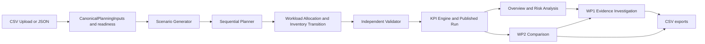
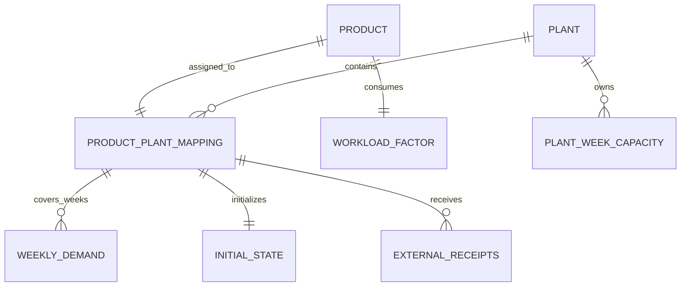
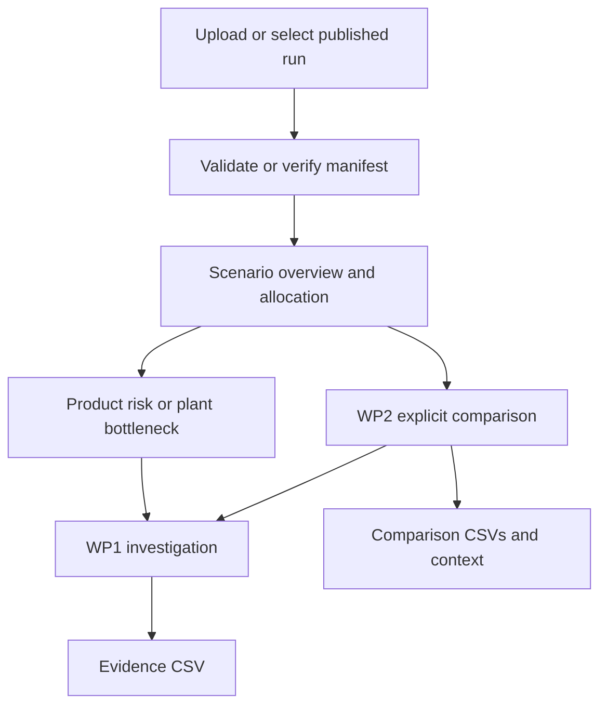

# Product Capability Catalog — Supply Chain Planning Decision Support

**Executive summary:** The application accepts CSV/JSON input, validates readiness, executes weekly workload planning across scenarios, publishes traceable results, and provides KPIs, product/plant risk, WP1 evidence investigation and WP2 same-run trade-offs. It is a rule-based, deterministic and explainable prototype. Bilingual UI is not implemented; this catalog and its Chinese counterpart document current capabilities and separately authorized future proposals.

2026-11-18 · HEAD `4b6c84d99173f2472de7a973c1ca98c3a4b15ec2` + existing uncommitted WP1/WP2 worktree · [Other language](PRODUCT_CAPABILITY_CATALOG_ZH-TW.md) · [User Guide](USER_GUIDE_EN.md)

- [1. Product overview and capability layers](#section-1)
- [2. Status, evidence and documentation authority](#section-2)
- [3. Complete module architecture](#section-3)
- [4. Detailed feature catalog](#section-4)
- [5. Implemented business logic](#section-5)
- [6. KPI and metric dictionary](#section-6)
- [7. Data inputs and relationships](#section-7)
- [8. Published runs, outputs and evidence](#section-8)
- [9. End-to-end user workflows](#section-9)
- [10. Actual interfaces and integration boundaries](#section-10)
- [11. Limitations and unimplemented capabilities](#section-11)
- [12. Future bilingual UI: separate implementation proposal](#section-12)
- [13. Future development opportunities](#section-13)
- [14. Bilingual glossary and documentation strategy](#section-14)
- [15. Verification evidence and open questions](#section-15)

<a id="section-1"></a>

## 1. Product overview and capability layers

This is a **scenario-based supply chain planning decision-support prototype** for supply-chain planners, plant planning/operations staff, analysts and demonstration developers. It combines demand, opening supply and workload capacity under deterministic rules to evaluate service feasibility, product/plant pressure, traceable observations and scenario trade-offs.

It supports questions such as which product/week needs attention, how demand increases or capacity disruption change service/backlog, and how two scenarios in the same run affect a fixed product cohort. People decide whether to change plans; the application neither issues procurement/production orders nor chooses an optimal scenario.

It is not a Production APS, ERP replacement, real-time production planning system or enterprise optimization platform. Forecasting, BOM/multi-echelon materials, production lead times, machine scheduling, procurement optimization, financial impacts, AI agents, external REST APIs and bilingual UI are not implemented.

| Capability layer | Purpose and boundary |
| --- | --- |
| Planning Engine | Execute weekly demand, allocation, inventory/backlog simulation and KPIs under fixed rules. |
| Planning Decision Support | Organize execution, monitoring, explanation, comparison and exports for human decisions. |
| Risk Analysis | Classify product risks, count plant bottlenecks and show Baseline changes from published results. |
| Root Cause Investigation (WP1) | Inspect a full key’s same-week, adjacent-week, peer-pool and source evidence; not causal proof. |
| Scenario Trade-off Analysis (WP2) | Compare explicit same-run scenarios and fixed reference cohorts with metric-level comparability; no rerun or recommendation. |

<a id="section-2"></a>

## 2. Status, evidence and documentation authority

**Implemented** means a reachable code path exists; test evidence is listed separately. **Partial** means incomplete capability or insufficient verification. **Planned** means proposal only. **Deprecated** requires an explicit retirement designation; none was found for Legacy.

**Verification levels:** “implemented with test evidence” does not mean tests were rerun here. The recorded final full suite is 227 passed, 0 failed, 0 skipped (169.334 seconds). This task performs documentation/static checks only. User-assisted browser visual/functional acceptance remains pending and is not marked passed.

This catalog uses the current worktree’s `src/`, single Streamlit app, `tests/`, examples/templates and published manifests, cross-checked against the repository inventory, historical notebook code and Markdown designs/progress. It is not limited to committed HEAD. When old specifications differ from reachable code, classify them as historical or open questions, not implemented features. Historical Route B WP1/WP2 numbering differs from WP1 Root Cause/WP2 Trade-off.

<a id="section-3"></a>

## 3. Complete module architecture

```text
A. Planning Input & Data Management
   CSV Upload / Templates / Column Mapping / Source Classification
   JSON Configuration / USER_DATA / SYNTHETIC_DEMO
   Data Validation / Readiness / Explicit Assumptions
B. Sequential Planning
   Demand Eligibility / Coverage / Product–Plant Mapping / Priority / Horizon
   Initial Inventory / Opening Backlog / External Receipts
   Production Requirements / Workload Factors / Shared Capacity / Allocation
   Inventory Transition / CARRY_FORWARD / LOST_SALES
C. Scenario Planning
   Baseline / Demand_Surge / Capacity_Disruption / Combined_Stress
   Additional JSON Scenarios / Per-Scenario Policy / Affected Weeks
D. Monitoring & Visualization
   Scenario Overview / Scenario Comparison / Capacity Allocation Detail
   KPI Cards / Weekly Trends / Published Outputs
E. Planning Risk Summary
   Product Risk / Plant Bottlenecks / Scenario Risk
   WP1 Root Cause Investigation / Native-Grain Evidence / CSV
F. WP2 Scenario Trade-off Analysis
   Explicit Reference–Candidate / Fixed Reference Cohorts
   ALL–SELECTED–COMPLEMENT / Metric Results / Comparability / POLICY_CONTRAST
   Shared Pool Context / Evidence References / Four CSVs / WP1 Handoff
G. Run & Evidence Management
   Runner / Independent Validator / Manifest / Hashes / Published Loader
H. Separate Existing Paths
   Legacy independent weeks / Historical Control Tower PBIX & Notebooks
I. Interfaces & Proposed Presentation Extension
   Internal Python / CLI / CSV Contracts
   Bilingual UI: PLANNED ONLY
```


Core engines use DataFrames/pure functions; CSV I/O belongs to adapters, runners, loaders and exports. The comparison loader currently depends on the dashboard loader and is not a fully independent headless package.

<a id="section-4"></a>

## 4. Detailed feature catalog

### UI control index (actual English labels)

| Area | Controls | Behavior / defaults |
| --- | --- | --- |
| main / sidebar | Planning model | Sequential workload (default) / Legacy independent weeks; separate paths. |
| Sequential input | Planning input; Sequential configuration JSON; Run sequential planning | Upload CSV data (default) or existing JSON; default JSON is synthetic_demo/config.json. |
| Published results | Published sequential run folder; Sequential scenario; Active assumptions and planning scope | Run folder starts empty; result tabs appear after loading; scenario selection affects overview/risk, not WP2 defaults. |
| Upload | Demand file format; file uploaders; Download CSV templates; Column mapping; Source classification | WEEKLY/ORDER_LINES; ten dataset uploaders, nine templates; USER_PROVIDED/SYNTHETIC/SYNTHETIC_EXAMPLE/DERIVED/REFERENCE_INPUT classifications. |
| Qualification | Status: <source status>; already-qualified weekly checkbox; complete-extract checkbox | Each status offers Choose…/Qualified/Excluded; status-free WEEKLY has an already-qualified declaration; see L10 for complete-extract reachability. |
| Run form | First/Last planning week (Sunday); Demand interpretation; Input/assumption version; Product quantity step | RETROSPECTIVE/USER_PROVIDED_PLAN; step defaults to 0. |
| Scenario form | Demand surge scenario (%); Capacity disruption scenario (%); Plant(s) affected; Shortage policy | Defaults +10%/−20%, first plant selected when present; CARRY_FORWARD/LOST_SALES. These visible UI defaults are not audited business facts. |
| Assumptions | Fallback quantity unit; assumed priority; uniform factor/unit; zero initial inventory; zero opening backlog; no receipts; synthetic capacity target | Replacement-assumption checkboxes start unchecked; priority control 2, factor 1, unit EqWU, target 0.75 apply only when explicitly enabled. |
| Execution | Validate inputs; Validate and run planning; Download run manifest | Separate validation-only and execution; execute still revalidates. |
| Risk / WP1 | Product drill-down; Investigate product; Plant drill-down; Investigate plant; Investigation path/product/plant/week | Two investigation paths; users switch tabs after clicking Investigate. |
| WP2 | Reference Scenario; Candidate Scenario; Reference priorities (fixed cohort); Comparison product to investigate; Investigate Reference/Candidate in WP1 | Reference/Candidate/priorities start empty; investigation buttons disabled until a product is selected. |
| Downloads | KPI results; allocation detail; run manifest; WP1 per-evidence downloads; WP2 four downloads | WP1 native-grain tables; WP2 metrics/membership/evidence/context. |
| Legacy sidebar / tabs | Planning start/end week; Demand surge (%); Capacity disruption (%); Disruption plant; Run planning; Scenario; Detail scenario; Plant | Legacy has scenario cards, plant utilization chart, Baseline KPI/delta/backlog charts, text insights and allocation detail; without Plotly, comparison table/insights remain. |

| ID | Module / feature | Status |
| --- | --- | --- |
| F01 | A / CSV upload and templates | Implemented |
| F02 | A / Column mapping and source classification | Implemented |
| F03 | A / JSON configuration and data modes | Implemented |
| F04 | A / Validation and data readiness | Implemented |
| F05 | B / Demand eligibility and coverage | Implemented |
| F06 | B / Horizon, product/plant mapping and priority | Implemented |
| F07 | B / Sequential planning execution | Implemented |
| F08 | B / Initial inventory and opening backlog | Implemented |
| F09 | B / External receipts and inventory transitions | Implemented |
| F10 | B / Workload and capacity | Partial / backend implemented, UI calibration wiring incomplete |
| F11 | B / Constrained workload allocation | Implemented |
| F12 | B / Backlog policies | Implemented |
| F13 | C / Scenario generation and execution | Implemented |
| F14 | G / Independent result validation | Implemented |
| F15 | G / Published runs and artifact management | Implemented |
| F16 | D / Sequential KPI calculation and monitoring | Implemented |
| F17 | D / Scenario Overview and Scenario Comparison | Implemented |
| F18 | D / Capacity Allocation Detail | Implemented |
| F19 | E / Product Risk | Implemented |
| F20 | E / Plant Bottlenecks | Implemented |
| F21 | E / WP1 Root Cause Investigation | Implemented |
| F22 | E / Scenario Risk | Implemented |
| F23 | F / WP2 explicit scenarios and scope | Implemented |
| F24 | F / Fixed reference-priority cohorts | Implemented |
| F25 | F / WP2 metric trade-offs | Implemented |
| F26 | F / Metric-level comparability and policy contrast | Implemented |
| F27 | G / Evidence inspection and WP1 CSVs | Implemented |
| F28 | F / WP2 evidence and four exports | Implemented |
| F29 | H / Legacy independent weeks | Implemented |
| F30 | H / Historical Control Tower / Power BI | Partial / historical assets present, execution not verified |
| F31 | I / Internal Python and CLI interfaces | Implemented |
| F32 | I / Bilingual UI and language switching | Planned / proposal only |

### F01 — CSV upload and templates

| Field | Actual behavior |
| --- | --- |
| Module | A |
| Feature | CSV upload and templates |
| Business Purpose | Let planners use their own data. |
| User Actions | Choose Upload CSV data; upload, preview, and download nine templates. |
| Required Inputs | products, plants, product_plant_mapping, demand. |
| Optional Inputs | Six additional dataset types and explicit assumptions; see input dictionary. |
| Processing Logic | Read IDs as strings; retain uploads in session; validate in memory and stage temporary CSVs only for execution. |
| Outputs | Previews, upload status, downloadable templates. |
| Business Interpretation | Templates define columns, not zero-demand facts. |
| Dependencies | A → B |
| Limitations | Not a database import; staged originals are not permanent; priorities has an uploader but no separate template download. |
| Implementation Status | Implemented |
| Source Reference | [dashboard/scenario_planning_app.py](../dashboard/scenario_planning_app.py) — `_user_csv_upload_workflow`; [dashboard/scenario_planning_app.py](../dashboard/scenario_planning_app.py) — `_capture_user_upload_state`; [dashboard/scenario_planning_app.py](../dashboard/scenario_planning_app.py) — `_restore_user_upload_state` |

### F02 — Column mapping and source classification

| Field | Actual behavior |
| --- | --- |
| Module | A |
| Feature | Column mapping and source classification |
| Business Purpose | Accept custom CSV headers. |
| User Actions | Select source columns and Source classification. |
| Required Inputs | CSV and required canonical fields. |
| Optional Inputs | Non-UTF-8 encoding via JSON; provenance and version. |
| Processing Logic | JSON columns map canonical → source; reject missing fields, duplicate mappings, and canonical collisions. |
| Outputs | Canonical fields and source inventory. |
| Business Interpretation | Classification describes origin, not factual verification. |
| Dependencies | F01 / F03 |
| Limitations | No automatic unit conversion; whitespace-padded IDs are rejected. |
| Implementation Status | Implemented |
| Source Reference | [dashboard/scenario_planning_app.py](../dashboard/scenario_planning_app.py) — `_render_column_mapping`; [src/csv_planning_inputs.py](../src/csv_planning_inputs.py) — `load_csv_planning_inputs` |

### F03 — JSON configuration and data modes

| Field | Actual behavior |
| --- | --- |
| Module | A |
| Feature | JSON configuration and data modes |
| Business Purpose | Reusable settings and non-UI execution. |
| User Actions | Choose Use existing JSON configuration, enter a path and run; CLI is also available. |
| Required Inputs | Version, horizon, policy, scenarios, files, data_mode. |
| Optional Inputs | product_ids, assumptions, status mapping, calibration. |
| Processing Logic | USER_DATA and SYNTHETIC_DEMO share CanonicalPlanningInputs and engines; paths are relative to the JSON directory. |
| Outputs | A published run in the shared schema. |
| Business Interpretation | Data Mode is source context, not a different KPI definition; neither mode generates forecasts. |
| Dependencies | F02 → F07 |
| Limitations | The JSON UI runs directly; standalone validation is available through CLI --validate-inputs. |
| Implementation Status | Implemented |
| Source Reference | [dashboard/scenario_planning_app.py](../dashboard/scenario_planning_app.py) — `_sequential_views`; [src/run_planning.py](../src/run_planning.py) — `main`; [src/planning_inputs.py](../src/planning_inputs.py) — `CanonicalPlanningInputs` |

### F04 — Validation and data readiness

| Field | Actual behavior |
| --- | --- |
| Module | A |
| Feature | Validation and data readiness |
| Business Purpose | Block incomplete inputs before simulation. |
| User Actions | Use Validate inputs or Validate and run planning; inspect errors and assumptions. |
| Required Inputs | Complete mappings and planning settings. |
| Optional Inputs | Explicit ZERO/NONE, common priority/factor, quantity unit, synthetic capacity calibration. |
| Processing Logic | Check keys, references, dates, finite nonnegative numbers, units, coverage, scenarios; return READY or BLOCKED, with capability status READY_WITH_ASSUMPTIONS where applicable. |
| Outputs | Sources, Assumptions, Derived_Values, Errors, Warnings, Unavailable_Capabilities. |
| Business Interpretation | READY means the program contract passed, not external business-data certification. |
| Dependencies | F02 / F03 |
| Limitations | Stops on failure rather than reporting every downstream error; no automatic repair. UI synthetic-capacity fallback has a configuration-location mismatch; see L11. |
| Implementation Status | Implemented |
| Source Reference | [src/csv_planning_inputs.py](../src/csv_planning_inputs.py) — `load_csv_planning_inputs`; [dashboard/scenario_planning_app.py](../dashboard/scenario_planning_app.py) — `_validate_uploaded_config`; [dashboard/scenario_planning_app.py](../dashboard/scenario_planning_app.py) — `_render_readiness_report` |

### F05 — Demand eligibility and coverage

| Field | Actual behavior |
| --- | --- |
| Module | B |
| Feature | Demand eligibility and coverage |
| Business Purpose | Separate gross, qualified, and excluded demand. |
| User Actions | Choose WEEKLY/ORDER_LINES; classify every Status; declare status-free weekly demand already qualified. |
| Required Inputs | Demand, mapping, status_eligibility or qualification_basis. |
| Optional Inputs | JSON unknown_status_policy=EXCLUDE, forced_excluded_statuses, source_is_complete. |
| Processing Logic | Gross = Qualified + Excluded; assign dates to Sunday; UNKNOWN blocks simulation; only an explicitly complete extract permits covered zeros inside a product’s observed lifespan. |
| Outputs | eligibility_ledger, weekly_demand, demand_coverage. |
| Business Interpretation | Missing data is not zero demand; scenario increments do not create source orders. |
| Dependencies | F02 / F04 |
| Limitations | Partial edge weeks and outside-lifespan weeks remain UNKNOWN; DataCo exclusions belong to its profile, not the generic engine. |
| Implementation Status | Implemented |
| Source Reference | [src/demand_preparation.py](../src/demand_preparation.py) — `prepare_order_demand`; [src/demand_preparation.py](../src/demand_preparation.py) — `build_demand_coverage`; [src/csv_planning_inputs.py](../src/csv_planning_inputs.py) — `load_csv_planning_inputs` |

### F06 — Horizon, product/plant mapping and priority

| Field | Actual behavior |
| --- | --- |
| Module | B |
| Feature | Horizon, product/plant mapping and priority |
| Business Purpose | Define what is planned, where and when. |
| User Actions | Select Sunday bounds; supply mapping and priority 1/2/3; JSON can select product_ids. |
| Required Inputs | Products, plants, single-plant mapping, complete horizon. |
| Optional Inputs | Separate priority file or explicit common priority; cannot duplicate a master priority. |
| Processing Logic | One plant per product; priority 3 is highest; no weekly changes within a trajectory; every initialized item covers every week. |
| Outputs | Planning items, calendar, priorities. |
| Business Interpretation | Not cross-plant sourcing or automatic ABC classification. |
| Dependencies | F04 / F05 |
| Limitations | Generic CSV needs no DataCo/ABC; only the legacy reference adapter derives 3/2/1 from ABC A/B/C. |
| Implementation Status | Implemented |
| Source Reference | [src/planning_inputs.py](../src/planning_inputs.py) — `horizon`; [src/csv_planning_inputs.py](../src/csv_planning_inputs.py) — `load_csv_planning_inputs`; [src/sequential_planner.py](../src/sequential_planner.py) — `simulate_sequential` |

### F07 — Sequential planning execution

| Field | Actual behavior |
| --- | --- |
| Module | B |
| Feature | Sequential planning execution |
| Business Purpose | Evaluate supply/demand constraints with continuous weekly state. |
| User Actions | Execute the existing runner after validation. |
| Required Inputs | Canonical demand, capacity, initial state, receipts, factors, policy, quantity step. |
| Optional Inputs | Additional JSON scenarios and scenario-specific receipts. |
| Processing Logic | Initialize each scenario independently; process week/plant requirements → allocation → inventory transition; carry ending inventory/backlog into the next week. |
| Outputs | Product-week states and plant-week pools. |
| Business Interpretation | Deterministic simulated outcomes, not optimized schedules. |
| Dependencies | F05 / F06 / F08–F12 |
| Limitations | No production lead times, machines, BOM, material or routing constraints. |
| Implementation Status | Implemented |
| Source Reference | [src/sequential_planner.py](../src/sequential_planner.py) — `simulate_sequential`; [src/run_planning.py](../src/run_planning.py) — `run_csv_planning` |

### F08 — Initial inventory and opening backlog

| Field | Actual behavior |
| --- | --- |
| Module | B |
| Feature | Initial inventory and opening backlog |
| Business Purpose | Retain supply and obligations preceding the horizon. |
| User Actions | Upload initial_inventory; embed backlog or supply a separate file, or declare ZERO. |
| Required Inputs | Complete balances for each Plant × Product. |
| Optional Inputs | Initial-inventory Week must equal the first week; Quantity_Unit. |
| Processing Logic | Each scenario uses the shared initial state; distinguish opening-origin from horizon-origin backlog. |
| Outputs | initial_state and separated fulfillment/ending backlog. |
| Business Interpretation | Fulfilling opening backlog does not count as horizon-demand service. |
| Dependencies | F04 → F07 |
| Limitations | LOST_SALES rejects nonzero opening backlog; inventory is not reset weekly. |
| Implementation Status | Implemented |
| Source Reference | [src/csv_planning_inputs.py](../src/csv_planning_inputs.py) — `load_csv_planning_inputs`; [src/inventory_engine.py](../src/inventory_engine.py) — `transition_inventory` |

### F09 — External receipts and inventory transitions

| Field | Actual behavior |
| --- | --- |
| Module | B |
| Feature | External receipts and inventory transitions |
| Business Purpose | Include known usable supply and reconcile balances. |
| User Actions | Supply Receipt_ID, product, plant, usable week and quantity; or declare NONE. |
| Required Inputs | Receipt events or explicit no-receipts declaration; F08. |
| Optional Inputs | Scenario column can target scenarios. |
| Processing Logic | Supply = opening inventory + receipts + internal production; serve old backlog before current demand within a product; receipts consume no internal workload. |
| Outputs | Current/backlog fulfillment, ending inventory/backlog, lost sales. |
| Business Interpretation | Usable week means usable that week; procurement/transit lead time is not inferred. |
| Dependencies | F07 / F08 |
| Limitations | No automatic replenishment, supplier scheduling, or safety-stock replenishment. |
| Implementation Status | Implemented |
| Source Reference | [src/inventory_engine.py](../src/inventory_engine.py) — `transition_inventory`; [src/sequential_planner.py](../src/sequential_planner.py) — `simulate_sequential` |

### F10 — Workload and capacity

| Field | Actual behavior |
| --- | --- |
| Module | B |
| Feature | Workload and capacity |
| Business Purpose | Put different products on a comparable capacity-consumption basis. |
| User Actions | Supply per-product factors, common unit/version and plant-week capacity; or explicitly choose synthetic calibration. |
| Required Inputs | Positive factors, nonnegative capacity, full calendar. |
| Optional Inputs | Calibration window, target utilization, capacity version. |
| Processing Logic | Workload = quantity × factor; synthetic baseline = plant mean weekly qualified workload / target. |
| Outputs | workload_factors, capacity_baseline, capacity_pools. |
| Business Interpretation | Synthetic capacity is not measured capacity; 100% utilization alone is not shortage. |
| Dependencies | F05 / F06 |
| Limitations | No plant-specific factors; one compatible factor version/unit. UI puts the recipe under assumptions.capacity_calibration, while the adapter reads top-level capacity_calibration (L11); the no-capacity-CSV UI fallback is not fully operational. Backend JSON calibration is implemented. |
| Implementation Status | Partial / backend implemented, UI calibration wiring incomplete |
| Source Reference | [src/workload_model.py](../src/workload_model.py) — `calibrate_workload_capacity`; [src/workload_model.py](../src/workload_model.py) — `validate_workload_factors`; [dashboard/scenario_planning_app.py](../dashboard/scenario_planning_app.py) — `_build_upload_config`; [src/csv_planning_inputs.py](../src/csv_planning_inputs.py) — `load_csv_planning_inputs` |

### F11 — Constrained workload allocation

| Field | Actual behavior |
| --- | --- |
| Module | B |
| Feature | Constrained workload allocation |
| Business Purpose | Allocate scarce capacity by the approved order. |
| User Actions | Set quantity_step; inspect Allocation_Order. |
| Required Inputs | Required_Production_Qty, priority, factor, plant-week capacity. |
| Optional Inputs | quantity_step=0 for continuous quantity; positive value for a shared pack step. |
| Processing Logic | Sort priority DESC, Required_Production_Qty DESC, Product Card Id ASC; feasible quantity min(requirement, remaining/factor), rounded down to the step. |
| Outputs | Production, allocated/unmet workload, remaining capacity, allocation order. |
| Business Interpretation | Cross-product priority first; backlog-first applies within each product. |
| Dependencies | F07 / F10 |
| Limitations | Greedy rules are not optimization; pack sizes can leave usable capacity. |
| Implementation Status | Implemented |
| Source Reference | [src/allocation_engine.py](../src/allocation_engine.py) — `allocate_workload` |

### F12 — Backlog policies

| Field | Actual behavior |
| --- | --- |
| Module | B |
| Feature | Backlog policies |
| Business Purpose | Distinguish delayed fulfillment from lost-sales assumptions. |
| User Actions | Choose CARRY_FORWARD/LOST_SALES; JSON can set policy per scenario. |
| Required Inputs | One explicit policy per scenario. |
| Optional Inputs | CARRY_FORWARD supports opening backlog. |
| Processing Logic | Carry: retain unfulfilled obligations; Lost: record current shortfall as loss and ending backlog=0. |
| Outputs | Separate backlog and lost sales. |
| Business Interpretation | Zero backlog under LOST_SALES does not imply better service. |
| Dependencies | F08 / F09 |
| Limitations | The upload UI uses one policy across four scenarios; mixed policies require JSON; no backlog aging or cost. |
| Implementation Status | Implemented |
| Source Reference | [src/inventory_engine.py](../src/inventory_engine.py) — `transition_inventory`; [dashboard/scenario_planning_app.py](../dashboard/scenario_planning_app.py) — `_build_upload_config` |

### F13 — Scenario generation and execution

| Field | Actual behavior |
| --- | --- |
| Module | C |
| Feature | Scenario generation and execution |
| Business Purpose | Test demand increases and capacity disruptions. |
| User Actions | Set UI demand increase, capacity decrease and affected plants; JSON supports names, multipliers, affected weeks and policies. |
| Required Inputs | Baseline and explicit scenario definitions. |
| Optional Inputs | Additional named JSON scenarios and Disruption_Weeks. |
| Processing Logic | Scenario_Qualified_Demand = Qualified_Demand × Demand_Multiplier; multiply capacity only for affected pools. |
| Outputs | Four UI scenarios: Baseline, Demand_Surge, Capacity_Disruption, Combined_Stress; scenario-specific states/pools/KPIs. |
| Business Interpretation | Original Gross/Qualified/Excluded remain intact; incremental demand is modeled. |
| Dependencies | F05 / F10 → F07 |
| Limitations | Capacity multiplier is 0–1, no expansion above 1; demand multiplier is nonnegative; no UI scenario editor or priority-shift generation. |
| Implementation Status | Implemented |
| Source Reference | [src/scenario_generator.py](../src/scenario_generator.py) — `generate_sequential_scenarios`; [dashboard/scenario_planning_app.py](../dashboard/scenario_planning_app.py) — `_build_upload_config` |

### F14 — Independent result validation

| Field | Actual behavior |
| --- | --- |
| Module | G |
| Feature | Independent result validation |
| Business Purpose | Detect more than arithmetic balance before publication. |
| User Actions | Execute a run; inspect validation_result. |
| Required Inputs | Expected scenario inputs, actual states/pools, initial state, receipts, factors. |
| Optional Inputs | quantity_step. |
| Processing Logic | Reconstruct expected values without calling planning engines; check source preservation, order, greedy allocation, stock/obligations/origin cohorts and pools. |
| Outputs | Check_ID, Passed, Rows_Checked, Message; raise on failure. |
| Business Interpretation | Passing means consistency with implemented rules, not real-world optimality. |
| Dependencies | F07 → F15 |
| Limitations | Does not replace input-fact verification or visual acceptance. |
| Implementation Status | Implemented |
| Source Reference | [src/sequential_validator.py](../src/sequential_validator.py) — `validate_sequential_results` |

### F15 — Published runs and artifact management

| Field | Actual behavior |
| --- | --- |
| Module | G |
| Feature | Published runs and artifact management |
| Business Purpose | Keep traceable, isolated run results. |
| User Actions | Execute a new run; enter Published sequential run folder to load results. |
| Required Inputs | Complete manifest and 12 CSV artifacts. |
| Optional Inputs | output_root; CLI --output-dir. |
| Processing Logic | Create a unique timestamp+UUID Run_ID; publish only after full success and independent validation; loader checks confined paths, SHA256, schema, identity; WP2 also checks row counts. |
| Outputs | run_manifest.json and 12 CSVs; failures retain FAILED/UNPUBLISHED manifests. |
| Business Interpretation | Published is a local validation state, not website deployment or enterprise approval. |
| Dependencies | F14 / F16 |
| Limitations | No run browser, deletion/retention manager or replay service; UI uses paths. |
| Implementation Status | Implemented |
| Source Reference | [src/run_planning.py](../src/run_planning.py) — `run_sequential_planning`; [dashboard/scenario_planning_app.py](../dashboard/scenario_planning_app.py) — `load_sequential_outputs`; [src/comparison_io.py](../src/comparison_io.py) — `load_comparison_input` |

### F16 — Sequential KPI calculation and monitoring

| Field | Actual behavior |
| --- | --- |
| Module | D |
| Feature | Sequential KPI calculation and monitoring |
| Business Purpose | Measure production coverage, fulfillment and resource use. |
| User Actions | Select Sequential scenario; inspect five KPI cards and the full performance CSV. |
| Required Inputs | States and unique pools. |
| Optional Inputs | Gross/qualified/excluded fields are retained where available. |
| Processing Logic | Four aggregation grains; ratios of sums; terminal stock per item; separate weekly and horizon fulfillment. |
| Outputs | performance_result; Production Coverage, Demand Fulfillment, Utilization, Ending Backlog, Lost Sales cards. |
| Business Interpretation | Zero denominators mean N/A; do not sum stocks across weeks. |
| Dependencies | F07 / F10 |
| Limitations | No financial KPI, OTIF, forecast accuracy or backlog aging. |
| Implementation Status | Implemented |
| Source Reference | [src/kpi_engine.py](../src/kpi_engine.py) — `calculate_sequential_kpis`; [dashboard/scenario_planning_app.py](../dashboard/scenario_planning_app.py) — `_sequential_views` |

### F17 — Scenario Overview and Scenario Comparison

| Field | Actual behavior |
| --- | --- |
| Module | D |
| Feature | Scenario Overview and Scenario Comparison |
| Business Purpose | Inspect outcomes across scenarios and weeks. |
| User Actions | Inspect the two existing tabs. |
| Required Inputs | Loaded published run and Sequential scenario. |
| Optional Inputs | Active assumptions and planning scope. |
| Processing Logic | Overview shows weekly Ending Inventory/Backlog/Lost Sales lines and pools; Comparison shows scenario-level summary. |
| Outputs | Charts, scenario KPI table and configuration context. |
| Business Interpretation | The existing Comparison is an overview, without WP2 cohort/comparability semantics. |
| Dependencies | F15 / F16 |
| Limitations | Sequential overview differs from Legacy Plotly charts; browser visual acceptance is pending. |
| Implementation Status | Implemented |
| Source Reference | [dashboard/scenario_planning_app.py](../dashboard/scenario_planning_app.py) — `_sequential_views`; [dashboard/scenario_planning_app.py](../dashboard/scenario_planning_app.py) — `scenario_kpis` |

### F18 — Capacity Allocation Detail

| Field | Actual behavior |
| --- | --- |
| Module | D |
| Feature | Capacity Allocation Detail |
| Business Purpose | Explain weekly product supply allocation. |
| User Actions | Select a scenario and inspect detail. |
| Required Inputs | allocation_result. |
| Optional Inputs | Full CSV download at the top of results. |
| Processing Logic | Sort by Order_Date, Plant_ID, Allocation_Order; show demand, supply, factor, fulfillment, ending stock/backlog/loss. |
| Outputs | Product × Plant × Week detail. |
| Business Interpretation | Do not multiply shared capacity by product rows. |
| Dependencies | F07 / F15 |
| Limitations | The sequential tab has no additional plant filter; Legacy has scenario/plant filters. |
| Implementation Status | Implemented |
| Source Reference | [dashboard/scenario_planning_app.py](../dashboard/scenario_planning_app.py) — `_sequential_views`; [dashboard/scenario_planning_app.py](../dashboard/scenario_planning_app.py) — `_allocation_detail` |

### F19 — Product Risk

| Field | Actual behavior |
| --- | --- |
| Module | E |
| Feature | Product Risk |
| Business Purpose | Find products needing service/terminal-obligation attention. |
| User Actions | Open Planning Risk Summary → Product Risk, select Product drill-down, then Investigate product. |
| Required Inputs | Complete allocation_result risk fields. |
| Optional Inputs | Current scenario selection. |
| Processing Logic | At Risk for current shortfall, terminal backlog, loss or incomplete horizon fulfillment; otherwise Watch for production coverage<1 or positive demand with zero terminal inventory; otherwise Healthy. |
| Outputs | Risk ranking, reasons, five product KPI cards and WP1 entry. |
| Business Interpretation | A product can remain At Risk for same-week shortage after horizon service reaches 100%; no composite score. |
| Dependencies | F15 / F16 |
| Limitations | Rule classification, not stockout probability or monetary exposure. |
| Implementation Status | Implemented |
| Source Reference | [src/planning_risk.py](../src/planning_risk.py) — `product_risk_ranking`; [dashboard/scenario_planning_app.py](../dashboard/scenario_planning_app.py) — `_planning_risk_summary` |

### F20 — Plant Bottlenecks

| Field | Actual behavior |
| --- | --- |
| Module | E |
| Feature | Plant Bottlenecks |
| Business Purpose | Locate unmet workload in shared capacity pools. |
| User Actions | Select Plant drill-down; inspect weekly rows, utilization bars, product pressure contributions and Investigate plant. |
| Required Inputs | Unique capacity_pools and allocation_result. |
| Optional Inputs | Derive Workload_Shortage from Unmet_Workload if absent. |
| Processing Logic | Aggregate unique plant pools; shortage = Unmet_Workload>1e-9; count bottleneck weeks and calculate ratio-of-sums utilization. |
| Outputs | Plant ranking, weekly detail, product workload table. |
| Business Interpretation | Full utilization without unmet workload is not a bottleneck; pack constraints can also cause unmet workload. |
| Dependencies | F10 / F15 |
| Limitations | Product pressure association is not causal responsibility or a reallocation recommendation. |
| Implementation Status | Implemented |
| Source Reference | [src/planning_risk.py](../src/planning_risk.py) — `plant_bottleneck_summary`; [dashboard/scenario_planning_app.py](../dashboard/scenario_planning_app.py) — `_planning_risk_summary` |

### F21 — WP1 Root Cause Investigation

| Field | Actual behavior |
| --- | --- |
| Module | E |
| Feature | WP1 Root Cause Investigation |
| Business Purpose | Trace a risk to selected-week evidence. |
| User Actions | Choose Product → Plant → Week or Plant → Week → Product; enter from product/plant risk or WP2. |
| Required Inputs | Run_ID, Scenario, Plant_ID, Product Card Id, Order_Date. |
| Optional Inputs | Adjacent weeks, peer products, source status. |
| Processing Logic | Select a unique full key; separately show selected week, shared capacity, observed signals, ±1 calendar week and Allocation_Order peers; filter evidence independently at native grain. |
| Outputs | Traceable investigation view and per-table CSVs. |
| Business Interpretation | Despite the Root Cause name, it shows observed signals, not causal inference or counterfactual reruns. |
| Dependencies | F19 / F20 / F15 |
| Limitations | Read-only published artifacts; missing raw sources do not replace outcomes or create orders. |
| Implementation Status | Implemented |
| Source Reference | [dashboard/scenario_planning_app.py](../dashboard/scenario_planning_app.py) — `_root_cause_investigation`; [src/planning_risk.py](../src/planning_risk.py) — `investigation_views`; [src/planning_risk.py](../src/planning_risk.py) — `filter_investigation_evidence` |

### F22 — Scenario Risk

| Field | Actual behavior |
| --- | --- |
| Module | E |
| Feature | Scenario Risk |
| Business Purpose | Inspect product and plant deterioration versus Baseline. |
| User Actions | Select a non-Baseline scenario and open Scenario Risk. |
| Required Inputs | performance_result, product risk, Baseline. |
| Optional Inputs | Bottleneck_Plant_Weeks where present. |
| Processing Logic | Scenario table and matched product/plant Baseline deltas; top ten deterioration rows, with policy changes. |
| Outputs | Descriptive delta tables and policy flags. |
| Business Interpretation | These deltas do not use WP2’s three comparability gates; retain policy context. |
| Dependencies | F16 / F19 |
| Limitations | No comparison without Baseline/matching results; no arbitrary Reference selector. |
| Implementation Status | Implemented |
| Source Reference | [src/planning_risk.py](../src/planning_risk.py) — `scenario_risk_comparison`; [src/planning_risk.py](../src/planning_risk.py) — `scenario_product_deterioration`; [src/planning_risk.py](../src/planning_risk.py) — `scenario_plant_deterioration` |

### F23 — WP2 explicit scenarios and scope

| Field | Actual behavior |
| --- | --- |
| Module | F |
| Feature | WP2 explicit scenarios and scope |
| Business Purpose | Make direction and common scope explicit. |
| User Actions | Open Scenario Trade-off Analysis; choose distinct Reference/Candidate scenarios. |
| Required Inputs | Same published sequential_v1 run, full horizon, scope. |
| Optional Inputs | Python ComparisonScope supports product_ids, plant_ids, metric_ids and four output_grain values. |
| Processing Logic | Validate manifest/tables; require same Run_ID and equal manifests; UI scenarios start unselected; Delta=Candidate−Reference. |
| Outputs | Comparison_ID and scope/identity context. |
| Business Interpretation | Compare existing outcomes without executing planning. |
| Dependencies | F15 / F16 |
| Limitations | UI uses manifest products and initial-state plants at Scenario grain; no cross-run or sub-horizon comparison. |
| Implementation Status | Implemented |
| Source Reference | [src/scenario_comparison.py](../src/scenario_comparison.py) — `ComparisonInput`; [src/scenario_comparison.py](../src/scenario_comparison.py) — `ComparisonScope`; [src/scenario_comparison.py](../src/scenario_comparison.py) — `compare_published_results`; [dashboard/scenario_planning_app.py](../dashboard/scenario_planning_app.py) — `_scenario_tradeoff_analysis` |

### F24 — Fixed reference-priority cohorts

| Field | Actual behavior |
| --- | --- |
| Module | F |
| Feature | Fixed reference-priority cohorts |
| Business Purpose | Prevent changing product membership between scenarios. |
| User Actions | Select Reference priorities or leave empty; inspect membership/Priority Changed. |
| Required Inputs | Reference/Candidate priorities 1/2/3, explicit product universe. |
| Optional Inputs | Empty priority selection. |
| Processing Logic | ALL=universe; SELECTED=matching Reference priorities; COMPLEMENT=remaining products; Candidate priority changes only flag changes; invalid priority on either side yields UNAVAILABLE and blocks comparison. |
| Outputs | Membership table, priority-change count, three result groups. |
| Business Interpretation | Additive quantities reconcile ALL=SELECTED+COMPLEMENT; rates are not additive. |
| Dependencies | F23 |
| Limitations | Empty cohorts are N/A; the normal generator has no priority-shift feature; flags do not imply editable priorities in UI. |
| Implementation Status | Implemented |
| Source Reference | [src/scenario_comparison.py](../src/scenario_comparison.py) — `_membership`; [src/scenario_comparison.py](../src/scenario_comparison.py) — `_priority` |

### F25 — WP2 metric trade-offs

| Field | Actual behavior |
| --- | --- |
| Module | F |
| Feature | WP2 metric trade-offs |
| Business Purpose | Inspect service, backlog, loss and workload together. |
| User Actions | Inspect five-metric summary, cohort details, weekly service and capacity context. |
| Required Inputs | F23, F24; allocation and pools. |
| Optional Inputs | Python can restrict metric_ids. |
| Processing Logic | Reuse KPI engine for service/terminal stocks/fulfillment/loss; sum workload and current-shortfall flows; service deltas ×100 give percentage points. |
| Outputs | Ten Metric_ID values, Reference/Candidate values, Delta, numerators/denominators. |
| Business Interpretation | Terminal backlog differs from current-unfulfilled flow; shared pools stay separate and counted once, without cohort utilization. |
| Dependencies | F16 / F23 / F24 |
| Limitations | Horizon metrics are unavailable at Week grain; weekly service expands weeks from Scenario/Plant grain. |
| Implementation Status | Implemented |
| Source Reference | [src/scenario_comparison.py](../src/scenario_comparison.py) — `_metric_values`; [src/scenario_comparison.py](../src/scenario_comparison.py) — `compare_published_results` |

### F26 — Metric-level comparability and policy contrast

| Field | Actual behavior |
| --- | --- |
| Module | F |
| Feature | Metric-level comparability and policy contrast |
| Business Purpose | Prevent incompatible outcomes being treated as improvements. |
| User Actions | Inspect Comparability_Status, Reason, Input_Differences and policy warning. |
| Required Inputs | Complete coverage, units, priority, policy, workload definitions. |
| Optional Inputs | Opening/receipts/eligibility/allocation-step/capacity-basis differences. |
| Processing Logic | COMPARABLE normally; DESCRIPTIVE_ONLY for conditioning differences or POLICY_CONTRAST; BLOCKED for missing data, zero denominators, empty cohorts, incompatibility, etc., with Delta=N/A. |
| Outputs | Per-metric status/reason; side values may remain available. |
| Business Interpretation | DESCRIPTIVE_ONLY can retain a delta, but it is not a causal effect or recommendation. |
| Dependencies | F23–F25 |
| Limitations | Workload incompatibility blocks workload metrics; coverage/priority issues can affect all metrics; no zero-fill or silent intersection. |
| Implementation Status | Implemented |
| Source Reference | [src/scenario_comparison.py](../src/scenario_comparison.py) — `_coverage_reason`; [src/scenario_comparison.py](../src/scenario_comparison.py) — `_input_differences`; [src/scenario_comparison.py](../src/scenario_comparison.py) — `_workload_reason`; [src/scenario_comparison.py](../src/scenario_comparison.py) — `compare_published_results` |

### F27 — Evidence inspection and WP1 CSVs

| Field | Actual behavior |
| --- | --- |
| Module | G |
| Feature | Evidence inspection and WP1 CSVs |
| Business Purpose | Preserve data grain and investigation context. |
| User Actions | Expand Evidence tables, download investigation CSVs and inspect source_status. |
| Required Inputs | Published artifacts and full investigation key. |
| Optional Inputs | Compare Source_Hashes where originals remain available. |
| Processing Logic | Filter each artifact separately; add Investigation_* and Evidence_Artifact, avoiding source-order joins that inflate results. |
| Outputs | Per-table CSVs, Source_Status, provenance/assumptions. |
| Business Interpretation | Investigation_* describes the selection, not every source row’s grain. |
| Dependencies | F15 / F21 |
| Limitations | Missing staged upload originals can be normal; published evidence remains usable; CSVs are not source-file archives. |
| Implementation Status | Implemented |
| Source Reference | [src/planning_risk.py](../src/planning_risk.py) — `investigation_evidence_csv`; [dashboard/scenario_planning_app.py](../dashboard/scenario_planning_app.py) — `investigation_source_status`; [dashboard/scenario_planning_app.py](../dashboard/scenario_planning_app.py) — `_root_cause_investigation` |

### F28 — WP2 evidence and four exports

| Field | Actual behavior |
| --- | --- |
| Module | F |
| Feature | WP2 evidence and four exports |
| Business Purpose | Retain context when sharing comparisons. |
| User Actions | Download Comparison CSV, Cohort, Evidence References and Context; choose product/side to open WP1. |
| Required Inputs | ComparisonResult. |
| Optional Inputs | Chosen WP1 scenario side and product. |
| Processing Logic | Twelve artifact references per side with hash/native grain/provenance; all four CSVs retain identity and Comparison_Context; metrics also embeds evidence/membership JSON. |
| Outputs | metrics, cohort_membership, evidence_refs, context CSVs; existing WP1 navigation state. |
| Business Interpretation | Evidence references are a locator index, not replay configuration or causal proof. |
| Dependencies | F23–F27 |
| Limitations | CSV fields are not translated; large JSON repeats; no XLSX/PDF/ZIP export; users still switch to the WP1 tab. |
| Implementation Status | Implemented |
| Source Reference | [src/comparison_io.py](../src/comparison_io.py) — `comparison_csv_exports`; [src/scenario_comparison.py](../src/scenario_comparison.py) — `_evidence`; [dashboard/scenario_planning_app.py](../dashboard/scenario_planning_app.py) — `_comparison_investigation_entry` |

### F29 — Legacy independent weeks

| Field | Actual behavior |
| --- | --- |
| Module | H |
| Feature | Legacy independent weeks |
| Business Purpose | Retain the completed historical model and interpretation. |
| User Actions | Select Legacy independent weeks; set horizon/surge/disruption/plant and Run planning. |
| Required Inputs | Reference data/master and processed inputs. |
| Optional Inputs | Existing legacy output folder. |
| Processing Logic | Net=max(Scenario Demand−Beginning Inventory,0); priority DESC, Net DESC, ID ASC; Allocated=min(Net,remaining quantity capacity); Backlog=Net−Allocated. |
| Outputs | Three legacy tabs, performance statuses, Baseline deltas; four planning CSV outputs. |
| Business Interpretation | Independent weeks and quantity capacity, not continuous inventory/workload. |
| Dependencies | legacy planning_snapshot → planning_pipeline → allocation_manager → performance_manager |
| Limitations | Still accessible, not marked Deprecated; do not apply sequential_v1 metrics or WP1/WP2. |
| Implementation Status | Implemented |
| Source Reference | [src/allocation_engine.py](../src/allocation_engine.py) — `allocate_capacity`; [src/planning_pipeline.py](../src/planning_pipeline.py) — `run_planning_pipeline`; [src/performance_manager.py](../src/performance_manager.py) — `evaluate_allocation`; [dashboard/scenario_planning_app.py](../dashboard/scenario_planning_app.py) — `_run_controls` |

### F30 — Historical Control Tower / Power BI

| Field | Actual behavior |
| --- | --- |
| Module | H |
| Feature | Historical Control Tower / Power BI |
| Business Purpose | Retain the historical monitoring analysis. |
| User Actions | Open PBIX separately; notebooks/processed CSVs supply historical context. |
| Required Inputs | Existing PBIX and historical monitoring data. |
| Optional Inputs | Local Power BI environment and source-path configuration. |
| Processing Logic | Repository retains demand/inventory/capacity/service/executive summaries; they are not the same KPIs generated by Streamlit. |
| Outputs | Existing PBIX/CSV assets. |
| Business Interpretation | DOI, safety stock and monitoring risk scores are not Sequential capabilities. |
| Dependencies | notebooks/ + data/processed + PBIX |
| Limitations | Assets and historical code exist; PBIX refresh and visual interaction were not verified in this task. |
| Implementation Status | Partial / historical assets present, execution not verified |
| Source Reference | [dashboard/supply_chain_control_tower.pbix](../dashboard/supply_chain_control_tower.pbix); [docs/04_KPI_Definition.md](../docs/04_KPI_Definition.md); [notebooks/03_inventory_risk.ipynb](../notebooks/03_inventory_risk.ipynb) |

### F31 — Internal Python and CLI interfaces

| Field | Actual behavior |
| --- | --- |
| Module | I |
| Feature | Internal Python and CLI interfaces |
| Business Purpose | Let developers reuse the same logic. |
| User Actions | Call pure engines/runners; validate or run through CLI. |
| Required Inputs | Function contracts in section 10. |
| Optional Inputs | Custom output root and ComparisonScope. |
| Processing Logic | Engines avoid CSV I/O; runners/loaders/exports own boundaries; comparison_io reuses the dashboard loader. |
| Outputs | DataFrames, dataclasses, Path dictionaries, CSV strings. |
| Business Interpretation | Programmatic interfaces are not external HTTP APIs. |
| Dependencies | Python + Pandas + NumPy + Streamlit; Plotly optional |
| Limitations | No REST/FastAPI/Flask endpoint, SDK contract, authentication or API versioning found. |
| Implementation Status | Implemented |
| Source Reference | [src/run_planning.py](../src/run_planning.py) — `run_csv_planning`; [src/scenario_comparison.py](../src/scenario_comparison.py) — `compare_published_results` |

### F32 — Bilingual UI and language switching

| Field | Actual behavior |
| --- | --- |
| Module | I |
| Feature | Bilingual UI and language switching |
| Business Purpose | Let Traditional Chinese and English users operate with the same definitions. |
| User Actions | Future sidebar zh-TW/en selector; this control does not exist today. |
| Required Inputs | Future central dictionaries, stable keys, translation helper, session locale. |
| Optional Inputs | See section 12 proposal. |
| Processing Logic | Translate display copies only; never canonical keys, IDs or CSV contracts. |
| Outputs | Current deliverable is bilingual documentation only; UI translation is not implemented. |
| Business Interpretation | Chinese in the manuals is not an available UI language toggle. |
| Dependencies | F01–F31 presentation boundaries |
| Limitations | Requires separate explicit authorization for development/testing; this catalog authorizes no implementation. |
| Implementation Status | Planned / proposal only |
| Source Reference | Proposed only: centralized presentation translation layer; no current source implementation |


<a id="section-5"></a>

## 5. Implemented business logic

These describe current code and do not authorize rule changes. Sequential and Legacy are separate paths; neither formula set replaces the other.

```text
Sequential policy: PRIORITY_NET_UNITS_BACKLOG_FIRST_WITHIN_PRODUCT
Required_Production_Qty = max(Beginning_Backlog + Scenario_Qualified_Demand
                              - Beginning_Inventory - External_Receipts_Qty, 0)
Order = Planning_Priority DESC, Required_Production_Qty DESC, Product Card Id ASC
Production = min(Required_Production_Qty, Remaining_Workload / Workload_Factor)
Production = floor_to_quantity_step(Production)  # only when quantity_step > 0
Allocated_Workload = Production * Workload_Factor
Supply = Beginning_Inventory + External_Receipts_Qty + Production
Fulfilled_Backlog_Qty = min(Beginning_Backlog, Supply)
Fulfilled_Opening_Backlog_Qty = min(Beginning_Opening_Backlog, Fulfilled_Backlog_Qty)
Fulfilled_Horizon_Backlog_Qty = Fulfilled_Backlog_Qty - Fulfilled_Opening_Backlog_Qty
Fulfilled_Current_Qty = min(Scenario_Qualified_Demand, Supply - Fulfilled_Backlog_Qty)
Current_Unfulfilled_Qty = Scenario_Qualified_Demand - Fulfilled_Current_Qty
CARRY_FORWARD: Ending_Backlog = Beginning_Backlog - Fulfilled_Backlog_Qty + Current_Unfulfilled_Qty
LOST_SALES: Ending_Backlog = 0; Lost_Sales_Qty = Current_Unfulfilled_Qty
```

Each scenario initializes isolated state, then carries inventory/backlog week by week. Capacity is shared at `Scenario × Plant × Week`, not assigned as product capacity. LOST_SALES rejects nonzero opening backlog.

```text
Legacy independent weeks:
Net_Demand = max(Scenario_Demand - Beginning_Inventory, 0)
Order = Planning_Priority DESC, Net_Demand DESC, Product Card Id ASC
Allocated_Qty = min(Net_Demand, Remaining_Capacity)
Backlog = Net_Demand - Allocated_Qty
```

Product Risk uses 1e-9 tolerance: current shortfall, ending backlog, lost sales or fulfillment<1 means At Risk; otherwise coverage<1 or positive demand with zero terminal stock means Watch; otherwise Healthy. Plant bottlenecks use unmet workload. Legacy `evaluate_performance` instead marks Total_Backlog>0 At Risk, or zero backlog with full utilization Watch. These classifications are not interchangeable.

<a id="section-6"></a>

## 6. KPI and metric dictionary

Notation: `S=Scenario`, `P=Plant`, `I=Product`, `W=Sunday-ending Week`; `D=Scenario_Qualified_Demand`, `BI=Beginning_Inventory`, `BB=Beginning_Backlog`, `ER=External_Receipts_Qty`, `IP=Internal_Production_Qty`, `R=Required_Production_Qty`, `FC=Fulfilled_Current_Qty`, `FB=Fulfilled_Backlog_Qty`, `FHB=Fulfilled_Horizon_Backlog_Qty`. Quantity units come from `Quantity_Unit`; workload units from `Workload_Unit`. Sequential ratios are N/A when their denominator is zero.

| ID | Metric / business meaning | Formula | Numerator / denominator | Grain | Unit | Data source | Interpretation | Caveats |
| --- | --- | --- | --- | --- | --- | --- | --- | --- |
| M01 | Scenario Qualified Demand | `Scenario_Qualified_Demand = Qualified_Demand * Demand_Multiplier` | — | S × P × I × W → Σ | quantity | scenario_snapshot.csv | Demand population the scenario is intended to serve. | Original Qualified_Demand is preserved. |
| M02 | Required Production Quantity | `R = max(BB + D - BI - ER, 0)` | — | S × P × I × W → Σ | quantity | allocation_result.csv | Obligations uncovered by stock and current receipts. | Includes old backlog; summing weekly requirements can revisit carried obligations. |
| M03 | Production Coverage Rate | `Production_Coverage_Rate = sum(IP) / sum(R)` | Σ IP / Σ R | S; S × P; S × W; S × P × W | ratio | performance_result.csv | Internal production coverage of calculated requirements. | R=0 is N/A; not demand service; stock/receipts can provide service without production. |
| M04 | Demand Fulfillment Rate / Horizon Service Level | `Horizon_Service_Level = (sum(FC) + sum(FHB)) / sum(D)` | (Σ FC + Σ FHB) / Σ D | S; S × P | ratio | performance_result.csv; WP2 Horizon_Service_Level | Share of horizon-origin demand served by the horizon end. | Excludes Fulfilled_Opening_Backlog_Qty; includes late service, not an on-time rate. |
| M05 | Weekly Service Level | `Weekly_Service_Level = sum(FC) / sum(D)` | Σ FC / Σ D | S × W; S × P × W | ratio | performance_result.csv; WP2 Weekly_Service_Level | Share of current-week demand served in that week. | Excludes service of earlier-week backlog; D=0 is N/A; WP2 values are fractions. |
| M06 | Terminal Backlog | `Terminal_Backlog = sum_item(Ending_Backlog[item, last_week])` | — | S; S × P (full horizon) | quantity | allocation_result.csv → performance_result.csv; WP2 Terminal_Backlog | All unfulfilled obligations at horizon end. | Never sum weekly stocks; zero under LOST_SALES does not imply no loss. |
| M07 | Opening Backlog and terminal opening-origin backlog | `Ending_Opening_Backlog = Beginning_Opening_Backlog - Fulfilled_Opening_Backlog_Qty` | — | P × I opening; S × P × I × W stock | quantity | initial_state.csv; allocation_result.csv; WP2 Terminal_Opening_Backlog | Track how much pre-horizon backlog remains. | Beginning_Opening_Backlog is part of Beginning_Backlog, not an additional obligation. |
| M08 | Terminal horizon-origin backlog | `Ending_Horizon_Backlog = Ending_Backlog - Ending_Opening_Backlog` | — | S; S × P (terminal item sums) | quantity | allocation_result.csv; WP2 Terminal_Horizon_Backlog | Uncleared backlog originating within the horizon. | Separate from Lost Sales. |
| M09 | Lost Sales Quantity | `Lost_Sales_Qty = D - FC if LOST_SALES else 0` | — | S × P × I × W → Σ | quantity | allocation_result.csv → performance_result.csv; WP2 Lost_Sales | Unserved demand discarded rather than carried under the selected policy. | Not lost revenue; zero loss under CARRY_FORWARD does not imply no shortfall. |
| M10 | Ending Inventory | `Ending_Inventory = max(BI + ER + IP - FB - FC, 0)` | — | item-week stock; terminal item sum at horizon | quantity | allocation_result.csv → performance_result.csv | Usable stock remaining after fulfillment. | Not a sum of weekly stock; no safety-stock target or automatic replenishment. |
| M11 | Allocated Workload | `Allocated_Workload = IP * Workload_Factor` | — | S × P × I × W → Σ; unique pools | Workload_Unit | allocation_result.csv; capacity_pools.csv; WP2 Allocated_Workload | Modeled workload consumed by internal production. | External receipts do not consume it; factor/unit/version must be compatible. |
| M12 | Unmet Workload | `Unmet_Workload = (R - IP) * Workload_Factor` | — | S × P × I × W → Σ; unique pools | Workload_Unit | allocation_result.csv; capacity_pools.csv; WP2 Unmet_Workload | Equivalent workload of unmet production requirements. | A flow across weeks, not terminal backlog; pack rounding can cause unmet workload. |
| M13 | Capacity Utilization | `Capacity_Utilization = min(sum(Allocated_Workload) / sum(Available_Workload_Capacity), 1)` | Σ allocated / Σ available | S; S × P; S × W; S × P × W | ratio | capacity_pools.csv → performance_result.csv | Share of unique plant-week workload capacity used. | Zero capacity is N/A; KPI engine first rejects over-allocation; risk summaries use the raw ratio of sums; no cohort utilization. |
| M14 | Available and remaining capacity | `Available = Baseline_Workload_Capacity * effective_capacity_multiplier; Remaining = Available - Allocated_Workload` | — | S × P × W → Σ | Workload_Unit | capacity_pools.csv | Shared workload available and remaining each week. | Multiplier applies only to affected plant-weeks; never count capacity once per product row. |
| M15 | Internal and unmet production quantity | `IP = step_down(min(R, remaining / factor)); Unmet_Production_Qty = R - IP` | — | S × P × I × W → Σ | quantity | allocation_result.csv | Current internal production from greedy allocation. | No rounding at step=0; no production lead time. |
| M16 | Current unfulfilled quantity | `Current_Unfulfilled_Qty = D - FC` | — | S × P × I × W → Σ | quantity | allocation_result.csv; WP2 Current_Unfulfilled_Quantity | Demand not served in its own week, even if later recovered. | Not terminal backlog; Product Risk names it Current_Demand_Unfulfilled_Qty. |
| M17 | Fulfilled quantity | `Fulfilled_Quantity = sum(FC) + sum(FHB)` | — | S; S × P (full horizon) | quantity | WP2 Fulfilled_Quantity; KPI Demand_Fulfillment_Numerator | Quantity of horizon-origin demand served. | Exclude opening-origin backlog; unavailable as a horizon metric at weekly grain. |
| M18 | Bottleneck plant-weeks | `Bottleneck_Plant_Weeks = count(unique pools where Unmet_Workload > 1e-9)` | — | S; S × P; S × W; S × P × W | plant-weeks | capacity_pools.csv → performance_result.csv | Count shared pools with unmet workload. | Not a utilization-threshold count; Plant Risk shows Bottleneck_Weeks. |
| M19 | Gross / qualified / excluded demand | `Gross_Demand = Qualified_Demand + Excluded_Demand` | — | source record → P × I × W → Σ | quantity | eligibility_ledger.csv; weekly_demand.csv | Explain input population and eligibility policy. | For status-free already-qualified input, gross covers only supplied records; excluded demand outside that population is unknown. |
| M20 | WP2 delta | `Delta = (Candidate_Value - Reference_Value) * (100 if service_metric else 1)` | — | per cohort × metric × declared grain | percentage points / quantity / Workload_Unit | WP2 metrics CSV | Interpret direction by metric; no automatic winner. | BLOCKED means Delta=N/A; DESCRIPTIVE_ONLY can retain numeric deltas but requires reading reasons. |

**Formula illustration, not a generated planning result:** demand 8 and same-week service 5 give weekly service 5/8. If 3 are served later, horizon service can reach 8/8 while current-week shortfall remains 3. Comparing 0.625 with 1.0 yields +37.5 percentage points in WP2, not +0.375%.

**The ten actual WP2 IDs:** `Horizon_Service_Level`, `Weekly_Service_Level`, `Fulfilled_Quantity`, `Terminal_Backlog`, `Terminal_Opening_Backlog`, `Terminal_Horizon_Backlog`, `Lost_Sales`, `Allocated_Workload`, `Unmet_Workload`, `Current_Unfulfilled_Quantity`.

| Legacy metric | Formula | Zero-denominator policy / caveat |
| --- | --- | --- |
| Service_Level | Σ Allocated_Qty / Σ Net_Demand | Denominator 0 → 1; production allocation coverage, not Sequential service. |
| Allocation_Rate | Σ Allocated_Qty / Σ Scenario_Demand | 0 → 1 |
| Capacity_Utilization | Σ Allocated_Qty / Σ unique Scenario_Capacity | 0 → 0 |
| Capacity_Gap; Remaining_Capacity | Σ unique Scenario_Capacity − Σ Allocated_Qty | Both hold slack, not unmet demand. |

[src/kpi_engine.py](../src/kpi_engine.py) — `calculate_sequential_kpis`; [src/kpi_engine.py](../src/kpi_engine.py) — `calculate_kpis`; [src/inventory_engine.py](../src/inventory_engine.py) — `transition_inventory`; [src/scenario_comparison.py](../src/scenario_comparison.py) — `_metric_values`

<a id="section-7"></a>

## 7. Data inputs and relationships

These are adapter canonical fields; original CSV headers may be mapped. All IDs remain strings (including `001` and `NA`), not integers or missing values. Optional columns/files are not permission to omit business facts silently; important missing datasets require explicit replacement assumptions.

| Dataset | Required columns | Optional columns | Key / grain | Conditions and relationships |
| --- | --- | --- | --- | --- |
| products | Product_ID, Product_Name | Quantity_Unit, Planning_Priority | Product_ID | Missing unit/priority requires explicit assumptions; priority may be separate. |
| plants | Plant_ID | Plant_Name | Plant_ID | All referenced plants must exist. |
| product_plant_mapping | Product_ID, Plant_ID | — | Product_ID | One plant per product; many products per plant. |
| demand (WEEKLY) | Product_ID, Week, Demand_Qty | Plant_ID, Status, Quantity_Unit, Coverage_Status | Plant_ID + Product_ID + Week (+ Status in source) | Plant can come from mapping; no Status requires ALREADY_QUALIFIED_INPUT; provide explicit zero rows. |
| demand (ORDER_LINES) | Product_ID, Order_Line_ID, Date, Quantity, Status | Plant_ID, Quantity_Unit | Order_Line_ID | Statuses must be explicit; dates map to Sunday; full-week coverage is additionally required. |
| priorities | Product_ID, Planning_Priority | — | Product_ID | Cannot duplicate master priority; JSON priority_value_mapping applies to this file. |
| workload_factors | Product_ID, Workload_Factor, Workload_Unit | Factor_Version, Quantity_Unit | Product_ID | factor>0; missing file requires explicit uniform_workload_factor/workload_unit. |
| weekly_capacity | Plant_ID, Week, Capacity, Workload_Unit | Capacity_Version, Factor_Version | Plant_ID + Week | Complete plant-weeks, including zero capacity; or explicit synthetic calibration. |
| initial_inventory | Plant_ID, Product_ID, Beginning_Inventory | Week, Quantity_Unit, Beginning_Backlog | Plant_ID + Product_ID | All initialized items; Week if supplied equals first week; or explicit ZERO. |
| opening_backlog | Plant_ID, Product_ID, Beginning_Backlog | Quantity_Unit | Plant_ID + Product_ID | May be embedded in inventory, never duplicated; explicit ZERO if absent from both. |
| external_receipts | Receipt_ID, Plant_ID, Product_ID, Week, External_Receipts_Qty | Scenario, Quantity_Unit | Receipt_ID or Scenario + Receipt_ID | Usable-week event; missing file requires NONE; Scenario column targets only that scenario, without filling others. |

**Common rules:** finite nonnegative numbers; positive factors; nonnegative quantity_step; priority 1/2/3 only; one quantity unit for selected products; compatible workload unit/factor version. Canonical conversion renames `Week` to `Order_Date` and `Product_ID` to `Product Card Id`. Weekly source data may retain multiple Status rows, then aggregate to a unique product/plant/week.

**Required JSON:** `data_mode`, `assumption_version`, `planning_interpretation`, `planning_start_week`, `planning_end_week`, `quantity_step`, `allocation_policy`, nonempty `scenarios`, `files`. Each scenario needs `Scenario`, `Demand_Multiplier`, `Capacity_Multiplier`, `Disruption_Plants`, `Disruption_Weeks`, `Backlog_Policy`. Baseline is required with both multipliers 1. Status data needs `status_eligibility`; status-free WEEKLY needs `qualification_basis=ALREADY_QUALIFIED_INPUT`. Other conditional settings include `product_ids`, `eligibility_version`, `source_is_complete`, `assumptions` and `capacity_calibration`.



**Relationship example:** the existing USER_DATA example uses `SKU-A` and `001`, assigned through mapping to a plant. Each item/week demand competes for that plant/week’s pool. Product-week allocation has multiple rows; plant-week capacity has one. Do not join source-order/receipt detail and then sum duplicated capacity.

**Source modes:** USER_DATA may contain user facts or labeled SYNTHETIC_EXAMPLE data and does not guarantee factual authenticity. SYNTHETIC_DEMO explicitly labels demonstration sources. Both use one canonical engine. The older reference adapter remains available with integer source IDs, ABC and DataCo masters; it is not required by generic CSV input.

[src/csv_planning_inputs.py](../src/csv_planning_inputs.py) — `load_csv_planning_inputs`; [src/planning_inputs.py](../src/planning_inputs.py) — `CanonicalPlanningInputs`; [docs/planning_csv_inputs.md](../docs/planning_csv_inputs.md); [examples/planning/README.md](../examples/planning/README.md)

<a id="section-8"></a>

## 8. Published runs, outputs and evidence

Each run gets a separate `sequential_<UTC timestamp>_<UUID prefix>/`. The UI/generic runner defaults to `tmp/planning_upgrade_runs`; CLI can set output-dir. The manifest records Run_ID, Schema_Version, three statuses, timestamps, Configuration, Data_Mode, Scope, Input_Validation, Source_Hashes, Environment, Artifacts (Path/SHA256/Rows) and Limitations. Extra fields vary by adapter.

| Artifact filename | Native grain | Contents / purpose |
| --- | --- | --- |
| eligibility_ledger.csv | Source order line / weekly source record | Gross, Qualified, Excluded, eligibility reasons and source IDs. |
| weekly_demand.csv | P × I × W | Aggregated demand and observed coverage. |
| demand_coverage.csv | P × I × W | Horizon coverage for initialized items; retains historical OUT_OF_SCOPE evidence. |
| initial_state.csv | P × I | Horizon opening inventory/backlog, version and provenance. |
| external_receipts.csv | Receipt_ID (+ S) | Explicit supply events; may be empty but must retain columns. |
| workload_factors.csv | I | Workload factors, unit, version, provenance. |
| capacity_baseline.csv | P or P × W | Calibration uses plant grain; direct weekly inputs use plant-week. |
| scenario_snapshot.csv | S × P × I × W | Scenario demand, increment, policy; not allocated outcomes. |
| capacity_pools.csv | S × P × W | Unique shared pool; available/used/remaining/unmet workload. |
| allocation_result.csv | S × P × I × W | Weekly state, production allocation and fulfillment. |
| performance_result.csv | Aggregation_Level + S (+ P, W) | KPI rows at four independent grains; do not aggregate mixed levels. |
| validation_result.csv | Check_ID + Message | Run-level independent check summary, not product-week check records. |

**Integrity:** only SUCCEEDED/PASSED/PUBLISHED sequential_v1 runs can load; every manifest artifact path must stay within the run and match SHA256. The loader checks loaded-table identity, required schemas, numeric fields and dates; external_receipts may be empty, other required tables may not. The WP2 wrapper also checks Rows and native keys. This is not authentication/signing, nor does every UI load rerun the independent validator.

**Exports:** the result header offers KPI/allocation CSV and manifest; WP1 adds `Investigation_*`/`Evidence_Artifact` to each native evidence table; WP2 adds identities and `Comparison_Context` JSON to four files, plus `Evidence_References` and `Cohort_Membership_Reference` in metrics. CSV headers remain canonical English. WP2 missing values use `N/A`; WP1/general artifacts can use empty cells. Preserve string IDs in consumers and avoid Excel converting `001` or `NA`.

**Evidence origin:** source hashes identify files read during execution. Uploaded originals are temporary and may be deleted, yielding Unavailable in `source_status`. Validated published evidence remains usable; a changed raw file on disk is not the original run’s source.

[src/run_planning.py](../src/run_planning.py) — `run_sequential_planning`; [dashboard/scenario_planning_app.py](../dashboard/scenario_planning_app.py) — `load_sequential_outputs`; [src/comparison_io.py](../src/comparison_io.py) — `comparison_csv_exports`

<a id="section-9"></a>

## 9. End-to-end user workflows

All five workflows have current code support. They exclude future language switching, cross-run and AI workflows. Browser acceptance remains pending.

### Workflow A — Start a new planning run

| Item | Operating guidance |
| --- | --- |
| Entry point | Planning input → Upload CSV data |
| Required inputs | Four required files, supply/capacity/factors or explicit assumptions, full horizon. |
| Steps | Upload → map → classify eligibility → set Sunday bounds/policy/scenarios → Validate inputs → resolve BLOCKED → Validate and run planning. |
| Outputs / related modules | After READY, a unique run, 12 CSVs, manifest and results; F01–F16. |
| Common mistakes / limitations | Do not treat missing weeks as zero or assumed priority/capacity as fact; LOST_SALES cannot take nonzero opening backlog. UI synthetic-capacity fallback is limited by L11; provide capacity CSV or use JSON. |

### Workflow B — Analyze existing scenarios

| Item | Operating guidance |
| --- | --- |
| Entry point | Published sequential run folder |
| Required inputs | Complete published-run directory. |
| Steps | Paste folder → confirm active Run/mode/assumptions → select Sequential scenario → inspect Overview, Comparison, Allocation Detail. |
| Outputs / related modules | KPI cards, weekly trends, shared pools and allocation; F15–F18. |
| Common mistakes / limitations | Do not select a parent directory or single CSV; recheck scenarios after switching runs. |

### Workflow C — Investigate a supply-chain risk

| Item | Operating guidance |
| --- | --- |
| Entry point | Planning Risk Summary |
| Required inputs | Loaded run, scenario, product or plant. |
| Steps | Product Risk/Plant Bottlenecks → drill-down → Investigate → switch to Root Cause Investigation → complete selection → inspect selected/adjacent/peers/evidence. |
| Outputs / related modules | Observations and supporting evidence under a full key; F19–F22, F27. |
| Common mistakes / limitations | Association is not causation; count the pool once; unavailable originals do not invalidate published evidence. |

### Workflow D — Compare alternative planning scenarios

| Item | Operating guidance |
| --- | --- |
| Entry point | Scenario Trade-off Analysis |
| Required inputs | Two distinct scenarios in the same run. |
| Steps | Select Reference/Candidate → select reference priorities → inspect membership → review ALL/SELECTED/COMPLEMENT → read status/reason/policy → open WP1 if needed. |
| Outputs / related modules | Per-metric values/deltas, capacity context, evidence references; F23–F28. |
| Common mistakes / limitations | No cross-run/sub-horizon; empty cohort N/A; percentage points are not percentage changes; zero loss/backlog alone cannot select a winner. |

### Workflow E — Export and trace results

| Item | Operating guidance |
| --- | --- |
| Entry point | Published outputs / WP1 Evidence / WP2 downloads |
| Required inputs | Valid run, comparison result or investigation selection. |
| Steps | Download manifest/results → WP1 per-table CSV → WP2 four files → reconcile Run_ID/Comparison_ID/hashes/native grain. |
| Outputs / related modules | Traceable CSV/JSON; F15, F27–F28. |
| Common mistakes / limitations | Preserve string IDs; do not translate CSV headers; evidence refs are not raw-data archives. |



<a id="section-10"></a>

## 10. Actual interfaces and integration boundaries

No external business HTTP API was found in current source and usage. Streamlit health/WebSocket endpoints belong to the framework, not a planning API. The following are local Python/CLI interfaces, not REST endpoints.

| Interface | Input → output | I/O and boundary |
| --- | --- | --- |
| `load_csv_planning_inputs(config, inputs_dir, *, reader=None)` | dict + directory → CanonicalPlanningInputs | Read CSV; InputValidationError.report on failure. |
| `generate_sequential_scenarios(demand, capacity_pools, definitions)` | DataFrames → (scenario demand, scenario pools) | No file I/O |
| `simulate_sequential(..., quantity_step=..., allocation_policy=...)` | DataFrames → (states, pool_results) | No file I/O |
| `validate_sequential_results(..., quantity_step=...)` | inputs + results → validation DataFrame | No file I/O |
| `calculate_sequential_kpis(states, pools)` | DataFrames → performance DataFrame | No file I/O |
| `run_csv_planning(config, *, inputs_dir, output_root=None)` | dict → dict[str, Path] | File publication orchestration. |
| `run_sequential_planning(data_root, config, *, inputs_dir, output_root=None)` | dict → dict[str, Path] | Dispatch generic CSV and older reference adapter. |
| `load_sequential_outputs(output_dir, *, include_evidence=False)` | directory → dict[str, DataFrame] | Dashboard loader; integrity checks. |
| `investigation_views(..., run_id=..., scenario=..., plant_id=..., product_id=..., week=...)` | DataFrames + key → dict[str, DataFrame] | Read-only |
| `compare_published_results(reference, candidate, scope)` | ComparisonInput × 2 + ComparisonScope → ComparisonResult | Pure, no file I/O |
| `load_comparison_input(directory, scenario)` | directory + explicit scenario → ComparisonInput | I/O; dashboard loader dependency |
| `comparison_csv_exports(result)` | ComparisonResult → dict[str, str] | In-memory CSV serialization |


```bash
# Repository root; validate only (no planning output)
python -B -m src.run_planning --sequential-config examples/planning/user_data/config.json --validate-inputs
# Execute and publish a NEW run; command shown, not executed for this documentation task
python -B -m src.run_planning --sequential-config examples/planning/user_data/config.json --output-dir tmp/planning_source_runs
# Existing application entry point
python -B -m streamlit run dashboard/scenario_planning_app.py
```

CSV outputs and configurations are file contracts, not network services. There is no authentication/authorization or guaranteed multi-user isolation; this local prototype does not constitute a production API.

<a id="section-11"></a>

## 11. Limitations and unimplemented capabilities

| ID | Area | Status | Concrete boundary |
| --- | --- | --- | --- |
| L01 | Same-run comparison | Implemented / restricted | WP2 requires the same Run_ID and manifest, distinct scenarios; no cross-run, replay or scenario regeneration. |
| L02 | Full horizon | Implemented / restricted | Contiguous Sunday calendar and full item/pool coverage. WP2 rejects sub-horizons; Python subset scopes still require the full horizon. |
| L03 | Data completeness | Implemented / test evidence | Never convert UNKNOWN to zero or intersect coverage silently; empty cohorts/zero denominators are N/A; missing endpoints block. |
| L04 | Backlog and priority | Implemented / restricted | One policy per scenario; LOST_SALES rejects nonzero opening backlog; priority 1/2/3, constant per trajectory; no backlog aging. |
| L05 | Workload / capacity | Implemented / restricted | Product factors, not plant-specific; incompatible units/versions block workload deltas; cohorts do not own the shared pool; capacity multiplier≤1. |
| L06 | UI and acceptance | Implemented / visual acceptance pending | Primarily English, no language selector; path-based run selection; full-run WP2 UI scope; AppTest is not browser acceptance. |
| L07 | Exports and source retention | Implemented / restricted | CSV/JSON, no XLSX/PDF/ZIP; no automatic source archive; upload originals can be unavailable after temporary cleanup. |
| L08 | Advanced planning/integration | Not implemented | No forecasting, optimization, cross-plant substitution, BOM, lead time, ERP writeback, business HTTP API, scheduled automation or AI. |
| L09 | Historical documentation conflicts | Documented / reconcile with code | readme.md still says upload wizard deferred although UI exists; Route B WP numbering differs from later WP1/WP2; historical monitoring KPIs are not Sequential KPIs. |
| L10 | ORDER_LINES UI completeness | Partial / static concern, targeted verification needed | The completeness checkbox is in an elif after status_values; valid ORDER_LINES normally has Status, so the UI may not expose source_is_complete. JSON supports it; no fix or runtime failure reproduction is claimed here. |
| L11 | UI synthetic-capacity calibration wiring | Partial / static interface mismatch, runtime reproduction not performed | UI _build_upload_config writes assumptions.capacity_calibration; load_csv_planning_inputs reads top-level config.capacity_calibration. Do not promise the UI fallback without weekly_capacity; provide capacity CSV or an explicit top-level JSON calibration recipe. Backend capability exists; no code is fixed here. |

<a id="section-12"></a>

## 12. Future bilingual UI: separate implementation proposal

**Separate implementation proposal; development is not authorized.** Existing UI largely uses English literals and has no locale selector, translation helper or central dictionary. This task creates bilingual documents only.

### 12.1 Proposed architecture and language state

Propose `dashboard/i18n.py`, `dashboard/locales/en.json` and `dashboard/locales/zh-TW.json` (proposal paths only; not currently present). A shared `t(key, **params)` reads central dictionaries. Use stable semantic keys such as `nav.tradeoff`, `metric.horizon_service.label` and `validation.coverage_unknown`, not complete English sentences or translated strings as keys.

Add sidebar `Language / 語言` with `English (en)` and `繁體中文 (zh-TW)`. Store the choice in `st.session_state["ui_locale"]`. Recommend default `en` to preserve the current experience; share one helper across tabs, reruns and future pages. Never place locale in planning configuration, the run manifest or Comparison_ID hash inputs.

### 12.2 Translation boundary and stable data

Translate presentation copies only: use `format_func` for option labels while preserving values; use column_config or renamed copies for table headings; map chart display labels/axes; map metric IDs to labels/help. Callbacks and widget/session keys use fixed identifiers and must not change with language.

**Never modify:** internal metric IDs, dataset column names, artifact schemas, Run IDs, Scenario IDs, comparison logic, KPI formulas, evidence references, CSV data contracts, machine status values or priority numbers. Keep Scenario IDs such as `Baseline` visible; add a translated explanation without changing the value. Format numbers only for rendering, never round and write back. UI dates may be localized but artifacts retain ISO dates. CSV content and headers do not change with language.

### 12.3 Complete scope and message handling

| Area | Translation scope and dependencies |
| --- | --- |
| main / _sequential_views / legacy views | Navigation, tabs, sidebar, buttons, controls, captions, download instructions, empty states. |
| _user_csv_upload_workflow / _render_column_mapping / _render_readiness_report | Display fields, help, eligibility options, readiness labels, validation/error/warning messages. |
| _planning_risk_summary / _root_cause_investigation | KPI names/descriptions, Risk_Category display, Risk_Reason/Risk_Signals, source-status labels, charts. |
| _scenario_tradeoff_analysis / _comparison_display | Metric/cohort labels, statuses/reasons, POLICY_CONTRAST, evidence headings; export original data. |
| Backend-generated strings | csv_planning_inputs, planning_risk, scenario_comparison and validators emit dynamic English strings; preserve originals and map recognized templates in a presentation message catalog, with technical details separate. |

Existing messages do not all have stable codes; arbitrary English-string replacement cannot guarantee complete translation. Prefer existing `Check_ID`, `Metric_ID` and `Comparability_Status`. For others, define a display adapter for recognized templates/parameters and enumerate uncovered messages. Adding structured diagnostic codes requires separate interface review while preserving existing exceptions, CSV/published reasons and business rules; no backend changes belong to this documentation task. Third-party/Pandas/Streamlit/OS messages may not be fully translatable: show a localized summary with original technical details rather than claiming full translation.

### 12.4 Fallback, dependencies and risks

Fallback: selected locale → en → `[missing:key]` plus development diagnostics; unknown locales use en. Use named placeholders and require identical placeholder sets across languages. Risks include widget resets on rerun, lost uploads, translated columns leaking into calculations, conflated service definitions, missed message templates and layout overflow. Dependencies are an approved glossary, inventory of literals/generated messages, and preservation of widget keys/session scopes. Standard-library JSON is sufficient initially; no translation dependency is needed. Fallback is resilience, not completeness; acceptance must eliminate unintended fallback for application-owned text.

### 12.5 Implementation stages and acceptance criteria

1. After separate authorization, inventory strings and approve glossary/invariant baseline.
2. Add dictionaries/helper/sidebar locale state; first translate navigation/controls while preserving widget keys.
3. Cover KPIs/tables/charts/validation/risk/WP1/WP2/download instructions and known generated messages.
4. Test key/placeholder parity, fallback, switching/reruns, retained uploads and retained Reference/Candidate/cohort/WP1 state.
5. Assert identical DataFrames/KPIs/Comparison_ID/artifact hashes/CSV bytes before and after language changes for the same inputs/run.
6. Run targeted AppTest for both modes/policies, empty cohort, zero denominator, BLOCKED and unavailable sources; then user browser acceptance in both languages, including narrow layouts, help, errors and downloads.

Estimated complexity is **Medium**, potentially higher for complete dynamic diagnostics. This extends the presentation layer; any diagnostic-contract change needs separate review. Completion requires consistent switching of all application-owned user-facing text, invariant technical values, passing targeted tests and actual browser observations in both languages. None of these implementation steps is performed here.

<a id="section-13"></a>

## 13. Future development opportunities

All items below are unimplemented suggestions, prioritizing clarity and existing workflows. Ordering is not stage/WP authorization; WP3 is not started.

| Category | Suggestion | Value and dependencies | Complexity | Architecture fit |
| --- | --- | --- | --- | --- |
| UX / Usability | Bilingual UI, KPI help and consistent empty states | First reduce learning cost; needs glossary, translation layer and browser acceptance. | Medium | Existing presentation architecture; separate authorization. |
| UX / Usability | Published-run picker and source-assumption summary | Reduce path mistakes; needs bounded directory discovery and existing loader. | Low–Medium | Existing UI; preserve publication gates. |
| Data Management | Optional source archival and retention policy | Improve reproducibility; needs data policy, storage and source hashes. | Medium | New management capability at runner boundary, not engines. |
| Analytics / Decision Support | Clarify risk/service semantics and comparability display | Reduce causal and zero-backlog/service confusion; depends on existing signals. | Low | Existing presentation; no new score/formula. |
| Planning Capabilities | Backlog aging or lead-time planning | Evaluate only with demonstrated business need; requires cohort/due-date data and approved new rules. | High | Engine/schema extension requiring architecture and business decisions. |
| Automation | Controlled batch execution and failure notifications | Reduce repeated work; requires scheduler, run lifecycle and notification authorization. | Medium | Separate orchestration module. |
| API / Integration | Stable headless loader before any HTTP wrapper | First reduce dashboard coupling; external APIs additionally require authentication, versioning and deployment. | Medium / High | Boundary refactor first; HTTP would be a new integration module. |
| Reporting | Context-rich readable reports and compact exports | Ease sharing and reduce repeated JSON; preserve canonical CSV and add separate reports. | Medium | New report adapter; do not replace artifact contracts. |

<a id="section-14"></a>

## 14. Bilingual glossary and documentation strategy

| English | 繁體中文 |
| --- | --- |
| Supply Chain | 供應鏈 |
| Planning Engine | 規劃引擎 |
| Planning Decision Support | 規劃決策支援 |
| Scenario | 情境 |
| Reference Scenario | 參考情境 |
| Candidate Scenario | 候選情境 |
| Planning Horizon | 規劃期間 |
| Qualified Demand | 合格需求 |
| Scenario Qualified Demand | 情境合格需求 |
| Demand Eligibility | 需求資格 |
| Priority | 優先級 |
| Cohort | 產品群組 |
| Fixed Reference Priority Cohort | 固定參考優先級群組 |
| Complement | 補集群組 |
| Beginning Inventory | 期初庫存 |
| Ending Inventory | 期末庫存 |
| Opening Backlog | 期初欠單 |
| Terminal Backlog | 期末累積欠單 |
| Lost Sales | 流失銷售 |
| External Receipts | 外部到貨 |
| Required Production Quantity | 所需生產數量 |
| Workload | 工作負荷 |
| Workload Factor | 工作負荷係數 |
| Allocated Workload | 已分配工作負荷 |
| Unmet Workload | 未滿足工作負荷 |
| Capacity Utilization | 產能利用率 |
| Production Coverage Rate | 生產覆蓋率 |
| Demand Fulfillment Rate | 需求履約率 |
| Service Level | 服務水準 |
| Weekly Service Level | 每週服務水準 |
| Horizon Service Level | 規劃期間服務水準 |
| Risk Analysis | 風險分析 |
| Product Risk | 產品風險 |
| Plant Bottlenecks | 工廠瓶頸 |
| Root Cause Investigation | 根因調查 |
| Scenario Risk | 情境風險 |
| Trade-off Analysis | 取捨分析 |
| Comparability | 可比性 |
| Policy Contrast | 政策對照 |
| Evidence References | 證據參照 |
| Published Run | 已發布規劃執行 |
| Artifact | 產出檔 |
| Data Readiness | 資料就緒狀態 |
| Percentage Points | 百分點 |

Technical values such as `Scenario`, `Product Card Id`, `CARRY_FORWARD` and `COMPARABLE` stay unchanged; Chinese terms are display/documentation labels.

The four documents are paired views, not four product specifications: catalogs serve business/developer readers and manuals serve operators. Both catalogs share F01–F32, M01–M20 and L01–L11; both manuals share U01–U22 and Workflows A–E. Update capabilities, formulas, statuses and limitations in both languages together. Preserve current English UI literals and canonical IDs; never imply the untranslated UI is already bilingual.

Maintenance order: inspect implementation/tests → update capability IDs/source functions → synchronize the other language → review glossary terms → compare formulas/units/zero policies/workflows/limits → check links/diffs. Use bilingual terminology at first mention and consistent terms thereafter. Do not translate code, CLI, CSV headers or scenario/status IDs. Translation must not alter service/fulfillment definitions.

Only genuine screenshots from the current application may be added. No browser screenshots were obtained, so no images are included. Existing PBIX/old UI images do not represent current WP2. These four files replace the originally requested single PRODUCT_CAPABILITY_CATALOG.md deliverable; no fifth index or historical-file modification is created.

<a id="section-15"></a>

## 15. Verification evidence and open questions

| Area | Test source | Coverage |
| --- | --- | --- |
| Input / upload | [tests/test_csv_planning_inputs.py](../tests/test_csv_planning_inputs.py); [tests/test_dashboard_upload_workflow.py](../tests/test_dashboard_upload_workflow.py) | Custom headers, string IDs, both modes, assumptions, coverage, uploads/model switching. |
| Planning / inventory / validator | [tests/test_planning_inputs_upgrade.py](../tests/test_planning_inputs_upgrade.py); [tests/test_inventory_transition.py](../tests/test_inventory_transition.py); [tests/test_sequential_upgrade.py](../tests/test_sequential_upgrade.py); [tests/test_independent_validation_upgrade.py](../tests/test_independent_validation_upgrade.py) | Normal/constrained/zero capacity, zero demand, stock coverage, receipts, policy, determinism, forged order/balances. |
| Publication / risk / WP1 | [tests/test_sequential_pipeline_upgrade.py](../tests/test_sequential_pipeline_upgrade.py); [tests/test_planning_risk.py](../tests/test_planning_risk.py); [tests/test_dashboard_app.py](../tests/test_dashboard_app.py) | Failed publication, hashes/identity, native evidence, both navigation paths. |
| WP2 | [tests/test_scenario_comparison.py](../tests/test_scenario_comparison.py); [tests/test_comparison_dashboard.py](../tests/test_comparison_dashboard.py); [tests/test_comparison_acceptance.py](../tests/test_comparison_acceptance.py) | Fixed cohorts, policy/units/coverage, deterministic CSV, both-mode AppTest, independent hand oracle. |

[tmp/wp2_acceptance/final_full_suite.log](../tmp/wp2_acceptance/final_full_suite.log); [tmp/wp2_acceptance/final_verification.json](../tmp/wp2_acceptance/final_verification.json); [docs/wp2_implementation_progress.md](../docs/wp2_implementation_progress.md)

**Open investigation/unverified items:** ORDER_LINES completeness-checkbox reachability (L10); browser acceptance not performed; PBIX refresh not verified; original WP2–WP4 research texts are not included, but the actual WP2 v1.0 specification exists; historical readme text differs from the active UI. `Weekly_Service_Level` expands weeks from non-week grains, but applicability of other custom grain/metric combinations still depends on status/reason. No additional implemented HTTP API or language toggle was found.


Additional static findings: UI synthetic-calibration recipe placement differs from the adapter contract (L11), without runtime reproduction; notebooks/03_control_tower_dashboard.ipynb is empty/non-JSON and is not executable capability evidence.
