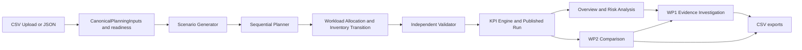
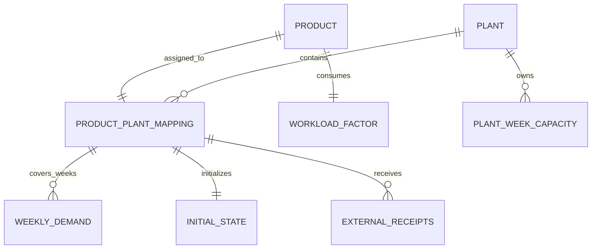
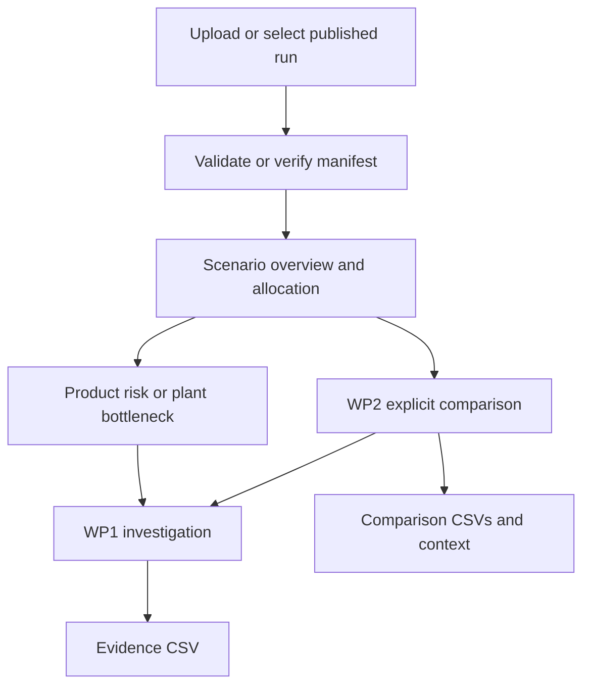

# 產品能力目錄 — 供應鏈規劃決策支援

**2026-11-20 Phase 2 最終狀態：**應用程式自有英文／繁中顯示文字、說明及語言控制項已實作，原始引擎／CSV／佐證契約不變。CSV 模式在表單內套用語言以保留待送出輸入，其他模式使用側欄。最終驗收記錄 T25、T32 PASS，Phase 2 COMPLETE — PASS WITH LIMITATIONS，待 owner review。修復後的受測 Chromium 可正常顯示 CJK 字形；字型仍是 container-local，尚未建立環境重建後的持久性。詳見[最終服務驗證](phase_2/PHASE_2_FINAL_SERVICE_VERIFICATION_REPORT.md)與[整合驗收](phase_2/PHASE_2_FINAL_ACCEPTANCE_REPORT.md)。以下歷史提案章節保留作為紀錄。

**執行摘要：** 現有應用可接收 CSV／JSON、驗證資料、執行多情境逐週 workload 規劃、發布可追溯結果，並提供 KPI、產品／工廠風險、WP1 證據調查與 WP2 同 Run 取捨比較。它是規則式、確定性、可解釋的 prototype。Phase 2 英文／繁中顯示層已通過宣告範圍的瀏覽器驗收；此結果不代表正式營運認證，也不代表環境重建後字型仍持久。本目錄區分已交付程式、驗收限制與未來提案。

2026-11-18 · HEAD `4b6c84d99173f2472de7a973c1ca98c3a4b15ec2` + existing uncommitted WP1/WP2 worktree · [Other language](PRODUCT_CAPABILITY_CATALOG_EN.md) · [User Guide](USER_GUIDE_ZH-TW.md)

- [1. 產品概觀與能力分層](#section-1)
- [2. 狀態、依據與文件權威](#section-2)
- [3. 完整模組架構](#section-3)
- [4. 詳細功能目錄](#section-4)
- [5. 已實作商業邏輯](#section-5)
- [6. KPI 與指標字典](#section-6)
- [7. 資料輸入與關聯](#section-7)
- [8. Published Run、輸出與證據](#section-8)
- [9. 端到端使用工作流](#section-9)
- [10. 實際介面與整合邊界](#section-10)
- [11. 限制與未實作能力](#section-11)
- [12. 未來雙語 UI：獨立實作提案](#section-12)
- [13. 未來改善機會](#section-13)
- [14. 雙語詞彙表與文件維護策略](#section-14)
- [15. 驗證依據與待釐清事項](#section-15)

<a id="section-1"></a>

## 1. 產品概觀與能力分層

這是 **Scenario-based supply chain planning decision-support prototype**。供應鏈規劃員、工廠規劃／營運人員、分析師與展示開發者，可把需求、期初供給及工作負荷產能放進同一套確定性規則，評估不同情境下哪些需求能被服務、哪些產品／工廠承壓，並沿證據追查與比較取捨。

它支援「哪一週、哪個產品需要注意」、「需求增加／產能中斷後服務與欠單怎樣變」、「同一 Run 兩情境對固定產品群組有何差異」等決策前分析。人員自行決定是否調整計畫；系統不下達採購／生產指令，也不選出最佳方案。

它不是 Production APS、ERP replacement、real-time production planning system 或 enterprise optimization platform。未實作 forecast、BOM／多階料件、production lead time、機台排程、採購最佳化、財務效果、AI Agent、外部 REST API 或雙語 UI。

| 能力層 | 作用與界線 |
| --- | --- |
| Planning Engine | 由輸入執行週次需求、allocation、inventory/backlog 模擬與 KPI；規則固定。 |
| Planning Decision Support | UI 組織執行、監控、解釋、比較與匯出，讓人判斷。 |
| Risk Analysis | 由已發布結果分類產品風險、統計工廠瓶頸及 Baseline 差異。 |
| Root Cause Investigation (WP1) | 選定完整 key，查看同週、相鄰週、同池 peers 與來源證據；不是因果證明。 |
| Scenario Trade-off Analysis (WP2) | 同 Run 明示兩情境、固定 reference cohort、逐指標比較與可比性判斷；不重跑、不推薦。 |

<a id="section-2"></a>

## 2. 狀態、依據與文件權威

**Implemented**：存在可達程式路徑；有測試依據者另列測試。**Partial**：部分存在或驗證不足。**Planned**：只有提案，未實作。**Deprecated**：明確停止使用；本次未找到將 Legacy 正式標示 Deprecated 的依據。

**驗證層次**：「已實作且有測試」不代表本次重新執行。最後保存的完整 suite 為 227 passed、0 failed、0 skipped（169.334 秒）；目錄撰寫工作只做文件／靜態核對，未重跑。其後的[Phase 2 最終驗收](phase_2/PHASE_2_FINAL_ACCEPTANCE_REPORT.md)記錄 T01–T33 與 P2-G00–G08 在各自宣告層次均 PASS，待 owner review。

本目錄以目前 working tree 的 `src/`、唯一 Streamlit app、`tests/`、examples／templates 與 published manifests 為準；並對照全 repository 檔案清單、歷史 notebook 程式與 Markdown 設計／進度。不是只看 HEAD committed code。當舊規格與可達程式路徑不同時，列為歷史或待釐清，不倒推已完成。Route B 的舊 WP1/WP2 編號不等於這次 WP1 Root Cause／WP2 Trade-off。

<a id="section-3"></a>

## 3. 完整模組架構

```text
A. Planning Input & Data Management
   CSV Upload / Templates / Column Mapping / Source Classification
   JSON Configuration / USER_DATA / SYNTHETIC_DEMO
   Data Validation / Readiness / Explicit Assumptions
B. Sequential Planning
   Demand Eligibility / Coverage / Product–Plant Mapping / Priority / Horizon
   Initial Inventory / Opening Backlog / External Receipts
   Production Requirements / Workload Factors / Shared Capacity / Allocation
   Inventory Transition / CARRY_FORWARD / LOST_SALES
C. Scenario Planning
   Baseline / Demand_Surge / Capacity_Disruption / Combined_Stress
   Additional JSON Scenarios / Per-Scenario Policy / Affected Weeks
D. Monitoring & Visualization
   Scenario Overview / Scenario Comparison / Capacity Allocation Detail
   KPI Cards / Weekly Trends / Published Outputs
E. Planning Risk Summary
   Product Risk / Plant Bottlenecks / Scenario Risk
   WP1 Root Cause Investigation / Native-Grain Evidence / CSV
F. WP2 Scenario Trade-off Analysis
   Explicit Reference–Candidate / Fixed Reference Cohorts
   ALL–SELECTED–COMPLEMENT / Metric Results / Comparability / POLICY_CONTRAST
   Shared Pool Context / Evidence References / Four CSVs / WP1 Handoff
G. Run & Evidence Management
   Runner / Independent Validator / Manifest / Hashes / Published Loader
H. Separate Existing Paths
   Legacy independent weeks / Historical Control Tower PBIX & Notebooks
I. Interfaces & Proposed Presentation Extension
   Internal Python / CLI / CSV Contracts
   Bilingual UI: IMPLEMENTED / T25-T32 ACCEPTANCE PASS
```


核心引擎使用 DataFrame／純函式；CSV I/O 在 adapter、runner、loader、export 邊界。比較 loader 目前依賴 dashboard 的既有 loader，因此不是完全獨立的 headless 套件。

<a id="section-4"></a>

## 4. 詳細功能目錄

### UI 控制索引（實際標籤保留英文）

| Area | Controls | 行為／預設 |
| --- | --- | --- |
| main / sidebar | Planning model | Sequential workload（預設）／Legacy independent weeks；兩條獨立路徑。 |
| Sequential input | Planning input; Sequential configuration JSON; Run sequential planning | Upload CSV data（預設）或既有 JSON；JSON 路徑預設 synthetic_demo/config.json。 |
| Published results | Published sequential run folder; Sequential scenario; Active assumptions and planning scope | Run folder 起始空白；載入後才有結果 tabs；scenario 選擇影響 overview／risk，不預選 WP2。 |
| Upload | Demand file format; file uploaders; Download CSV templates; Column mapping; Source classification | WEEKLY／ORDER_LINES；10 類 dataset uploaders、9 種 templates；來源分類 USER_PROVIDED／SYNTHETIC／SYNTHETIC_EXAMPLE／DERIVED／REFERENCE_INPUT。 |
| Qualification | Status: <source status>; already-qualified weekly checkbox; complete-extract checkbox | 每 status 選 Choose…／Qualified／Excluded；無 Status 的 WEEKLY 有已合格聲明；complete-extract 可達性見 L10。 |
| Run form | First/Last planning week (Sunday); Demand interpretation; Input/assumption version; Product quantity step | RETROSPECTIVE／USER_PROVIDED_PLAN；step 預設 0。 |
| Scenario form | Demand surge scenario (%); Capacity disruption scenario (%); Plant(s) affected; Shortage policy | 預設 +10%／−20%，工廠預選首項（若有）；policy CARRY_FORWARD／LOST_SALES。這些是 UI 可見預設，不是經審核的企業事實。 |
| Assumptions | Fallback quantity unit; assumed priority; uniform factor/unit; zero initial inventory; zero opening backlog; no receipts; synthetic capacity target | 重要替代假設 checkbox 預設未勾；priority 控制預設 2、factor 1、unit EqWU、target 0.75，只有明示啟用才採用。 |
| Execution | Validate inputs; Validate and run planning; Download run manifest | 分開只驗證與執行；執行前仍重新驗證。 |
| Risk / WP1 | Product drill-down; Investigate product; Plant drill-down; Investigate plant; Investigation path/product/plant/week | 兩條 investigation 路徑；按 Investigate 後由使用者切頁籤。 |
| WP2 | Reference Scenario; Candidate Scenario; Reference priorities (fixed cohort); Comparison product to investigate; Investigate Reference/Candidate in WP1 | Reference／Candidate／priority 預設空；產品未選時 Investigate buttons disabled。 |
| Downloads | KPI results; allocation detail; run manifest; WP1 per-evidence downloads; WP2 four downloads | WP1 原粒度表；WP2 metrics／membership／evidence／context。 |
| Legacy sidebar / tabs | Planning start/end week; Demand surge (%); Capacity disruption (%); Disruption plant; Run planning; Scenario; Detail scenario; Plant | 舊模式另有 scenario cards、plant utilization chart、Baseline KPI／delta／backlog charts、文字 insights 與 allocation detail；Plotly 缺少時保留 comparison table／insights。 |

| ID | 模組／功能 | Status |
| --- | --- | --- |
| F01 | A / CSV 上傳與範本 | Implemented／已實作 |
| F02 | A / 欄位對應與來源分類 | Implemented／已實作 |
| F03 | A / JSON 設定與資料模式 | Implemented／已實作 |
| F04 | A / 驗證與 Data Readiness | Implemented／已實作 |
| F05 | B / 需求資格與 Coverage | Implemented／已實作 |
| F06 | B / 規劃範圍、產品工廠與優先級 | Implemented／已實作 |
| F07 | B / Sequential Planning 執行 | Implemented／已實作 |
| F08 | B / 期初庫存與期初欠單 | Implemented／已實作 |
| F09 | B / 外部到貨與庫存轉移 | Implemented／已實作 |
| F10 | B / 工作負荷與產能 | 已實作但有限制／UI calibration 傳遞已於 UI V1.2 驗證 |
| F11 | B / 受限產能分配 | Implemented／已實作 |
| F12 | B / 欠單政策 | Implemented／已實作 |
| F13 | C / 情境生成與執行 | Implemented／已實作 |
| F14 | G / 獨立結果驗證 | Implemented／已實作 |
| F15 | G / Published Run 與 artifact 管理 | Implemented／已實作 |
| F16 | D / Sequential KPI 計算與監控 | Implemented／已實作 |
| F17 | D / Scenario Overview 與 Scenario Comparison | Implemented／已實作 |
| F18 | D / Capacity Allocation Detail | Implemented／已實作 |
| F19 | E / Product Risk | Implemented／已實作 |
| F20 | E / Plant Bottlenecks | Implemented／已實作 |
| F21 | E / WP1 根因調查 | Implemented／已實作 |
| F22 | E / Scenario Risk | Implemented／已實作 |
| F23 | F / WP2 明示情境與範圍 | Implemented／已實作 |
| F24 | F / 固定優先級 Cohort | Implemented／已實作 |
| F25 | F / WP2 指標取捨比較 | Implemented／已實作 |
| F26 | F / 逐指標可比性與政策對照 | Implemented／已實作 |
| F27 | G / 證據檢視與 WP1 CSV | Implemented／已實作 |
| F28 | F / WP2 Evidence 與四份匯出 | Implemented／已實作 |
| F29 | H / Legacy independent weeks | Implemented／已實作 |
| F30 | H / 歷史 Control Tower／Power BI | Partial／歷史資產存在，執行未驗證 |
| F31 | I / 內部 Python／CLI 介面 | Implemented／已實作 |
| F32 | I / 雙語介面與語言切換 | 已實作／T25-T32 宣告範圍驗收 PASS |

### F01 — CSV 上傳與範本

| 欄位 | 實作內容 |
| --- | --- |
| Module | A |
| Feature | CSV 上傳與範本 |
| Business Purpose | 讓規劃人員帶入自己的資料。 |
| User Actions | 選 Upload CSV data；上傳 CSV、預覽、下載九種範本。 |
| Required Inputs | products、plants、product_plant_mapping、demand。 |
| Optional Inputs | 另外六類輸入及明示假設，見資料字典。 |
| Processing Logic | 以字串讀取 ID；上傳保存在 session；驗證讀記憶體，執行時暫存 CSV 後清除。 |
| Outputs | 預覽、上傳狀態、可下載範本。 |
| Business Interpretation | 範本僅定義欄位，不提供零需求事實。 |
| Dependencies | A → B |
| Limitations | 不是資料庫匯入；原始暫存檔不永久保存；priorities 有上傳欄位但沒有獨立下載範本。 |
| Implementation Status | Implemented／已實作 |
| Source Reference | [dashboard/scenario_planning_app.py](../dashboard/scenario_planning_app.py) — `_user_csv_upload_workflow`; [dashboard/scenario_planning_app.py](../dashboard/scenario_planning_app.py) — `_capture_user_upload_state`; [dashboard/scenario_planning_app.py](../dashboard/scenario_planning_app.py) — `_restore_user_upload_state` |

### F02 — 欄位對應與來源分類

| 欄位 | 實作內容 |
| --- | --- |
| Module | A |
| Feature | 欄位對應與來源分類 |
| Business Purpose | 接納自訂 CSV 欄位名稱。 |
| User Actions | 逐欄選來源欄位，設定 Source classification。 |
| Required Inputs | CSV 與 canonical 必填欄位。 |
| Optional Inputs | UTF-8 以外 encoding 可透過 JSON 指定；provenance、version。 |
| Processing Logic | JSON columns 為 canonical → source；拒絕遺漏、重複映射及 canonical 欄位碰撞。 |
| Outputs | 標準資料欄位、來源清單。 |
| Business Interpretation | 來源分類描述資料出處，不保證是真實歷史。 |
| Dependencies | F01 / F03 |
| Limitations | 無自動單位轉換；周圍空白 ID 被拒絕。 |
| Implementation Status | Implemented／已實作 |
| Source Reference | [dashboard/scenario_planning_app.py](../dashboard/scenario_planning_app.py) — `_render_column_mapping`; [src/csv_planning_inputs.py](../src/csv_planning_inputs.py) — `load_csv_planning_inputs` |

### F03 — JSON 設定與資料模式

| 欄位 | 實作內容 |
| --- | --- |
| Module | A |
| Feature | JSON 設定與資料模式 |
| Business Purpose | 可重用的規劃設定與非 UI 操作。 |
| User Actions | 選 Use existing JSON configuration，輸入路徑並執行；也可用 CLI。 |
| Required Inputs | 版本、期間、政策、scenarios、files、data_mode。 |
| Optional Inputs | product_ids、assumptions、status mapping、calibration。 |
| Processing Logic | USER_DATA 與 SYNTHETIC_DEMO 共用 CanonicalPlanningInputs 與引擎；路徑相對 JSON 目錄。 |
| Outputs | 相同格式的 published run。 |
| Business Interpretation | Data Mode 是來源脈絡，非不同 KPI 定義；兩模式都不產生預測。 |
| Dependencies | F02 → F07 |
| Limitations | UI 直接 JSON 執行不提供獨立驗證按鈕；CLI 有 --validate-inputs。 |
| Implementation Status | Implemented／已實作 |
| Source Reference | [dashboard/scenario_planning_app.py](../dashboard/scenario_planning_app.py) — `_sequential_views`; [src/run_planning.py](../src/run_planning.py) — `main`; [src/planning_inputs.py](../src/planning_inputs.py) — `CanonicalPlanningInputs` |

### F04 — 驗證與 Data Readiness

| 欄位 | 實作內容 |
| --- | --- |
| Module | A |
| Feature | 驗證與 Data Readiness |
| Business Purpose | 在不完整輸入進入模擬前阻擋。 |
| User Actions | Validate inputs 或 Validate and run planning；檢查錯誤與假設。 |
| Required Inputs | 完整映射與規劃設定。 |
| Optional Inputs | 明示 ZERO／NONE、共同 priority／factor、quantity unit、合成 capacity calibration。 |
| Processing Logic | 檢查鍵、參照、日期、非負有限數值、單位、coverage、scenario；READY 或 BLOCKED，能力可為 READY_WITH_ASSUMPTIONS。 |
| Outputs | Sources、Assumptions、Derived_Values、Errors、Warnings、Unavailable_Capabilities。 |
| Business Interpretation | READY 表示通過程式契約，並非商業數據已由外部稽核。 |
| Dependencies | F02 / F03 |
| Limitations | 失敗時停止，並非一次列出所有後續錯誤；不自動修補資料。UI 合成 capacity calibration 傳遞已於 V1.2 驗證，證據見 L11。 |
| Implementation Status | Implemented／已實作 |
| Source Reference | [src/csv_planning_inputs.py](../src/csv_planning_inputs.py) — `load_csv_planning_inputs`; [dashboard/scenario_planning_app.py](../dashboard/scenario_planning_app.py) — `_validate_uploaded_config`; [dashboard/scenario_planning_app.py](../dashboard/scenario_planning_app.py) — `_render_readiness_report` |

### F05 — 需求資格與 Coverage

| 欄位 | 實作內容 |
| --- | --- |
| Module | B |
| Feature | 需求資格與 Coverage |
| Business Purpose | 分開原始需求、合格需求與排除量。 |
| User Actions | 選 WEEKLY／ORDER_LINES；逐一分類 Status；無 Status 的週需求明示已合格。 |
| Required Inputs | 需求資料、mapping、status_eligibility 或 qualification_basis。 |
| Optional Inputs | JSON unknown_status_policy=EXCLUDE、forced_excluded_statuses、source_is_complete。 |
| Processing Logic | Gross = Qualified + Excluded；訂單日期歸至週日；UNKNOWN 阻擋模擬；只有明示完整 extract 的產品觀察生命週期內無訂單週可補 covered zero。 |
| Outputs | eligibility_ledger、weekly_demand、demand_coverage。 |
| Business Interpretation | 缺少資料不是零需求；情境增量不虛構來源訂單。 |
| Dependencies | F02 / F04 |
| Limitations | 邊界不完整週與生命週期外仍 UNKNOWN；DataCo 排除名單是 profile 規則，非通用引擎規則。 |
| Implementation Status | Implemented／已實作 |
| Source Reference | [src/demand_preparation.py](../src/demand_preparation.py) — `prepare_order_demand`; [src/demand_preparation.py](../src/demand_preparation.py) — `build_demand_coverage`; [src/csv_planning_inputs.py](../src/csv_planning_inputs.py) — `load_csv_planning_inputs` |

### F06 — 規劃範圍、產品工廠與優先級

| 欄位 | 實作內容 |
| --- | --- |
| Module | B |
| Feature | 規劃範圍、產品工廠與優先級 |
| Business Purpose | 定義誰在哪裡、何時接受規劃。 |
| User Actions | 選首末週日；上傳 mapping 和 priority 1/2/3；JSON 可選 product_ids。 |
| Required Inputs | 產品、工廠、單一工廠 mapping、完整期間。 |
| Optional Inputs | priority 獨立檔或明示共同 priority；不可與 master 重複。 |
| Processing Logic | 一個產品僅對應一個工廠；priority 3 最高；同 trajectory 不可逐週變動；每個初始化 item 須涵蓋每週。 |
| Outputs | 規劃 item、週曆、優先級。 |
| Business Interpretation | 不是跨工廠 sourcing 或自動 ABC 分類。 |
| Dependencies | F04 / F05 |
| Limitations | 通用 CSV 不依賴 DataCo／ABC；Legacy reference adapter 才由 ABC A/B/C 對應 3/2/1。 |
| Implementation Status | Implemented／已實作 |
| Source Reference | [src/planning_inputs.py](../src/planning_inputs.py) — `horizon`; [src/csv_planning_inputs.py](../src/csv_planning_inputs.py) — `load_csv_planning_inputs`; [src/sequential_planner.py](../src/sequential_planner.py) — `simulate_sequential` |

### F07 — Sequential Planning 執行

| 欄位 | 實作內容 |
| --- | --- |
| Module | B |
| Feature | Sequential Planning 執行 |
| Business Purpose | 以連續週狀態評估供需限制。 |
| User Actions | 驗證後執行既有 runner。 |
| Required Inputs | canonical demand、capacity、initial、receipts、factors、政策與步長。 |
| Optional Inputs | 額外 JSON 情境及 scenario-specific receipts。 |
| Processing Logic | 各情境獨立初始化；按週／工廠計算生產需求→分配→庫存轉移；週末庫存與欠單帶入下週。 |
| Outputs | 產品週 states、工廠週 pools。 |
| Business Interpretation | 確定性模擬結果，不是最佳化排程。 |
| Dependencies | F05 / F06 / F08–F12 |
| Limitations | 沒有生產提前期、機台、BOM、物料或工序限制。 |
| Implementation Status | Implemented／已實作 |
| Source Reference | [src/sequential_planner.py](../src/sequential_planner.py) — `simulate_sequential`; [src/run_planning.py](../src/run_planning.py) — `run_csv_planning` |

### F08 — 期初庫存與期初欠單

| 欄位 | 實作內容 |
| --- | --- |
| Module | B |
| Feature | 期初庫存與期初欠單 |
| Business Purpose | 保留規劃開始前既有供需狀態。 |
| User Actions | 上傳 initial_inventory；欠單可內嵌或另檔，或明示 ZERO。 |
| Required Inputs | 每個 Plant × Product 的完整餘額。 |
| Optional Inputs | initial inventory 的 Week 須為首週；Quantity_Unit。 |
| Processing Logic | 每個情境用同一期初資料；區分 opening-origin 與 horizon-origin backlog。 |
| Outputs | initial_state 與分拆 fulfilled／ending backlog。 |
| Business Interpretation | 期初欠單履約不算本 horizon demand service。 |
| Dependencies | F04 → F07 |
| Limitations | LOST_SALES 情境拒絕非零期初欠單；不是每週重設庫存。 |
| Implementation Status | Implemented／已實作 |
| Source Reference | [src/csv_planning_inputs.py](../src/csv_planning_inputs.py) — `load_csv_planning_inputs`; [src/inventory_engine.py](../src/inventory_engine.py) — `transition_inventory` |

### F09 — 外部到貨與庫存轉移

| 欄位 | 實作內容 |
| --- | --- |
| Module | B |
| Feature | 外部到貨與庫存轉移 |
| Business Purpose | 納入已知可用供給並對帳。 |
| User Actions | 提供 Receipt_ID、產品、工廠、可用週與數量；或明示 NONE。 |
| Required Inputs | 收貨事件或明示無到貨；F08。 |
| Optional Inputs | Scenario 欄位可指定情境。 |
| Processing Logic | 供給 = 期初庫存 + 到貨 + 內製；同產品先清舊欠單，再供當週；到貨不扣內部 workload。 |
| Outputs | fulfilled current/backlog、ending inventory、ending backlog、lost sales。 |
| Business Interpretation | 可用週即當週可用，並不推算採購／運輸提前期。 |
| Dependencies | F07 / F08 |
| Limitations | 無自動補貨、供應商排程或安全庫存補足。 |
| Implementation Status | Implemented／已實作 |
| Source Reference | [src/inventory_engine.py](../src/inventory_engine.py) — `transition_inventory`; [src/sequential_planner.py](../src/sequential_planner.py) — `simulate_sequential` |

### F10 — 工作負荷與產能

| 欄位 | 實作內容 |
| --- | --- |
| Module | B |
| Feature | 工作負荷與產能 |
| Business Purpose | 讓不同產品使用可比較的產能耗用基礎。 |
| User Actions | 提供每產品 factor、共同單位／版本與每工廠每週 capacity；或明示合成校準。 |
| Required Inputs | 正數 factor、非負 capacity、完整週曆。 |
| Optional Inputs | 校準期間、target utilization、capacity version。 |
| Processing Logic | Workload = quantity × factor；合成 baseline = 工廠平均每週 qualified workload / target。 |
| Outputs | workload_factors、capacity_baseline、capacity_pools。 |
| Business Interpretation | 合成 capacity 並非量測產能；100% utilization 本身不等於 shortage。 |
| Dependencies | F05 / F06 |
| Limitations | 不支援 plant-specific factor；一組 compatible factor version／unit。合成產能依需求校準，並非實測工廠產能。定向 UI V1.2 驗證確認既有 UI recipe 透過頂層 capacity_calibration 傳入 adapter，且合成 adapter 達 READY。 |
| Implementation Status | 已實作但有限制；UI recipe 傳遞已於 UI V1.2 驗證 |
| Source Reference | [src/workload_model.py](../src/workload_model.py) — `calibrate_workload_capacity`; [src/workload_model.py](../src/workload_model.py) — `validate_workload_factors`; [dashboard/scenario_planning_app.py](../dashboard/scenario_planning_app.py) — `_build_upload_config`; [src/csv_planning_inputs.py](../src/csv_planning_inputs.py) — `load_csv_planning_inputs` |

### F11 — 受限產能分配

| 欄位 | 實作內容 |
| --- | --- |
| Module | B |
| Feature | 受限產能分配 |
| Business Purpose | 依已批准順位分配稀缺產能。 |
| User Actions | 設定 quantity_step；查看 Allocation_Order。 |
| Required Inputs | Required_Production_Qty、priority、factor、plant-week capacity。 |
| Optional Inputs | quantity_step=0 連續量；正數為共用包裝步長。 |
| Processing Logic | 排序 priority DESC、Required_Production_Qty DESC、Product Card Id ASC；可行量 min(requirement, remaining/factor)，依步長向下取整。 |
| Outputs | 內製量、已分配／未滿足 workload、剩餘 capacity、分配序。 |
| Business Interpretation | 跨產品依優先級；先清欠單只發生在各產品內。 |
| Dependencies | F07 / F10 |
| Limitations | 貪婪規則非最優解；包裝限制可能留下可用產能。 |
| Implementation Status | Implemented／已實作 |
| Source Reference | [src/allocation_engine.py](../src/allocation_engine.py) — `allocate_workload` |

### F12 — 欠單政策

| 欄位 | 實作內容 |
| --- | --- |
| Module | B |
| Feature | 欠單政策 |
| Business Purpose | 分開延後履約與流失銷售兩種假設。 |
| User Actions | 選 CARRY_FORWARD／LOST_SALES；JSON 可每情境各選政策。 |
| Required Inputs | 每個情境一個明示政策。 |
| Optional Inputs | CARRY_FORWARD 支援期初欠單。 |
| Processing Logic | Carry：未履約義務帶下週；Lost：當週未供應量計 loss、ending backlog=0。 |
| Outputs | 分拆 backlog 與 lost sales。 |
| Business Interpretation | LOST_SALES 的零欠單不能代表較好服務。 |
| Dependencies | F08 / F09 |
| Limitations | UI 一次 run 的四個情境共用政策；混合政策須用 JSON；不計欠單年齡或成本。 |
| Implementation Status | Implemented／已實作 |
| Source Reference | [src/inventory_engine.py](../src/inventory_engine.py) — `transition_inventory`; [dashboard/scenario_planning_app.py](../dashboard/scenario_planning_app.py) — `_build_upload_config` |

### F13 — 情境生成與執行

| 欄位 | 實作內容 |
| --- | --- |
| Module | C |
| Feature | 情境生成與執行 |
| Business Purpose | 測試需求上升與產能中斷的影響。 |
| User Actions | UI 設需求增幅、產能減幅及受影響工廠；JSON 可設定情境名、倍數、受影響週、政策。 |
| Required Inputs | Baseline 與顯式 scenario definitions。 |
| Optional Inputs | JSON 額外命名情境與 Disruption_Weeks。 |
| Processing Logic | Scenario_Qualified_Demand = Qualified_Demand × Demand_Multiplier；僅選中 pools 的 capacity 乘 Capacity_Multiplier。 |
| Outputs | UI 四情境：Baseline、Demand_Surge、Capacity_Disruption、Combined_Stress；scenario-specific states/pools/KPIs。 |
| Business Interpretation | 原始 Gross／Qualified／Excluded 保留；增量是 modeled demand。 |
| Dependencies | F05 / F10 → F07 |
| Limitations | capacity multiplier 限 0–1，不提供擴產 >1；demand multiplier 非負；無 UI 情境編輯器或 priority-shift 生成。 |
| Implementation Status | Implemented／已實作 |
| Source Reference | [src/scenario_generator.py](../src/scenario_generator.py) — `generate_sequential_scenarios`; [dashboard/scenario_planning_app.py](../dashboard/scenario_planning_app.py) — `_build_upload_config` |

### F14 — 獨立結果驗證

| 欄位 | 實作內容 |
| --- | --- |
| Module | G |
| Feature | 獨立結果驗證 |
| Business Purpose | 在發布前偵測算式平衡以外的錯誤。 |
| User Actions | 執行 run；檢查 validation_result。 |
| Required Inputs | 原始 scenario inputs、實際 states/pools、initial、receipts、factors。 |
| Optional Inputs | quantity_step。 |
| Processing Logic | 不呼叫規劃引擎重建 expected；獨立核對來源保存、排序、greedy allocation、stock／obligation／origin cohort 與 pools。 |
| Outputs | Check_ID、Passed、Rows_Checked、Message；失敗擲錯。 |
| Business Interpretation | 通過是已實作規則一致性，不是現實最優性。 |
| Dependencies | F07 → F15 |
| Limitations | 不取代輸入真實性或人工視覺驗收。 |
| Implementation Status | Implemented／已實作 |
| Source Reference | [src/sequential_validator.py](../src/sequential_validator.py) — `validate_sequential_results` |

### F15 — Published Run 與 artifact 管理

| 欄位 | 實作內容 |
| --- | --- |
| Module | G |
| Feature | Published Run 與 artifact 管理 |
| Business Purpose | 保存可追溯、不可混用的單次結果。 |
| User Actions | 執行新 run；輸入 Published sequential run folder 載入既有結果。 |
| Required Inputs | 完整 manifest 與 12 CSV artifacts。 |
| Optional Inputs | output_root；CLI --output-dir。 |
| Processing Logic | 建立唯一 timestamp+UUID Run_ID；完整成功與獨立驗證後 PUBLISHED；loader 核對 path confinement、SHA256、schema、identity；WP2 再核對列數。 |
| Outputs | run_manifest.json、12 CSV；失敗留 FAILED／UNPUBLISHED manifest。 |
| Business Interpretation | Published 是本機驗證狀態，不是網站上線或企業審批。 |
| Dependencies | F14 / F16 |
| Limitations | 無 Run browser、刪除／留存管理或 replay service；UI 用路徑。 |
| Implementation Status | Implemented／已實作 |
| Source Reference | [src/run_planning.py](../src/run_planning.py) — `run_sequential_planning`; [dashboard/scenario_planning_app.py](../dashboard/scenario_planning_app.py) — `load_sequential_outputs`; [src/comparison_io.py](../src/comparison_io.py) — `load_comparison_input` |

### F16 — Sequential KPI 計算與監控

| 欄位 | 實作內容 |
| --- | --- |
| Module | D |
| Feature | Sequential KPI 計算與監控 |
| Business Purpose | 量化生產覆蓋、履約與資源使用。 |
| User Actions | 選 Sequential scenario，查看五張 KPI cards 與完整 performance CSV。 |
| Required Inputs | states 與 unique pools。 |
| Optional Inputs | gross／qualified／excluded 欄位可保留。 |
| Processing Logic | 四種彙總粒度；ratio of sums；stock 取各 item 最後週；週與 horizon fulfillment 分開。 |
| Outputs | performance_result；Production Coverage、Demand Fulfillment、Utilization、Ending Backlog、Lost Sales cards。 |
| Business Interpretation | 0 分母為 N/A；不得把 stocks 跨週加總。 |
| Dependencies | F07 / F10 |
| Limitations | 沒有財務 KPI、OTIF、forecast accuracy 或欠單年齡。 |
| Implementation Status | Implemented／已實作 |
| Source Reference | [src/kpi_engine.py](../src/kpi_engine.py) — `calculate_sequential_kpis`; [dashboard/scenario_planning_app.py](../dashboard/scenario_planning_app.py) — `_sequential_views` |

### F17 — Scenario Overview 與 Scenario Comparison

| 欄位 | 實作內容 |
| --- | --- |
| Module | D |
| Feature | Scenario Overview 與 Scenario Comparison |
| Business Purpose | 快速了解情境間與週次間結果。 |
| User Actions | 在既有兩頁籤查看趨勢與情境表。 |
| Required Inputs | 已載入 published run、Sequential scenario。 |
| Optional Inputs | Active assumptions and planning scope。 |
| Processing Logic | Overview 顯示 weekly Ending Inventory／Backlog／Lost Sales 折線及 pools；Comparison 顯示 scenario-level summary。 |
| Outputs | 圖表、情境 KPI 表及設定脈絡。 |
| Business Interpretation | 既有 Comparison 是概覽，不具 WP2 cohort／comparability 語義。 |
| Dependencies | F15 / F16 |
| Limitations | Sequential overview 並非 Legacy Plotly 圖表；未人工瀏覽器驗收。 |
| Implementation Status | Implemented／已實作 |
| Source Reference | [dashboard/scenario_planning_app.py](../dashboard/scenario_planning_app.py) — `_sequential_views`; [dashboard/scenario_planning_app.py](../dashboard/scenario_planning_app.py) — `scenario_kpis` |

### F18 — Capacity Allocation Detail

| 欄位 | 實作內容 |
| --- | --- |
| Module | D |
| Feature | Capacity Allocation Detail |
| Business Purpose | 解釋產品每週怎樣取得供給。 |
| User Actions | 選情境並查看明細表。 |
| Required Inputs | allocation_result。 |
| Optional Inputs | 完整 CSV 可由頁首下載。 |
| Processing Logic | 依 Order_Date、Plant_ID、Allocation_Order 排序呈現需求、供給、factor、fulfilled、ending stock/backlog/loss。 |
| Outputs | 產品 × 工廠 × 週明細。 |
| Business Interpretation | 同一共享 pool 不可按產品行重複加總 capacity。 |
| Dependencies | F07 / F15 |
| Limitations | Sequential 此頁無額外 plant filter；Legacy 版本有 scenario／plant filters。 |
| Implementation Status | Implemented／已實作 |
| Source Reference | [dashboard/scenario_planning_app.py](../dashboard/scenario_planning_app.py) — `_sequential_views`; [dashboard/scenario_planning_app.py](../dashboard/scenario_planning_app.py) — `_allocation_detail` |

### F19 — Product Risk

| 欄位 | 實作內容 |
| --- | --- |
| Module | E |
| Feature | Product Risk |
| Business Purpose | 找出服務與期末義務需關注的產品。 |
| User Actions | 進入 Planning Risk Summary → Product Risk，選 Product drill-down，按 Investigate product。 |
| Required Inputs | 完整 allocation_result risk 欄位。 |
| Optional Inputs | 選擇當前情境。 |
| Processing Logic | 依 current shortfall、terminal backlog、loss、horizon fulfillment 分 At Risk；其餘 production coverage<1 或有需求且零期末庫存為 Watch；否則 Healthy。 |
| Outputs | 風險排序、原因、五張產品 KPI 卡、WP1 入口。 |
| Business Interpretation | 延後補供後 horizon service=100% 仍可能因同週缺貨 At Risk；無 composite score。 |
| Dependencies | F15 / F16 |
| Limitations | 是規則分類，不是缺貨機率或商業金額風險。 |
| Implementation Status | Implemented／已實作 |
| Source Reference | [src/planning_risk.py](../src/planning_risk.py) — `product_risk_ranking`; [dashboard/scenario_planning_app.py](../dashboard/scenario_planning_app.py) — `_planning_risk_summary` |

### F20 — Plant Bottlenecks

| 欄位 | 實作內容 |
| --- | --- |
| Module | E |
| Feature | Plant Bottlenecks |
| Business Purpose | 定位共享產能池未滿足工作負荷。 |
| User Actions | 選 Plant drill-down，查週表、utilization 長條圖、產品壓力貢獻表並 Investigate plant。 |
| Required Inputs | unique capacity_pools 與 allocation_result。 |
| Optional Inputs | 缺少 Workload_Shortage 時由 Unmet_Workload 推導。 |
| Processing Logic | 依工廠彙總 unique pools；shortage = Unmet_Workload>1e-9；計瓶頸週數、ratio-of-sums utilization。 |
| Outputs | 工廠排行、週次明細、產品 workload 表。 |
| Business Interpretation | 滿載但無 unmet workload 不算瓶頸；包裝限制也可造成 unmet。 |
| Dependencies | F10 / F15 |
| Limitations | 產品關聯壓力不是因果責任或重分配建議。 |
| Implementation Status | Implemented／已實作 |
| Source Reference | [src/planning_risk.py](../src/planning_risk.py) — `plant_bottleneck_summary`; [dashboard/scenario_planning_app.py](../dashboard/scenario_planning_app.py) — `_planning_risk_summary` |

### F21 — WP1 根因調查

| 欄位 | 實作內容 |
| --- | --- |
| Module | E |
| Feature | WP1 根因調查 |
| Business Purpose | 從風險定位到同週可追溯觀察。 |
| User Actions | 選 Product → Plant → Week 或 Plant → Week → Product；也可由產品／工廠／WP2 導入。 |
| Required Inputs | Run_ID、Scenario、Plant_ID、Product Card Id、Order_Date。 |
| Optional Inputs | 相鄰週、同池競爭產品、來源狀態。 |
| Processing Logic | 唯一完整 key 選行；分開展示 selected week、shared capacity、observed signals、前後各一 calendar week、Allocation_Order peers；證據獨立按 native grain 篩選。 |
| Outputs | 可追蹤調查畫面及逐表 CSV。 |
| Business Interpretation | 標題為 Root Cause，但只呈現同時觀察訊號；沒有因果推論或反事實重跑。 |
| Dependencies | F19 / F20 / F15 |
| Limitations | 只讀 published artifacts；缺 raw source 不會替換結果或虛構訂單。 |
| Implementation Status | Implemented／已實作 |
| Source Reference | [dashboard/scenario_planning_app.py](../dashboard/scenario_planning_app.py) — `_root_cause_investigation`; [src/planning_risk.py](../src/planning_risk.py) — `investigation_views`; [src/planning_risk.py](../src/planning_risk.py) — `filter_investigation_evidence` |

### F22 — Scenario Risk

| 欄位 | 實作內容 |
| --- | --- |
| Module | E |
| Feature | Scenario Risk |
| Business Purpose | 看相對 Baseline 的產品與工廠惡化。 |
| User Actions | 選非 Baseline 情境並進 Scenario Risk。 |
| Required Inputs | performance_result、product risk、Baseline。 |
| Optional Inputs | Bottleneck_Plant_Weeks 若有就顯示。 |
| Processing Logic | scenario 表與同產品／工廠的 Baseline 差值；前十筆產品／工廠惡化，標示政策改變。 |
| Outputs | 描述性差異表與 policy flags。 |
| Business Interpretation | 此 view 的 delta 不具 WP2 三種 comparability gate；跨政策尤其要保留脈絡。 |
| Dependencies | F16 / F19 |
| Limitations | Baseline 或匹配結果缺少時無比較；不是任意 Reference selector。 |
| Implementation Status | Implemented／已實作 |
| Source Reference | [src/planning_risk.py](../src/planning_risk.py) — `scenario_risk_comparison`; [src/planning_risk.py](../src/planning_risk.py) — `scenario_product_deterioration`; [src/planning_risk.py](../src/planning_risk.py) — `scenario_plant_deterioration` |

### F23 — WP2 明示情境與範圍

| 欄位 | 實作內容 |
| --- | --- |
| Module | F |
| Feature | WP2 明示情境與範圍 |
| Business Purpose | 讓比較方向與共同範圍明確。 |
| User Actions | 進 Scenario Trade-off Analysis；選兩個不同 Reference／Candidate。 |
| Required Inputs | 同一 published sequential_v1 Run、完整 horizon、scope。 |
| Optional Inputs | Python ComparisonScope 可選 product_ids、plant_ids、metric_ids、四種 output_grain。 |
| Processing Logic | 先驗證 manifest／tables；同 Run_ID 且 manifest 相等；UI 不預選 scenario；Delta=Candidate−Reference。 |
| Outputs | Comparison_ID、scope／identity context。 |
| Business Interpretation | 比較既有結果，不觸發規劃執行。 |
| Dependencies | F15 / F16 |
| Limitations | UI 使用 manifest 全部產品與 initial_state 工廠、Scenario grain；不支援 Cross-Run 或子期間。 |
| Implementation Status | Implemented／已實作 |
| Source Reference | [src/scenario_comparison.py](../src/scenario_comparison.py) — `ComparisonInput`; [src/scenario_comparison.py](../src/scenario_comparison.py) — `ComparisonScope`; [src/scenario_comparison.py](../src/scenario_comparison.py) — `compare_published_results`; [dashboard/scenario_planning_app.py](../dashboard/scenario_planning_app.py) — `_scenario_tradeoff_analysis` |

### F24 — 固定優先級 Cohort

| 欄位 | 實作內容 |
| --- | --- |
| Module | F |
| Feature | 固定優先級 Cohort |
| Business Purpose | 避免兩情境使用不同產品母體。 |
| User Actions | 選 Reference priorities，可留空；檢查 membership／Priority Changed。 |
| Required Inputs | Reference 與 Candidate priority 1/2/3、顯式產品 universe。 |
| Optional Inputs | 空優先級選擇。 |
| Processing Logic | ALL=universe；SELECTED=Reference priority 命中；COMPLEMENT=其餘；Candidate 改 priority 只標示變動；任一側 priority 不明則 UNAVAILABLE 並阻擋比較。 |
| Outputs | membership 表、priority-change count、三組結果。 |
| Business Interpretation | 可加總數量 ALL=SELECTED+COMPLEMENT；比率不可相加。 |
| Dependencies | F23 |
| Limitations | 空 cohort 為 N/A；現有一般情境生成不提供 priority-shift；顯示旗標不等於 UI 可改 priority。 |
| Implementation Status | Implemented／已實作 |
| Source Reference | [src/scenario_comparison.py](../src/scenario_comparison.py) — `_membership`; [src/scenario_comparison.py](../src/scenario_comparison.py) — `_priority` |

### F25 — WP2 指標取捨比較

| 欄位 | 實作內容 |
| --- | --- |
| Module | F |
| Feature | WP2 指標取捨比較 |
| Business Purpose | 同時看服務、欠單、流失與負荷。 |
| User Actions | 看五指標摘要、三組明細、週服務與 capacity context。 |
| Required Inputs | F23、F24；allocation 與 pools。 |
| Optional Inputs | Python 可限制 metric_ids。 |
| Processing Logic | 既有 KPI 引擎供服務／terminal stocks／fulfilled／loss；直接加總 workload 與同週 shortfall flows；service Delta ×100 為百分點。 |
| Outputs | 10 種 Metric_ID、Reference/Candidate values、Delta、numerators/denominators。 |
| Business Interpretation | Terminal backlog 與 current-unfulfilled flow 不同；共享 pool 獨立計一次，不標 cohort utilization。 |
| Dependencies | F16 / F23 / F24 |
| Limitations | Horizon metrics 在 Week grain 不適用；週服務在 Scenario／Plant grain 自動展開週。 |
| Implementation Status | Implemented／已實作 |
| Source Reference | [src/scenario_comparison.py](../src/scenario_comparison.py) — `_metric_values`; [src/scenario_comparison.py](../src/scenario_comparison.py) — `compare_published_results` |

### F26 — 逐指標可比性與政策對照

| 欄位 | 實作內容 |
| --- | --- |
| Module | F |
| Feature | 逐指標可比性與政策對照 |
| Business Purpose | 防止不相容結果被當成可決策改善。 |
| User Actions | 查看 Comparability_Status、Reason、Input_Differences 及政策警示。 |
| Required Inputs | 完整 coverage、units、priority、policy、workload definitions。 |
| Optional Inputs | opening／receipts／eligibility／allocation step／capacity basis 差異資訊。 |
| Processing Logic | COMPARABLE 正常；DESCRIPTIVE_ONLY 有條件差異或 POLICY_CONTRAST；BLOCKED 為缺資料、零分母、空 cohort、不相容等，Delta=N/A。 |
| Outputs | 每 metric 的 status/reason；可能保留單側 values。 |
| Business Interpretation | DESCRIPTIVE_ONLY 的 delta 可存在，但不是因果效果或推薦。 |
| Dependencies | F23–F25 |
| Limitations | workload 不相容只阻擋 workload；coverage／priority 問題可影響全部；不填零、不縮成交集。 |
| Implementation Status | Implemented／已實作 |
| Source Reference | [src/scenario_comparison.py](../src/scenario_comparison.py) — `_coverage_reason`; [src/scenario_comparison.py](../src/scenario_comparison.py) — `_input_differences`; [src/scenario_comparison.py](../src/scenario_comparison.py) — `_workload_reason`; [src/scenario_comparison.py](../src/scenario_comparison.py) — `compare_published_results` |

### F27 — 證據檢視與 WP1 CSV

| 欄位 | 實作內容 |
| --- | --- |
| Module | G |
| Feature | 證據檢視與 WP1 CSV |
| Business Purpose | 保留數據粒度與調查選擇脈絡。 |
| User Actions | 展開各 Evidence 表、下載 investigation CSV，查 source_status。 |
| Required Inputs | published artifacts 與完整 investigation key。 |
| Optional Inputs | 原始來源存在時比對 Source_Hashes。 |
| Processing Logic | 各 artifact 各自篩選；加 Investigation_* 與 Evidence_Artifact，不把來源訂單 join 進結果造成 fanout。 |
| Outputs | 逐表 CSV、Source_Status、provenance／assumptions。 |
| Business Interpretation | Investigation_* 是選擇脈絡，非每個來源記錄的 grain。 |
| Dependencies | F15 / F21 |
| Limitations | 缺原始上傳暫存檔可能正常；published evidence 仍可用；CSV 不含完整原始檔封裝。 |
| Implementation Status | Implemented／已實作 |
| Source Reference | [src/planning_risk.py](../src/planning_risk.py) — `investigation_evidence_csv`; [dashboard/scenario_planning_app.py](../dashboard/scenario_planning_app.py) — `investigation_source_status`; [dashboard/scenario_planning_app.py](../dashboard/scenario_planning_app.py) — `_root_cause_investigation` |

### F28 — WP2 Evidence 與四份匯出

| 欄位 | 實作內容 |
| --- | --- |
| Module | F |
| Feature | WP2 Evidence 與四份匯出 |
| Business Purpose | 將比較交給他人重閱時保留上下文。 |
| User Actions | 下載 Comparison CSV、Cohort、Evidence References、Context；選產品／比較側導入 WP1。 |
| Required Inputs | ComparisonResult。 |
| Optional Inputs | WP1 深查情境側與產品。 |
| Processing Logic | 兩側各 12 artifact refs，含 hash/native grain/provenance；四 CSV 均保留身份與 Comparison_Context；metrics 再內嵌 evidence／membership JSON。 |
| Outputs | metrics、cohort_membership、evidence_refs、context CSV；既有 WP1 導航狀態。 |
| Business Interpretation | Evidence refs 是定位索引，不是重跑設定或因果證明。 |
| Dependencies | F23–F27 |
| Limitations | CSV 欄位不翻譯；大 JSON 會重複；無 XLSX/PDF/ZIP 匯出；WP1 頁籤仍需自行切換。 |
| Implementation Status | Implemented／已實作 |
| Source Reference | [src/comparison_io.py](../src/comparison_io.py) — `comparison_csv_exports`; [src/scenario_comparison.py](../src/scenario_comparison.py) — `_evidence`; [dashboard/scenario_planning_app.py](../dashboard/scenario_planning_app.py) — `_comparison_investigation_entry` |

### F29 — Legacy independent weeks

| 欄位 | 實作內容 |
| --- | --- |
| Module | H |
| Feature | Legacy independent weeks |
| Business Purpose | 保留已完成的舊模型與結果解讀。 |
| User Actions | Planning model 選 Legacy independent weeks；設定 horizon／surge／disruption／plant，Run planning。 |
| Required Inputs | data/ master 與 processed reference inputs。 |
| Optional Inputs | 既有 legacy output folder。 |
| Processing Logic | Net=max(Scenario Demand−Beginning Inventory,0)；priority DESC、Net DESC、ID ASC；Allocated=min(Net,remaining quantity capacity)；Backlog=Net−Allocated。 |
| Outputs | 三個舊頁籤、performance statuses、Baseline deltas；四個 planning CSV outputs。 |
| Business Interpretation | 每週獨立、quantity capacity；不是連續庫存／workload 模型。 |
| Dependencies | legacy planning_snapshot → planning_pipeline → allocation_manager → performance_manager |
| Limitations | 仍可用，未標 Deprecated；不可套用 sequential_v1 KPI 或 WP1/WP2。 |
| Implementation Status | Implemented／已實作 |
| Source Reference | [src/allocation_engine.py](../src/allocation_engine.py) — `allocate_capacity`; [src/planning_pipeline.py](../src/planning_pipeline.py) — `run_planning_pipeline`; [src/performance_manager.py](../src/performance_manager.py) — `evaluate_allocation`; [dashboard/scenario_planning_app.py](../dashboard/scenario_planning_app.py) — `_run_controls` |

### F30 — 歷史 Control Tower／Power BI

| 欄位 | 實作內容 |
| --- | --- |
| Module | H |
| Feature | 歷史 Control Tower／Power BI |
| Business Purpose | 保留監控型資料分析成果。 |
| User Actions | 另開 PBIX；notebooks／processed CSV 作為歷史脈絡。 |
| Required Inputs | 既有 PBIX 與歷史監控資料。 |
| Optional Inputs | 本機 Power BI 環境與來源路徑設定。 |
| Processing Logic | Repository 保留 demand／inventory／capacity／service／executive summaries；非 Streamlit 即時生成的同一套 KPI。 |
| Outputs | 既有 PBIX 與 CSV 資產。 |
| Business Interpretation | DOI、安全庫存、monitoring risk score 不應解讀成 Sequential 功能。 |
| Dependencies | notebooks/ + data/processed + PBIX |
| Limitations | 存在與歷史程式可查；本次未開啟 PBIX／未驗證 refresh 或視覺互動。 |
| Implementation Status | Partial／歷史資產存在，執行未驗證 |
| Source Reference | [dashboard/supply_chain_control_tower.pbix](../dashboard/supply_chain_control_tower.pbix); [docs/04_KPI_Definition.md](../docs/04_KPI_Definition.md); [notebooks/03_inventory_risk.ipynb](../notebooks/03_inventory_risk.ipynb) |

### F31 — 內部 Python／CLI 介面

| 欄位 | 實作內容 |
| --- | --- |
| Module | I |
| Feature | 內部 Python／CLI 介面 |
| Business Purpose | 讓開發者重用相同邏輯。 |
| User Actions | 呼叫 pure engines／runner；CLI 驗證或執行。 |
| Required Inputs | 見第 10 節的函式契約。 |
| Optional Inputs | 自訂輸出根目錄、ComparisonScope。 |
| Processing Logic | engine 無 CSV I/O，runner／loader／exports 負責邊界；comparison_io 重用 dashboard loader。 |
| Outputs | DataFrames、dataclasses、Path dict、CSV strings。 |
| Business Interpretation | 程式介面不代表對外 HTTP API。 |
| Dependencies | Python + Pandas + NumPy + Streamlit; Plotly optional |
| Limitations | 未發現 REST／FastAPI／Flask endpoint、SDK 契約、認證或 API versioning。 |
| Implementation Status | Implemented／已實作 |
| Source Reference | [src/run_planning.py](../src/run_planning.py) — `run_csv_planning`; [src/scenario_comparison.py](../src/scenario_comparison.py) — `compare_published_results` |

### F32 — 雙語 UI 與語言切換

| 欄位 | 目前實作 |
| --- | --- |
| Module | 顯示層／國際化 |
| Feature | 英文與繁體中文標籤、說明及語言選擇 |
| Business Purpose | 以兩種語言理解既有規劃、調查與比較流程 |
| User Actions | CSV 模式在表單內選擇並套用語言以保留待送出值；其他模式使用側欄語言選擇 |
| Required Inputs | 既有 UI／工作階段；結果畫面需既有 Published Run |
| Optional Inputs | 已保留上傳內容／設定；不需新資料集 |
| Processing Logic | 中央字典、穩定識別鍵與狀態快照；只處理顯示副本／欄位設定 |
| Outputs | 本地化應用程式自有摘要、標籤與說明；技術明細及匯出保持標準內容 |
| Business Interpretation | 不改 KPI、群組、政策含義，不新增因果判定 |
| Dependencies | 既有 Streamlit 與已接受後端；用戶端需支援 CJK 字形 |
| Limitations | 原始後端／第三方明細保持原文；CJK 字型為 container-local，尚未驗證環境重建後的持久性 |
| Implementation Status | T25/T32 瀏覽器驗收在宣告範圍內 PASS；Phase 2 PASS WITH LIMITATIONS，待 owner review；不代表正式營運就緒 |
| Source Reference | dashboard/i18n.py、dashboard/display_metadata.py、dashboard/locales/*.json 及 scenario_planning_app.py 語言／顯示 helper |


<a id="section-5"></a>

## 5. 已實作商業邏輯

以下是程式現況說明，不是改規則授權。Sequential 與 Legacy 是分開的模式，不以一套算式替代另一套。

```text
Sequential policy: PRIORITY_NET_UNITS_BACKLOG_FIRST_WITHIN_PRODUCT
Required_Production_Qty = max(Beginning_Backlog + Scenario_Qualified_Demand
                              - Beginning_Inventory - External_Receipts_Qty, 0)
Order = Planning_Priority DESC, Required_Production_Qty DESC, Product Card Id ASC
Production = min(Required_Production_Qty, Remaining_Workload / Workload_Factor)
Production = floor_to_quantity_step(Production)  # only when quantity_step > 0
Allocated_Workload = Production * Workload_Factor
Supply = Beginning_Inventory + External_Receipts_Qty + Production
Fulfilled_Backlog_Qty = min(Beginning_Backlog, Supply)
Fulfilled_Opening_Backlog_Qty = min(Beginning_Opening_Backlog, Fulfilled_Backlog_Qty)
Fulfilled_Horizon_Backlog_Qty = Fulfilled_Backlog_Qty - Fulfilled_Opening_Backlog_Qty
Fulfilled_Current_Qty = min(Scenario_Qualified_Demand, Supply - Fulfilled_Backlog_Qty)
Current_Unfulfilled_Qty = Scenario_Qualified_Demand - Fulfilled_Current_Qty
CARRY_FORWARD: Ending_Backlog = Beginning_Backlog - Fulfilled_Backlog_Qty + Current_Unfulfilled_Qty
LOST_SALES: Ending_Backlog = 0; Lost_Sales_Qty = Current_Unfulfilled_Qty
```

每情境重設獨立狀態，再依週傳遞庫存與欠單。共享產能 grain 為 `Scenario × Plant × Week`；不是產品專屬產能。LOST_SALES 拒絕非零期初欠單。

```text
Legacy independent weeks:
Net_Demand = max(Scenario_Demand - Beginning_Inventory, 0)
Order = Planning_Priority DESC, Net_Demand DESC, Product Card Id ASC
Allocated_Qty = min(Net_Demand, Remaining_Capacity)
Backlog = Net_Demand - Allocated_Qty
```

Product Risk：以 1e-9 容差判斷 current unfulfilled／ending backlog／lost sales 或 fulfillment<1 為 At Risk；非 At Risk 而 coverage<1 或有需求且期末庫存為零為 Watch；其餘 Healthy。Plant bottleneck 以 unmet workload 判斷。Legacy `evaluate_performance` 則依 Total_Backlog>0 判 At Risk；零 backlog 且滿載為 Watch。兩種 status 不能混為一談。

<a id="section-6"></a>

## 6. KPI 與指標字典

符號：`S=Scenario`、`P=Plant`、`I=Product`、`W=Sunday-ending Week`；`D=Scenario_Qualified_Demand`、`BI=Beginning_Inventory`、`BB=Beginning_Backlog`、`ER=External_Receipts_Qty`、`IP=Internal_Production_Qty`、`R=Required_Production_Qty`、`FC=Fulfilled_Current_Qty`、`FB=Fulfilled_Backlog_Qty`、`FHB=Fulfilled_Horizon_Backlog_Qty`。數量單位來自 `Quantity_Unit`；workload 來自 `Workload_Unit`。所有 Sequential 比率分母為零時為 N/A。

| ID | 指標／業務意義 | 算式 | 分子／分母 | Grain | Unit | Data source | 解讀 | 注意事項 |
| --- | --- | --- | --- | --- | --- | --- | --- | --- |
| M01 | 情境合格需求 | `Scenario_Qualified_Demand = Qualified_Demand * Demand_Multiplier` | — | S × P × I × W → Σ | quantity | scenario_snapshot.csv | 情境需要服務的需求母體。 | 原始 Qualified_Demand 不被覆寫。 |
| M02 | 所需生產數量 | `R = max(BB + D - BI - ER, 0)` | — | S × P × I × W → Σ | quantity | allocation_result.csv | 現有庫存與當週外部到貨以外的義務。 | 含舊欠單；跨週加總是逐週需求流，可能重複反映未清欠單。 |
| M03 | 生產覆蓋率 | `Production_Coverage_Rate = sum(IP) / sum(R)` | Σ IP / Σ R | S; S × P; S × W; S × P × W | ratio | performance_result.csv | 內製覆蓋所計算生產需求的比例。 | R=0 為 N/A；不是 demand service；庫存／到貨可使零生產仍有服務。 |
| M04 | 需求履約率／規劃期間服務水準 | `Horizon_Service_Level = (sum(FC) + sum(FHB)) / sum(D)` | (Σ FC + Σ FHB) / Σ D | S; S × P | ratio | performance_result.csv; WP2 Horizon_Service_Level | 本期間產生的需求截至期末獲得履約的比例。 | 排除 Fulfilled_Opening_Backlog_Qty；可包含延後補供，並非準時率。 |
| M05 | 每週服務水準 | `Weekly_Service_Level = sum(FC) / sum(D)` | Σ FC / Σ D | S × W; S × P × W | ratio | performance_result.csv; WP2 Weekly_Service_Level | 當週需求在當週獲得履約的比例。 | 不含當週補供以前週欠單；D=0 為 N/A；WP2 rate value 為 fraction。 |
| M06 | 期末累積欠單 | `Terminal_Backlog = sum_item(Ending_Backlog[item, last_week])` | — | S; S × P (full horizon) | quantity | allocation_result.csv → performance_result.csv; WP2 Terminal_Backlog | 期末仍未履約的全部義務。 | 不得加總每週 stock；LOST_SALES 下為零，不代表零損失。 |
| M07 | 期初欠單與期末期初來源欠單 | `Ending_Opening_Backlog = Beginning_Opening_Backlog - Fulfilled_Opening_Backlog_Qty` | — | P × I opening; S × P × I × W stock | quantity | initial_state.csv; allocation_result.csv; WP2 Terminal_Opening_Backlog | 追蹤規劃期間以前產生的欠單尚餘多少。 | Beginning_Opening_Backlog 是 Beginning_Backlog 的一部分，不是額外加一次。 |
| M08 | 期末本期間來源欠單 | `Ending_Horizon_Backlog = Ending_Backlog - Ending_Opening_Backlog` | — | S; S × P (terminal item sums) | quantity | allocation_result.csv; WP2 Terminal_Horizon_Backlog | 本期間需求截至期末未清的欠單。 | 與 Lost Sales 分開。 |
| M09 | 流失銷售量 | `Lost_Sales_Qty = D - FC if LOST_SALES else 0` | — | S × P × I × W → Σ | quantity | allocation_result.csv → performance_result.csv; WP2 Lost_Sales | 政策定義為不遞延的未滿足需求。 | 不是營收損失金額；CARRY_FORWARD 的零 loss 不表示零 shortfall。 |
| M10 | 期末庫存 | `Ending_Inventory = max(BI + ER + IP - FB - FC, 0)` | — | item-week stock; terminal item sum at horizon | quantity | allocation_result.csv → performance_result.csv | 履約後剩餘可用庫存。 | 不是每週 stock 的總和；無安全庫存目標或自動補貨。 |
| M11 | 已分配工作負荷 | `Allocated_Workload = IP * Workload_Factor` | — | S × P × I × W → Σ; unique pools | Workload_Unit | allocation_result.csv; capacity_pools.csv; WP2 Allocated_Workload | 內部生產實際消耗的模型負荷。 | 外部到貨不耗此 capacity；factor／unit／version 須一致。 |
| M12 | 未滿足工作負荷 | `Unmet_Workload = (R - IP) * Workload_Factor` | — | S × P × I × W → Σ; unique pools | Workload_Unit | allocation_result.csv; capacity_pools.csv; WP2 Unmet_Workload | 所需內製量尚未滿足的等效負荷。 | 跨週是 flow，不等於期末欠單；包裝向下取整也可造成 unmet。 |
| M13 | 產能利用率 | `Capacity_Utilization = min(sum(Allocated_Workload) / sum(Available_Workload_Capacity), 1)` | Σ allocated / Σ available | S; S × P; S × W; S × P × W | ratio | capacity_pools.csv → performance_result.csv | 唯一工廠週池的已用工作負荷占比。 | capacity=0 為 N/A；KPI 引擎先拒絕超配；risk summaries 直接 ratio-of-sums；無 cohort utilization。 |
| M14 | 可用與剩餘產能 | `Available = Baseline_Workload_Capacity * effective_capacity_multiplier; Remaining = Available - Allocated_Workload` | — | S × P × W → Σ | Workload_Unit | capacity_pools.csv | 每週可用與尚未用完的共享負荷。 | 僅受影響工廠週使用 multiplier；不得依產品行重複計算。 |
| M15 | 內部生產與未滿足生產量 | `IP = step_down(min(R, remaining / factor)); Unmet_Production_Qty = R - IP` | — | S × P × I × W → Σ | quantity | allocation_result.csv | 貪婪分配產生的當週內製數量。 | step=0 不取整；不含生產提前期。 |
| M16 | 當週未履約流量 | `Current_Unfulfilled_Qty = D - FC` | — | S × P × I × W → Σ | quantity | allocation_result.csv; WP2 Current_Unfulfilled_Quantity | 需求週未服務量，即使之後補供仍保留此觀察。 | 不可視為 terminal backlog；Product Risk 名稱為 Current_Demand_Unfulfilled_Qty。 |
| M17 | 已履約數量 | `Fulfilled_Quantity = sum(FC) + sum(FHB)` | — | S; S × P (full horizon) | quantity | WP2 Fulfilled_Quantity; KPI Demand_Fulfillment_Numerator | 服務了本規劃期間來源需求的數量。 | 排除期初來源欠單；週 grain 不提供此 horizon metric。 |
| M18 | 瓶頸工廠週 | `Bottleneck_Plant_Weeks = count(unique pools where Unmet_Workload > 1e-9)` | — | S; S × P; S × W; S × P × W | plant-weeks | capacity_pools.csv → performance_result.csv | 有未滿足負荷的共享池數量。 | 不是 utilization 超過門檻的次數；Plant Risk 顯示 Bottleneck_Weeks。 |
| M19 | 原始／合格／排除需求 | `Gross_Demand = Qualified_Demand + Excluded_Demand` | — | source record → P × I × W → Σ | quantity | eligibility_ledger.csv; weekly_demand.csv | 說明輸入需求母體與資格政策。 | 無 Status 且已合格的輸入，gross 僅指所提供母體，外部排除量未知。 |
| M20 | WP2 差值 | `Delta = (Candidate_Value - Reference_Value) * (100 if service_metric else 1)` | — | per cohort × metric × declared grain | percentage points / quantity / Workload_Unit | WP2 metrics CSV | 正負方向依 metric 解讀，沒有自動 winner。 | BLOCKED 時 Delta=N/A；DESCRIPTIVE_ONLY 可保留數值差但需讀 reason。 |

**範例只是算式示意，並非新生成的規劃結果：** 當週需求 8、當週履約 5，週服務為 5/8；若之後補供 3，horizon service 可為 8/8，當週短缺流仍為 3。若分別比較 0.625 與 1.0，WP2 Delta 為 +37.5 百分點，不是 +0.375%。

**WP2 實際十個 ID：** `Horizon_Service_Level`、`Weekly_Service_Level`、`Fulfilled_Quantity`、`Terminal_Backlog`、`Terminal_Opening_Backlog`、`Terminal_Horizon_Backlog`、`Lost_Sales`、`Allocated_Workload`、`Unmet_Workload`、`Current_Unfulfilled_Quantity`。

| Legacy 指標 | Formula | 零分母／注意事項 |
| --- | --- | --- |
| Service_Level | Σ Allocated_Qty / Σ Net_Demand | 分母 0 → 1；生產 allocation coverage，非 Sequential 服務。 |
| Allocation_Rate | Σ Allocated_Qty / Σ Scenario_Demand | 0 → 1 |
| Capacity_Utilization | Σ Allocated_Qty / Σ unique Scenario_Capacity | 0 → 0 |
| Capacity_Gap; Remaining_Capacity | Σ unique Scenario_Capacity − Σ Allocated_Qty | 兩欄同值，是 slack，不是 unmet demand。 |

[src/kpi_engine.py](../src/kpi_engine.py) — `calculate_sequential_kpis`; [src/kpi_engine.py](../src/kpi_engine.py) — `calculate_kpis`; [src/inventory_engine.py](../src/inventory_engine.py) — `transition_inventory`; [src/scenario_comparison.py](../src/scenario_comparison.py) — `_metric_values`

<a id="section-7"></a>

## 7. 資料輸入與關聯

以下為 adapter canonical 欄位；CSV 原始欄名可經 mapping 改名。所有 ID 保留字串（例如 `001`、`NA`），不當成整數或缺值。optional 欄位不表示可無條件忽略；重要資料缺檔須明示替代假設。

| Dataset | 必填欄位 | 選填欄位 | Key / grain | 條件與關係 |
| --- | --- | --- | --- | --- |
| products | Product_ID, Product_Name | Quantity_Unit, Planning_Priority | Product_ID | 缺 unit／priority 須明示假設；priority 也可另檔。 |
| plants | Plant_ID | Plant_Name | Plant_ID | 所參照工廠必須存在。 |
| product_plant_mapping | Product_ID, Plant_ID | — | Product_ID | 一產品一工廠；同廠可多產品。 |
| demand (WEEKLY) | Product_ID, Week, Demand_Qty | Plant_ID, Status, Quantity_Unit, Coverage_Status | Plant_ID + Product_ID + Week (+ Status in source) | Plant 可由 mapping 推導；無 Status 須 ALREADY_QUALIFIED_INPUT；每週明示零值。 |
| demand (ORDER_LINES) | Product_ID, Order_Line_ID, Date, Quantity, Status | Plant_ID, Quantity_Unit | Order_Line_ID | 狀態須明確；日期轉週日；完整週 coverage 是額外要求。 |
| priorities | Product_ID, Planning_Priority | — | Product_ID | 不可與 master priority 重複；JSON priority_value_mapping 適用此檔。 |
| workload_factors | Product_ID, Workload_Factor, Workload_Unit | Factor_Version, Quantity_Unit | Product_ID | factor>0；若無檔須明示 uniform_workload_factor／workload_unit。 |
| weekly_capacity | Plant_ID, Week, Capacity, Workload_Unit | Capacity_Version, Factor_Version | Plant_ID + Week | 完整工廠週，含零 capacity；或明示合成 calibration。 |
| initial_inventory | Plant_ID, Product_ID, Beginning_Inventory | Week, Quantity_Unit, Beginning_Backlog | Plant_ID + Product_ID | 完整初始化 item；Week 若有須首週；或明示 ZERO。 |
| opening_backlog | Plant_ID, Product_ID, Beginning_Backlog | Quantity_Unit | Plant_ID + Product_ID | 可在 inventory 內嵌但不能重複；若兩者都無則須 ZERO。 |
| external_receipts | Receipt_ID, Plant_ID, Product_ID, Week, External_Receipts_Qty | Scenario, Quantity_Unit | Receipt_ID or Scenario + Receipt_ID | 可用週事件；無檔須 NONE；有 Scenario 欄時僅供指定側，不自動填其他情境。 |

**共通規則：** 非負有限數值；factor 必須正數；quantity_step 非負；priority 只能 1/2/3；選中產品 quantity unit 只能一種；workload unit／factor version 必須相容。`Week` 進 canonical 後改名 `Order_Date`、`Product_ID` 改名 `Product Card Id`。ORDER_LINES 的週來源可保留多 Status rows，再聚合至唯一 product/plant/week。

**JSON 必需：** `data_mode`、`assumption_version`、`planning_interpretation`、`planning_start_week`、`planning_end_week`、`quantity_step`、`allocation_policy`、非空 `scenarios`、`files`。每 scenario：`Scenario`、`Demand_Multiplier`、`Capacity_Multiplier`、`Disruption_Plants`、`Disruption_Weeks`、`Backlog_Policy`。必須有倍數均為 1 的 Baseline；Status 需 `status_eligibility`，無 Status 的 WEEKLY 需 `qualification_basis=ALREADY_QUALIFIED_INPUT`。其餘如 `product_ids`、`eligibility_version`、`source_is_complete`、`assumptions`、`capacity_calibration` 為條件設定。



**關聯範例：** 既有 USER_DATA example 的 `SKU-A` 與 `001` 透過 mapping 指向工廠；每個 item 的每週 demand 連至同工廠同週 capacity pool。產品週 allocation 可有多行，但 plant-week capacity 只有一行。來源訂單／到貨證據不要直接 join 後再 sum capacity。

**來源模式：** USER_DATA 可為使用者資料或標示 SYNTHETIC_EXAMPLE 的樣本，並不保證真實；SYNTHETIC_DEMO 明示示範來源。兩者共用 canonical engine。另保留舊 reference adapter（整數來源 ID、ABC、DataCo master），不是通用 CSV 的必要依賴。

[src/csv_planning_inputs.py](../src/csv_planning_inputs.py) — `load_csv_planning_inputs`; [src/planning_inputs.py](../src/planning_inputs.py) — `CanonicalPlanningInputs`; [docs/planning_csv_inputs.md](../docs/planning_csv_inputs.md); [examples/planning/README.md](../examples/planning/README.md)

<a id="section-8"></a>

## 8. Published Run、輸出與證據

每個新 Run 建立獨立 `sequential_<UTC timestamp>_<UUID prefix>/`。UI／通用 runner 預設 `tmp/planning_upgrade_runs`；CLI 可指定 output-dir。manifest 內含 Run_ID、Schema_Version、三種狀態、起訖時間、Configuration、Data_Mode、Scope、Input_Validation、Source_Hashes、Environment、Artifacts（Path／SHA256／Rows）與 Limitations。不是每個來源 adapter 都填完全相同的額外欄位。

| Artifact filename | Native grain | 內容／用途 |
| --- | --- | --- |
| eligibility_ledger.csv | 來源訂單／週來源記錄 | Gross、Qualified、Excluded、資格原因與來源 ID。 |
| weekly_demand.csv | P × I × W | 聚合需求與 observed coverage。 |
| demand_coverage.csv | P × I × W | 初始化 item 的期間 coverage；保留歷史 OUT_OF_SCOPE 證據。 |
| initial_state.csv | P × I | 規劃期初庫存與欠單、版本與 provenance。 |
| external_receipts.csv | Receipt_ID (+ S) | 明示供給事件；可為空表但仍須欄位。 |
| workload_factors.csv | I | 工作負荷係數、unit、version、provenance。 |
| capacity_baseline.csv | P or P × W | 合成校準為 plant grain；直接每週輸入為 plant-week。 |
| scenario_snapshot.csv | S × P × I × W | 情境需求、增量、政策；不是已分配結果。 |
| capacity_pools.csv | S × P × W | 唯一共享 pool、可用／已用／剩餘／未滿足 workload。 |
| allocation_result.csv | S × P × I × W | 逐週模擬狀態、生產分配與履約。 |
| performance_result.csv | Aggregation_Level + S (+ P, W) | 四種獨立 grain 的 KPI rows；不可混合後再加總。 |
| validation_result.csv | Check_ID + Message | Run-level 獨立檢查摘要，不是產品週檢查記錄。 |

**完整性：** 只有 SUCCEEDED／PASSED／PUBLISHED 且 sequential_v1 的 Run 可載入；所有 manifest artifact 檔案路徑須留在 Run 內且 SHA256 相符。loader 檢查已載表的身份、必要 schema、數值與日期；external_receipts 可為空，其餘必要表不可空。WP2 wrapper 額外逐表檢查 Rows 與 native keys。這不是認證／簽章機制，也不是每次 UI 載入都重跑獨立 validator。

**匯出：** 頁首有 KPI、allocation CSV 與 manifest；WP1 各 native evidence 表加 `Investigation_*`／`Evidence_Artifact`；WP2 四檔加 identities 與 `Comparison_Context` JSON，metrics 再加 `Evidence_References`、`Cohort_Membership_Reference`。CSV 使用 canonical 英文欄位；WP2 缺值寫 `N/A`，WP1／一般 artifact 可能是空值。CSV 消費者應保留字串 ID，避免 Excel 自動改 `001` 或 `NA`。

**證據來源：** source hashes 指向執行時讀取的檔案；上傳來源暫存檔可能已清除，`source_status` 因而 Unavailable。已驗證 published evidence 仍可調查；不得把現在磁碟上的不同 raw source 視為原執行來源。

[src/run_planning.py](../src/run_planning.py) — `run_sequential_planning`; [dashboard/scenario_planning_app.py](../dashboard/scenario_planning_app.py) — `load_sequential_outputs`; [src/comparison_io.py](../src/comparison_io.py) — `comparison_csv_exports`

<a id="section-9"></a>

## 9. 端到端使用工作流

以下五種工作流均有程式支援，並提供應用程式自有英文／繁中顯示。T25/T32 瀏覽器驗收已在宣告範圍內通過。跨 Run 與 AI 工作流仍不在範圍內；既有 Phase 1 限制見最終驗收報告。

### Workflow A — 開始新的 Planning Run

| 項目 | 操作說明 |
| --- | --- |
| 入口 | Planning input → Upload CSV data |
| 必要輸入 | 四個必要檔、供給／capacity／factor 或明示假設、完整 horizon。 |
| 步驟 | 上傳→mapping→資格分類→週日／policy／scenarios→Validate inputs→解 BLOCKED→Validate and run planning。 |
| 輸出／依賴 | READY 後產生唯一 Run、12 CSV、manifest 與 results；F01–F16。 |
| 常見錯誤／限制 | 不要把缺週當零、把 assumed priority／capacity 當事實；LOST_SALES 不可帶非零 opening backlog。合成產能是依需求校準的假設，並非實測產能。 |

### Workflow B — 分析既有情境

| 項目 | 操作說明 |
| --- | --- |
| 入口 | Published sequential run folder |
| 必要輸入 | 完整已發布 Run 目錄。 |
| 步驟 | 貼目錄→核對 active Run／mode／assumptions→選 Sequential scenario→看 Overview、Comparison、Allocation Detail。 |
| 輸出／依賴 | KPI cards、週趨勢、共享 pools 與 allocation；F15–F18。 |
| 常見錯誤／限制 | 不要選 parent folder 或單一 CSV；切換 Run 後重新核對情境。 |

### Workflow C — 調查供應鏈風險

| 項目 | 操作說明 |
| --- | --- |
| 入口 | Planning Risk Summary |
| 必要輸入 | 已載入 Run、scenario、產品或工廠。 |
| 步驟 | Product Risk／Plant Bottlenecks→drill-down→Investigate→切 Root Cause Investigation→選完整路徑→看 selected／adjacent／peers／evidence。 |
| 輸出／依賴 | 完整 key 下的觀察與 supporting evidence；F19–F22、F27。 |
| 常見錯誤／限制 | 共現不是因果；capacity pool 只計一次；來源 unavailable 不表示 published evidence 失效。 |

### Workflow D — 比較替代規劃情境

| 項目 | 操作說明 |
| --- | --- |
| 入口 | Scenario Trade-off Analysis |
| 必要輸入 | 同一 Run 的兩個不同 scenarios。 |
| 步驟 | 明選 Reference／Candidate→選 reference priorities→查 membership→看 ALL／SELECTED／COMPLEMENT→讀 status／reason／policy→需要時開 WP1。 |
| 輸出／依賴 | 逐 metric values／Delta、capacity context、evidence refs；F23–F28。 |
| 常見錯誤／限制 | 不可跨 Run／sub-horizon；空 cohort N/A；百分點非百分比變動；零 loss／backlog 不能單獨選 winner。 |

### Workflow E — 匯出與追溯

| 項目 | 操作說明 |
| --- | --- |
| 入口 | Published outputs／WP1 Evidence／WP2 downloads |
| 必要輸入 | 有效 Run 或 ComparisonResult／investigation selection。 |
| 步驟 | 下載 manifest 與 results→WP1 逐表 CSV→WP2 四檔→以 Run_ID／Comparison_ID／hash／native grain 對照。 |
| 輸出／依賴 | 可追溯的 CSV／JSON；F15、F27–F28。 |
| 常見錯誤／限制 | 保留字串 ID；勿因 UI 翻譯改欄名；evidence refs 不是原始資料封裝。 |



<a id="section-10"></a>

## 10. 實際介面與整合邊界

未在現有來源與依賴使用處發現對外 business HTTP API。Streamlit 的 health／WebSocket 是框架服務，不是規劃 API。下面皆為本機 Python 或 CLI，不能稱 REST endpoint。

| Interface | Input → output | I/O 與限制 |
| --- | --- | --- |
| `load_csv_planning_inputs(config, inputs_dir, *, reader=None)` | dict + directory → CanonicalPlanningInputs | 讀 CSV；失敗 InputValidationError.report。 |
| `generate_sequential_scenarios(demand, capacity_pools, definitions)` | DataFrames → (scenario demand, scenario pools) | No file I/O |
| `simulate_sequential(..., quantity_step=..., allocation_policy=...)` | DataFrames → (states, pool_results) | No file I/O |
| `validate_sequential_results(..., quantity_step=...)` | inputs + results → validation DataFrame | No file I/O |
| `calculate_sequential_kpis(states, pools)` | DataFrames → performance DataFrame | No file I/O |
| `run_csv_planning(config, *, inputs_dir, output_root=None)` | dict → dict[str, Path] | 檔案發布 orchestration。 |
| `run_sequential_planning(data_root, config, *, inputs_dir, output_root=None)` | dict → dict[str, Path] | 通用 CSV 與舊 reference adapter dispatch。 |
| `load_sequential_outputs(output_dir, *, include_evidence=False)` | directory → dict[str, DataFrame] | dashboard loader；完整性檢查。 |
| `investigation_views(..., run_id=..., scenario=..., plant_id=..., product_id=..., week=...)` | DataFrames + key → dict[str, DataFrame] | Read-only |
| `compare_published_results(reference, candidate, scope)` | ComparisonInput × 2 + ComparisonScope → ComparisonResult | Pure, no file I/O |
| `load_comparison_input(directory, scenario)` | directory + explicit scenario → ComparisonInput | I/O; dashboard loader dependency |
| `comparison_csv_exports(result)` | ComparisonResult → dict[str, str] | In-memory CSV serialization |


```bash
# Repository root; validate only (no planning output)
python -B -m src.run_planning --sequential-config examples/planning/user_data/config.json --validate-inputs
# Execute and publish a NEW run; command shown, not executed for this documentation task
python -B -m src.run_planning --sequential-config examples/planning/user_data/config.json --output-dir tmp/planning_source_runs
# Existing application entry point
python -B -m streamlit run dashboard/scenario_planning_app.py
```

CSV outputs 與 configuration 是檔案契約，不是網路服務。沒有認證／權限管理／多使用者隔離保證；本機 prototype 不應據此宣稱 production API。

<a id="section-11"></a>

## 11. 限制與未實作能力

| ID | 範圍 | Status | 具體邊界 |
| --- | --- | --- | --- |
| L01 | 同 Run 比較 | Implemented／受限 | WP2 同 Run_ID、相同 manifest、不同 scenario；不支援跨 Run、replay 或重新生成 scenario。 |
| L02 | 完整規劃期間 | Implemented／受限 | 週日連續週曆；每個初始化 item 及 pool 完整 coverage。WP2 不支援 sub-horizon；Python subset scope 仍須完整期間。 |
| L03 | 資料完整性 | Implemented／有測試 | UNKNOWN 不轉零；coverage 不取兩側交集；空 cohort／零分母 N/A，缺 endpoint 阻擋。 |
| L04 | 欠單與優先級 | Implemented／受限 | 一 scenario 一政策；LOST_SALES 不容非零 opening backlog；priority 1/2/3、同 trajectory 不變；無 backlog aging。 |
| L05 | Workload／capacity | Implemented／受限 | 產品 factor，非 plant-specific；版本／單位不相容阻擋 workload delta；不能視 cohort 擁有整個 shared pool；capacity multiplier≤1。 |
| L06 | UI 與驗收 | 已實作／宣告範圍驗收通過 | 英文／zh-TW 應用自有顯示；T25/T32 瀏覽器驗收已通過。字型為 container-local。Run 仍以路徑選取，WP2 使用完整 Run；不代表正式營運認證。 |
| L07 | 匯出與來源留存 | Implemented／受限 | CSV／JSON，不提供 XLSX/PDF/ZIP；無自動來源封存；upload temp 清除後 raw source 可 unavailable。 |
| L08 | 高階規劃與整合 | Not implemented／未實作 | 無 forecasting、optimization、跨廠替代、BOM、lead time、ERP 寫入、HTTP business API、排程 automation、AI。 |
| L09 | 歷史文件衝突 | Documented／需按程式解讀 | readme.md 仍寫 upload wizard deferred，但 UI 已存在；Route B WP 編號與後來 WP1/WP2 不同；歷史 monitoring KPI 不當成 Sequential KPI。 |
| L10 | ORDER_LINES UI completeness | 已於 UI V1.2 修正 | 完整擷取聲明現在獨立於需求狀態分類顯示；既有 `source_is_complete` 契約與驗證規則不變。定向 AppTest 確認 Status 有值時仍看得到聲明欄位。 |
| L11 | UI 合成產能校準傳遞 | 已於 UI V1.2 修正 | 既有 UI recipe 改以 adapter 要求的頂層 `capacity_calibration` 傳遞。合成 demo adapter 驗證達 READY，並標示 `SYNTHETIC_DEMAND_CALIBRATED`；engine 公式與校準規則不變。 |

<a id="section-12"></a>

## 12. 歷史雙語 UI 提案 — 現況以 Phase 2 補充為準

本節保留 Phase 2 授權實作前的提案內容。已交付實作及最終驗收狀態請以 F32 與上方現況摘要為準。

**獨立實作提案，未授權開發。** 現有 UI 大多直接寫英文 literal；沒有 locale selector、translation helper 或中央字典。本次只建立雙語文件。

### 12.1 建議架構與語言狀態

建議未來新增 `dashboard/i18n.py`、`dashboard/locales/en.json`、`dashboard/locales/zh-TW.json`（全部為提案路徑，目前不存在）。`t(key, **params)` 讀中央字典；stable semantic keys 如 `nav.tradeoff`、`metric.horizon_service.label`、`validation.coverage_unknown`，不用完整英文句子或翻譯字串當 key。

sidebar 加 `Language / 語言`，選項為 `English (en)` 與 `繁體中文 (zh-TW)`；`st.session_state["ui_locale"]` 保存語言。建議預設 `en` 保持現有使用經驗；同一 helper 供所有 tabs、reruns 及未來 pages 使用。不將 locale 寫入 planning config、Run manifest 或 Comparison_ID 的 hash 輸入。

### 12.2 翻譯邊界與穩定資料

只改 presentation copies：`format_func` 翻譯選項標籤但保留選項 value；tables 以 column_config 或副本 rename 顯示標題；charts 使用顯示資料／軸標籤映射；KPI 使用 metric ID → label/help 映射。所有 callback／session widget keys 使用固定識別值，不能因語言文字改 key。

**絕不修改：** internal metric IDs、dataset column names、artifact schemas、Run IDs、Scenario IDs、Comparison logic、KPI formulas、Evidence refs、CSV data contracts、status machine values、priority numbers。`Baseline` 等 Scenario ID 保持可見；可加翻譯說明但 value 不變。數值格式僅渲染，不 round 後寫回；日期 UI 可本地化，但 artifacts 保持 ISO 日期。CSV 下載內容與欄名不隨語言改變。

### 12.3 完整影響面與訊息處理

| 位置 | 翻譯範圍與依賴 |
| --- | --- |
| main / _sequential_views / legacy views | 導航、tabs、sidebar、按鈕、控制、caption、下載說明與 empty states。 |
| _user_csv_upload_workflow / _render_column_mapping / _render_readiness_report | 欄位顯示、help、資格選項、readiness labels、validation／error／warning 訊息。 |
| _planning_risk_summary / _root_cause_investigation | KPI names/descriptions、Risk_Category 顯示、Risk_Reason／Risk_Signals、source-status labels、charts。 |
| _scenario_tradeoff_analysis / _comparison_display | metric labels、cohort 顯示、status／reason、POLICY_CONTRAST、evidence display headings；匯出沿用原資料。 |
| Backend-generated strings | csv_planning_inputs、planning_risk、scenario_comparison、validators 產生英文動態文字；先保留原值，以 presentation message catalog 翻譯已識別模板，技術細節另列。 |

現有 message 並非全有穩定 code，不能靠任意英文全文 replace 保證完整翻譯。優先使用既有 `Check_ID`、`Metric_ID`、`Comparability_Status`；其餘建立已知模板／參數的 display adapter，並列出未涵蓋訊息。若要新增 structured diagnostic codes，須另行審核為介面調整，保持舊 exception／CSV／published reason 值與業務規則相容；不能在本次文檔任務改後端。第三方 library、Pandas／Streamlit／OS 錯誤未必能全翻；顯示在地化摘要與原始技術詳情，不能宣稱已完整翻譯。

### 12.4 Fallback、依賴與風險

Fallback：所選 locale → en → 顯示 `[missing:key]` 並記錄開發診斷；未知 locale 回 en。placeholder 以 named parameters 統一，兩語 placeholder set 必須一致。風險包括 rerun 導致 widget reset、上傳流失、翻譯 column 回流計算、中文把兩種 service 混淆、錯誤模板漏譯及欄寬溢出。依賴先核定本文件 glossary、列出所有 literal／generated messages、保留現有 widget keys 與 session scopes。使用 Python stdlib JSON 即可，初期不需要新增翻譯套件。Fallback 是容錯，不是完成率；驗收須無應翻而 fallback 的 app-owned 文字。

### 12.5 分階段實作與驗收條件

1. 另行授權後盤點字串、確認 glossary 與不變項 baseline。
2. 加入字典、helper、sidebar locale state；先翻導航與控制，保留 widget keys。
3. 涵蓋 KPI／tables／charts／validation／risk／WP1／WP2／downloads 指示及已知動態訊息。
4. 驗證 key／placeholder parity、fallback、切換及 rerun、上傳保存、Reference／Candidate／cohort／WP1 state 保存。
5. 同輸入與 Run 兩語切換前後 DataFrames／KPI／Comparison_ID／artifact hashes／CSV bytes 完全一致。
6. 對兩模式、兩政策、空 cohort、零分母、BLOCKED、來源 unavailable 進行定向 AppTest；再由使用者驗兩語實際瀏覽器，含窄螢幕、tooltip、錯誤、下載。

估計複雜度 **Medium**；完整動態訊息覆蓋可能提高。這是 presentation 層擴充；任何 diagnostic contract 變更另審。完成條件是所有 application-owned user-facing strings 一致切換、技術值不變、目標測試通過及兩語 browser acceptance 有實際回報；本次沒有實作上述任何一步。

<a id="section-13"></a>

## 13. 未來改善機會

以下均為未實作建議，優先改善可理解性與現有工作流。排序不構成 stage／WP 授權；本次不開始 WP3。

| Category | 建議 | 價值與依賴 | Complexity | 架構位置 |
| --- | --- | --- | --- | --- |
| UX / Usability | Phase 2 範圍以外的雙語體驗改善 | 擴大 glossary 與 empty state 覆蓋；需另行審查範圍與驗收。 | Low–Medium | 現有 presentation architecture。 |
| UX / Usability | Published Run 選擇器與來源假設摘要 | 減少路徑錯誤；需受限目錄掃描與既有 loader。 | Low–Medium | 現有 UI；不得變更 publication gates。 |
| Data Management | 可選來源封存與留存政策 | 提高重現性；需使用者資料政策、容量與來源 hash 清單。 | Medium | runner 邊界新管理功能，不改引擎。 |
| Analytics / Decision Support | 釐清風險／服務語義及 comparability 顯示 | 降低把共現當因果、把零欠單當服務的誤解；依賴現有 signals。 | Low | 既有 presentation；不新增分數或公式。 |
| Planning Capabilities | 欠單年齡或 lead-time 規劃 | 若業務確有需要才評估；需來源 cohort／due-date 與批准新規則。 | High | 引擎／schema 擴充，須架構與業務決策。 |
| Automation | 受控批次執行與失敗通知 | 減少重複作業；需排程器、run lifecycle、通知授權。 | Medium | 獨立 orchestration module。 |
| API / Integration | 穩定 headless loader，之後才評估 HTTP wrapper | 先減低 dashboard coupling；外部 API 才需認證、版本及部署。 | Medium / High | 先 boundary refactor；HTTP 是新 integration module。 |
| Reporting | 具脈絡的可讀報告與精簡匯出 | 分享方便、減少重複 JSON；需保留 canonical CSV 並另加報告。 | Medium | 新 report adapter，不替換 artifact contract。 |

<a id="section-14"></a>

## 14. 雙語詞彙表與文件維護策略

| English | 繁體中文 |
| --- | --- |
| Supply Chain | 供應鏈 |
| Planning Engine | 規劃引擎 |
| Planning Decision Support | 規劃決策支援 |
| Scenario | 情境 |
| Reference Scenario | 參考情境 |
| Candidate Scenario | 候選情境 |
| Planning Horizon | 規劃期間 |
| Qualified Demand | 合格需求 |
| Scenario Qualified Demand | 情境合格需求 |
| Demand Eligibility | 需求資格 |
| Priority | 優先級 |
| Cohort | 產品群組 |
| Fixed Reference Priority Cohort | 固定參考優先級群組 |
| Complement | 補集群組 |
| Beginning Inventory | 期初庫存 |
| Ending Inventory | 期末庫存 |
| Opening Backlog | 期初欠單 |
| Terminal Backlog | 期末累積欠單 |
| Lost Sales | 流失銷售 |
| External Receipts | 外部到貨 |
| Required Production Quantity | 所需生產數量 |
| Workload | 工作負荷 |
| Workload Factor | 工作負荷係數 |
| Allocated Workload | 已分配工作負荷 |
| Unmet Workload | 未滿足工作負荷 |
| Capacity Utilization | 產能利用率 |
| Production Coverage Rate | 生產覆蓋率 |
| Demand Fulfillment Rate | 需求履約率 |
| Service Level | 服務水準 |
| Weekly Service Level | 每週服務水準 |
| Horizon Service Level | 規劃期間服務水準 |
| Risk Analysis | 風險分析 |
| Product Risk | 產品風險 |
| Plant Bottlenecks | 工廠瓶頸 |
| Root Cause Investigation | 根因調查 |
| Scenario Risk | 情境風險 |
| Trade-off Analysis | 取捨分析 |
| Comparability | 可比性 |
| Policy Contrast | 政策對照 |
| Evidence References | 證據參照 |
| Published Run | 已發布規劃執行 |
| Artifact | 產出檔 |
| Data Readiness | 資料就緒狀態 |
| Percentage Points | 百分點 |

技術識別值（例如 `Scenario`、`Product Card Id`、`CARRY_FORWARD`、`COMPARABLE`）保留原樣；中文是顯示／說明用語。

四份文件是配對而非四種產品規格：catalog 給業務及開發者，manual 給操作人員。中英文 catalog 共用 F01–F32、M01–M20、L01–L11；manual 共用 U01–U22 與 Workflow A–E。任何能力、公式、status、限制更新須在兩語同次更新，保留英文 UI literal 與 canonical IDs，避免把尚未翻譯 UI 寫成已支援。

維護順序：查實作與測試→更新能力 ID／來源函式→同步另一語→以 glossary 審詞→逐項核對 formula／units／zero policy／workflow／limits→再做連結與 diff 檢查。技術名詞首見可雙語，之後保持相同譯名；程式碼、CLI、CSV headers、scenario/status IDs 不翻。不要使用機器翻譯擅改 service 與 fulfillment 定義。

只有取得目前應用的真實截圖才可加入手冊；本次未取得 browser screenshots，故不放圖片。現有 PBIX／舊 UI 圖片不代表目前 WP2 畫面。此四份文件取代本次原要求單一 PRODUCT_CAPABILITY_CATALOG.md 的交付形式；沒有另外建立第五份總目錄或修改歷史文件。

<a id="section-15"></a>

## 15. 驗證依據與待釐清事項

| 範圍 | Test source | 覆蓋 |
| --- | --- | --- |
| Input / upload | [tests/test_csv_planning_inputs.py](../tests/test_csv_planning_inputs.py); [tests/test_dashboard_upload_workflow.py](../tests/test_dashboard_upload_workflow.py) | 自訂欄位、字串 ID、兩模式、假設、coverage、上傳／model 切換。 |
| Planning / inventory / validator | [tests/test_planning_inputs_upgrade.py](../tests/test_planning_inputs_upgrade.py); [tests/test_inventory_transition.py](../tests/test_inventory_transition.py); [tests/test_sequential_upgrade.py](../tests/test_sequential_upgrade.py); [tests/test_independent_validation_upgrade.py](../tests/test_independent_validation_upgrade.py) | 正常／受限／零產能、零需求、庫存覆蓋、收貨、policy、determinism、排序／平衡造假。 |
| Publication / risk / WP1 | [tests/test_sequential_pipeline_upgrade.py](../tests/test_sequential_pipeline_upgrade.py); [tests/test_planning_risk.py](../tests/test_planning_risk.py); [tests/test_dashboard_app.py](../tests/test_dashboard_app.py) | failed publication、hash／identity、native evidence、兩導航路徑。 |
| WP2 | [tests/test_scenario_comparison.py](../tests/test_scenario_comparison.py); [tests/test_comparison_dashboard.py](../tests/test_comparison_dashboard.py); [tests/test_comparison_acceptance.py](../tests/test_comparison_acceptance.py) | 固定 cohort、policy／unit／coverage、CSV determinism、兩模式 AppTest、獨立手算 oracle。 |

[tmp/wp2_acceptance/final_full_suite.log](../tmp/wp2_acceptance/final_full_suite.log); [tmp/wp2_acceptance/final_verification.json](../tmp/wp2_acceptance/final_verification.json); [docs/wp2_implementation_progress.md](../docs/wp2_implementation_progress.md)

**仍需調查／未驗證：** 未做 browser acceptance；PBIX refresh 未驗證；原 WP2–WP4 research 全文未納入，但實際 v1.0 WP2 specification 已存在；歷史 readme 與 active UI 文案不同。`Weekly_Service_Level` 這個 ID 在非週 grain 雖自動展週，但其他自訂 grain／metric 組合的適用性仍必須讀 status/reason。沒有找到其他應當宣稱已實作的 HTTP API 或語言切換。L10、L11 已於 UI V1.2 修正，如上表所記。


額外靜態發現：notebooks/03_control_tower_dashboard.ipynb 為空／非有效 JSON，不可當成可執行能力證據。先前 L11 設定傳遞問題已於 UI V1.2 重現、修正並驗證。
