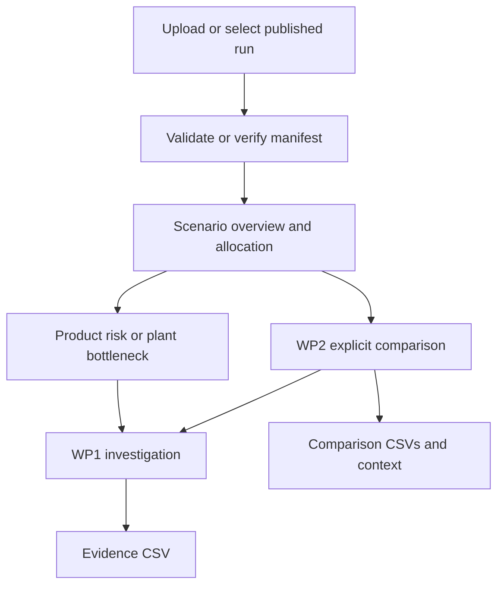

# User Guide — Supply Chain Planning Decision Support

**Quick summary:** New data follows upload → validate → execute. Existing results follow Published Run → KPIs/risk. Use WP1 for evidence and WP2 for two-scenario trade-offs. Phase 2 English/Traditional Chinese presentation passed its declared browser acceptance scope; CJK fonts remain container-local, with no rebuild-persistence guarantee. Instructions below describe existing controls; future capabilities are explicitly labeled proposals.

2026-11-18 · [Capability Catalog](PRODUCT_CAPABILITY_CATALOG_EN.md) · [Other language](USER_GUIDE_ZH-TW.md)

- [1. Application overview and startup](#u01)
- [2. Language selection: current availability](#u02)
- [3. Data upload](#u03)
- [4. Input validation](#u04)
- [5. Execute a planning run](#u05)
- [6. Select a published run](#u06)
- [7. Scenario Overview](#u07)
- [8. Scenario Comparison](#u08)
- [9. Capacity Allocation Detail](#u09)
- [10. Planning Risk Summary](#u10)
- [11. Product Risk](#u11)
- [12. Plant Bottlenecks](#u12)
- [13. Root Cause Investigation](#u13)
- [14. Scenario Risk](#u14)
- [15. Scenario Trade-off Analysis](#u15)
- [16. Reference / Candidate selection](#u16)
- [17. Fixed priority cohort](#u17)
- [18. Comparability Status](#u18)
- [19. Evidence inspection](#u19)
- [20. CSV exports](#u20)
- [21. Troubleshooting](#u21)
- [22. Known limitations and acceptance status](#u22)
- [Five end-to-end workflows](#workflows)
- [Bilingual glossary](#glossary)

<a id="u01"></a>

## U01 — Application overview and startup

Purpose: apply existing rules to demand/supply, workload capacity and inventory/backlog, then inspect risk, evidence and trade-offs. Prerequisites: a Python environment with repository read/write access and Pandas, NumPy and Streamlit installed; Plotly is optional for some Legacy charts.

1. Run the command below from the repository root.
2. Open the Local URL printed in the terminal; the default is usually http://localhost:8501, but use the actual startup output.
3. Keep sidebar `Planning model = Sequential workload`.
4. Choose new input or load a published run directly. Viewing results does not require rerunning planning.

```bash
python -B -m streamlit run dashboard/scenario_planning_app.py
```

Earlier acceptance preparation used port 8502; it is not a permanent address or availability guarantee. For a remote container, use the environment’s port forwarding; localhost is not a public remote site.

<a id="u02"></a>

## U02 — Language selection

English is the default; Traditional Chinese (zh-TW) presentation passed the Phase 2 browser acceptance at its declared scope (T25/T32). In CSV upload mode, find Language / 語言 inside the planning form, choose English or 繁體中文, then select Apply language and keep form inputs. This transmits pending edits only; it does not validate inputs or execute planning. The sidebar explains this location. In JSON configuration and legacy modes, use the sidebar Language selector.

Run/Scenario IDs, technical statuses, original diagnostic details, uploaded content, canonical CSV headers/data and filenames stay unchanged. Metric definitions and technical identifiers remain available under Technical IDs and display definitions. Language persists within the browser session, not across browser restarts. Wide tables may require horizontal scrolling.

The final report records readable CJK rendering in the tested Chromium runtime after remediation. Fonts are container-local, so their persistence across environment rebuilds is not established. This is not a production uptime or deployment guarantee; see the Phase 2 final service verification report.

<a id="u03"></a>

## U03 — Data upload

1. Choose `Planning input → Upload CSV data`.
2. Select `Demand file format = WEEKLY` or `ORDER_LINES`.
3. Upload Products, Plants, Product to plant mapping and Demand. Expand `Download CSV templates` for nine header templates; header-only files are not valid demand data.
4. Provide Weekly workload capacity, Product workload factors, Initial inventory, Opening backlog and External receipts, or explicitly declare permitted replacements under `Explicit assumptions for optional or missing inputs`. Put priority in Products or Optional planning priorities, never both.
5. Map canonical fields to source headers under `Column mapping`; select `Source classification`.
6. Classify every demand Status as Qualified or Excluded. For status-free WEEKLY input, declare it already qualified.

The existing `examples/planning/user_data/` sample is available (demonstration data, not verified fact). Its product headers are sku/title/uom/rank and mapping headers sku/site; map them rather than assuming canonical names. Order-line input needs complete coverage; see troubleshooting for the source_is_complete UI reachability concern.

**Synthetic-capacity UI limitation:** the calibration checkbox exists, but its recipe location differs from the adapter contract (L11). Supply Weekly workload capacity CSV or use top-level capacity_calibration in JSON.

<a id="u04"></a>

## U04 — Input validation

1. Set `First planning week (Sunday)` and `Last planning week (Sunday)`; both must be Sundays and start must not exceed end.
2. Choose `Demand interpretation`: USER_PROVIDED_PLAN or RETROSPECTIVE; no forecast is generated for you.
3. Enter `Input/assumption version`; confirm quantity units, priority and factor/capacity units.
4. Click `Validate inputs`. Read READY/BLOCKED, Errors, source classifications, assumptions and unavailable capabilities.
5. For BLOCKED, correct data/mappings/explicit assumptions and validate again. Missing weeks require credible explicit zero-demand rows, not an assumption converting unknown to zero.

READY_WITH_ASSUMPTIONS is a capability status; the overall report remains READY. Validate inputs operates in memory and publishes no run.

<a id="u05"></a>

## U05 — Execute a planning run

1. Set `Product quantity step (0 = continuous)`.
2. Set `Demand surge scenario (%)`, `Capacity disruption scenario (%)`, `Plant(s) affected by capacity disruption` and `Shortage policy`. The four UI scenarios share that policy.
3. After reviewing READY, click `Validate and run planning`; it validates again rather than trusting a previous screen.
4. On success, record the `Published run` folder/Run_ID and inspect manifest/results.

Alternative: choose `Use existing JSON configuration`, enter `Sequential configuration JSON` in the sidebar and click `Run sequential planning`. Supply complete JSON rather than changing Python. This supports extra scenarios, different policies and affected weeks. Each execution creates a new run; failures are not published as successful partial runs. LOST_SALES with nonzero opening backlog is blocked.

<a id="u06"></a>

## U06 — Select a published run

1. Enter the **single run directory** containing run_manifest.json in sidebar `Published sequential run folder`, not a CSV or parent folder. Relative paths resolve from repository root.
2. Confirm Active results Run_ID, Data_Mode, assumption version and interpretation.
3. Expand `Active assumptions and planning scope`; inspect horizon, sources, assumptions and limitations.
4. Select `Sequential scenario`.

Existing USER_DATA acceptance run:
```text
tmp/user_data_acceptance_2026-11-17/runs/sequential_20261117T133913_e22d0f430e98
```
It contains Baseline, Demand_Surge, Capacity_Disruption, Combined_Stress and Combined_Stress_Lost_Sales. Alternative SYNTHETIC_DEMO:
```text
tmp/planning_source_runs/sequential_20261117T130829_37d2418290d1
```
The latter has only the first four scenarios. These tmp paths are existing workspace data, not guaranteed in another clone; do not edit artifacts to repair hashes.

<a id="u07"></a>

## U07 — Scenario Overview

1. Open `Scenario Overview`.
2. Inspect the five header KPI cards: Production Coverage Rate, Demand Fulfillment Rate, Capacity Utilization, Ending Backlog, Lost Sales Qty.
3. Review weekly Ending Inventory/Ending Backlog/Lost Sales trends and the selected scenario’s capacity pools.
4. Follow shortage signals into Allocation Detail or Planning Risk Summary.

Each stock point is a weekly ending balance, not something to sum over weeks. Horizon fulfillment can include late recovery; weekly fulfillment covers the current-week cohort only.

<a id="u08"></a>

## U08 — Scenario Comparison

1. Open the existing `Scenario Comparison` tab.
2. Read the scenario-level KPI summary, checking Backlog_Policy first.
3. For fixed cohorts, explicit arbitrary scenario pairs, statuses/reasons and exports, use WP2 `Scenario Trade-off Analysis`.

This tab is not an alias for WP2. Existing performance change fields require a Baseline match at the same grain/policy. Scenario Risk is another separate descriptive Baseline view.

<a id="u09"></a>

## U09 — Capacity Allocation Detail

1. Open `Capacity Allocation Detail`.
2. Inspect date, plant and Allocation_Order, alongside priority, scenario demand, opening stock/backlog, receipts, requirements, production, factors, workload, fulfillment and ending balances.
3. Compare with the shared pool to understand capacity or pack-step constraints.
4. Download allocation CSV for all original columns.

The Sequential tab has no additional plant dropdown; do not apply Legacy-tab instructions.

<a id="u10"></a>

## U10 — Planning Risk Summary

1. Open `Planning Risk Summary`.
2. Its four tabs are Product Risk, Plant Bottlenecks, Root Cause Investigation and Scenario Risk.
3. Find service issues through product risk and shared-pool pressure through plant bottlenecks, then use WP1 for evidence.

There is no composite risk score. Missing required risk fields yield an unavailable message. This is not the Control Tower PBIX Service Risk Score.

<a id="u11"></a>

## U11 — Product Risk

1. Read the At Risk/Watch/Healthy ordering and Risk_Reason.
2. Select `Product drill-down` and inspect five product KPI cards.
3. Click `Investigate product`, then switch to `Root Cause Investigation`.

At Risk can reflect same-week shortfall, terminal backlog, loss or horizon service<1; later recovery does not erase the same-week signal. Watch includes positive demand with no terminal inventory. Categories are not stockout probabilities.

<a id="u12"></a>

## U12 — Plant Bottlenecks

1. Inspect plant Bottleneck_Weeks, Unmet_Workload and utilization.
2. Select `Plant drill-down`.
3. Review weekly pool rows, utilization bar chart and associated product workload table.
4. Click `Investigate plant`, switch to WP1 and select week/product.

Bottlenecks use unmet workload, not simply 100% utilization. Product workload association does not establish responsibility for another product’s shortage.

<a id="u13"></a>

## U13 — Root Cause Investigation

1. Open `Root Cause Investigation`.
2. Choose `Investigation path`: Product → Plant → Week or Plant → Week → Product.
3. Complete the selection and confirm Run/Scenario/Plant/Product/Sunday.
4. Read Selected-week observations, Shared plant-week capacity, Observed together, Adjacent-week product trajectory and All products sharing the selected capacity pool.
5. Expand Supporting Evidence tables and download as needed.

Adjacent weeks means previous/selected/next calendar week, not the entire horizon. The shared pool appears once; peers preserve Allocation_Order. The Root Cause name does not imply causal proof.

<a id="u14"></a>

## U14 — Scenario Risk

1. Choose a non-Baseline `Sequential scenario` above the tabs.
2. Open `Scenario Risk` and inspect scenario/Baseline deltas.
3. Review the top ten product/plant deterioration rows and policy-change fields.
4. Use WP1 for investigation rather than selecting a scenario solely by delta size.

This is descriptive Baseline comparison, without WP2’s per-metric status gates. Missing Baseline matches yield an unavailable message.

<a id="u15"></a>

## U15 — Scenario Trade-off Analysis

1. Open `Scenario Trade-off Analysis`.
2. Initially Reference/Candidate and priorities should be unselected.
3. Choose both sides and reference priorities; inspect Context/scope first.
4. Read the five-metric summary: Horizon Service, Terminal Backlog, Lost Sales, Allocated Workload, Unmet Workload.
5. Expand All Products/Selected Cohort/Complement for all ten metric types, including weekly service.
6. Read comparability reasons, capacity context and evidence before exporting or opening WP1.

Only one published run and its full horizon are supported. This does not rerun planning or recommend a winner.

<a id="u16"></a>

## U16 — Reference / Candidate selection

1. Choose the baseline in `Reference Scenario` and another scenario in `Candidate Scenario`; neither is silently preselected.
2. Candidate options exclude Reference; changing Reference clears an invalid Candidate.
3. Delta always means Candidate − Reference; service differences are percentage points.
4. Start with Baseline → Combined_Stress, then Combined_Stress → Combined_Stress_Lost_Sales in the USER_DATA run that includes it.

The header `Sequential scenario` is not WP2 Reference. WP2 has its own two selections; recheck them after switching published runs.

<a id="u17"></a>

## U17 — Fixed priority cohort

1. Select any combination of 1/2/3 in `Reference priorities (fixed cohort)`, or leave empty.
2. Inspect Reference Priority, Candidate Priority, Cohort Membership and Priority Changed.
3. ALL is the scoped universe; SELECTED fixes membership using Reference priority; COMPLEMENT contains the rest.
4. Empty selection makes SELECTED empty/N/A and COMPLEMENT=ALL; selecting all makes COMPLEMENT empty/N/A.

In the recommended USER_DATA run, Priority 3 selects SKU-A; Priority 2 selects SKU-C; Priority 1 selects SKU-B/SKU-D. All its scenarios share priorities, so change count should be 0; this run cannot test a nonzero change flag. Candidate changes do not move membership; invalid priority on either side makes it unavailable/blocked.

<a id="u18"></a>

## U18 — Comparability Status

1. Expand `Metric-level comparability reasons`.
2. COMPARABLE: compatible data/bases; interpret deltas using their definitions.
3. DESCRIPTIVE_ONLY: policies or conditioning inputs differ; a delta can exist but reasons must be read.
4. BLOCKED: missing data, empty cohort, zero denominator, coverage or unit/factor incompatibility, etc.; Delta=N/A although side values may remain.
5. For `POLICY_CONTRAST`, inspect service, backlog and lost sales separately; LOST_SALES zero backlog is not evidence of better service.

Never treat N/A as zero or add rates to reconcile ALL=SELECTED+COMPLEMENT. Only additive quantities reconcile that way.

<a id="u19"></a>

## U19 — Evidence inspection

1. In WP1 expand `Evidence: ...` and `Source provenance and assumptions`; inspect native rows and source_status.
2. In WP2 expand `Comparison evidence references`; inspect artifact path, SHA256, Native_Grain, Key_Filter and Provenance.
3. Inspect `Shared plant capacity pool context — counted once`; this is the selected shared pool, not cohort utilization.
4. In WP2 select `Comparison product to investigate`, click `Investigate Reference in WP1` or Candidate, then switch to Planning Risk Summary → Root Cause Investigation.

Missing staged originals can be normal; no fictitious source orders explain scenario increments. initial_state is horizon opening, performance evidence is plant-week, and validation_result is run-level.

<a id="u20"></a>

## U20 — CSV exports

1. Under `Published outputs`, download KPI results, allocation detail and run manifest.
2. Each WP1 Evidence expander has a Download button exporting the table with Investigation_* and Evidence_Artifact.
3. Download WP2 Comparison CSV, Comparison Cohort, Comparison Evidence References and Comparison Context.
4. Check Comparison_ID, Reference/Candidate Run_ID and Scenario, and Comparison_Context; metrics additionally embeds evidence/membership JSON.
5. Import string IDs as text in spreadsheets and retain canonical English headers.

WP2 writes missing values as N/A; other CSVs may use blanks. English/Traditional Chinese display switching does not change CSV bytes. No XLSX, PDF or bundled download is available.

<a id="u21"></a>

## U21 — Troubleshooting

Use the troubleshooting table below. Record actions, Run_ID, Scenario and the full error first; never edit published artifacts or change business numbers to suppress warnings.

| Symptom | Action and boundary |
| --- | --- |
| URL cannot open | Confirm the server is running, use its printed URL and a free port; remote environments need port forwarding. |
| Result tabs missing | Select Sequential workload and provide a valid Published sequential run folder; the view returns early without a loaded run. |
| BLOCKED / UNKNOWN coverage | Supply explicit demand/credible zero rows for each item/week; order-line edge weeks need complete data; never fillna(0). |
| ORDER_LINES complete-extract checkbox unavailable | The checkbox follows status_values in an elif and may be unreachable. This is a static concern, not a reproduced defect. Use explicit JSON source_is_complete only if the extract is actually complete. |
| Synthetic capacity checked but still BLOCKED | UI writes assumptions.capacity_calibration while the adapter reads top-level capacity_calibration; this static interface mismatch was not runtime-reproduced. Provide capacity CSV or use a valid top-level JSON recipe; do not edit published outputs. |
| Incompatible units/factors/capacity | Check Quantity_Unit, Workload_Unit and Factor_Version; separate quantity units into runs or explicitly convert upstream. |
| LOST_SALES rejected | Nonzero opening backlog cannot be discarded silently; verify the business policy rather than clearing balances arbitrarily. |
| Hash/schema/identity error | Check the folder and all 12 artifacts; use the intact run or execute a legitimate new run, never alter manifest hashes to hide differences. |
| Empty SELECTED / Delta N/A | Check priority selection, zero denominator, coverage and Reason; this can be correct semantics rather than a UI defect. |
| Source_Status unavailable | Uploaded temporary files may be removed; use validated published evidence/provenance, not a different raw file. |
| Investigate does not switch tabs | The button seeds selection context; manually switch to Planning Risk Summary → Root Cause Investigation. |
| Date parsing / width warning | These warnings are recorded; check actual rendering/data and report a concrete defect without changing engines. |

<a id="u22"></a>

## U22 — Known limitations and acceptance status

The capabilities have code and automated-test evidence. The recorded full suite is 227 passed, 0 failed, 0 skipped; it was not rerun while updating this guide. Phase 2 final acceptance records T01–T33 and P2-G00–G08 as PASS at their declared layers, pending owner review. This does not claim complete negative-data Published E2E coverage or production certification.

Boundaries: same run/full horizon, one plant per product, common units, product factors, fixed priorities and capacity multiplier≤1. No forecast, optimizer, BOM/lead times, AI, ERP integration, business HTTP API or language selector. Historical PBIX functionality is separate. No current-application screenshots were obtained and no fabricated screenshots are used.

[Full limitations, formulas and source references](PRODUCT_CAPABILITY_CATALOG_EN.md#section-11)

<a id="workflows"></a>

## Five end-to-end workflows

All five workflows have current code support, including English/Traditional Chinese presentation. T25/T32 browser acceptance passed at the declared scope. Cross-run and AI workflows remain out of scope; see the final acceptance report for limitations.

### Workflow A — Start a new planning run

| Item | Operating guidance |
| --- | --- |
| Entry point | Planning input → Upload CSV data |
| Required inputs | Four required files, supply/capacity/factors or explicit assumptions, full horizon. |
| Steps | Upload → map → classify eligibility → set Sunday bounds/policy/scenarios → Validate inputs → resolve BLOCKED → Validate and run planning. |
| Outputs / related modules | After READY, a unique run, 12 CSVs, manifest and results; F01–F16. |
| Common mistakes / limitations | Do not treat missing weeks as zero or assumed priority/capacity as fact; LOST_SALES cannot take nonzero opening backlog. UI synthetic-capacity fallback is limited by L11; provide capacity CSV or use JSON. |

### Workflow B — Analyze existing scenarios

| Item | Operating guidance |
| --- | --- |
| Entry point | Published sequential run folder |
| Required inputs | Complete published-run directory. |
| Steps | Paste folder → confirm active Run/mode/assumptions → select Sequential scenario → inspect Overview, Comparison, Allocation Detail. |
| Outputs / related modules | KPI cards, weekly trends, shared pools and allocation; F15–F18. |
| Common mistakes / limitations | Do not select a parent directory or single CSV; recheck scenarios after switching runs. |

### Workflow C — Investigate a supply-chain risk

| Item | Operating guidance |
| --- | --- |
| Entry point | Planning Risk Summary |
| Required inputs | Loaded run, scenario, product or plant. |
| Steps | Product Risk/Plant Bottlenecks → drill-down → Investigate → switch to Root Cause Investigation → complete selection → inspect selected/adjacent/peers/evidence. |
| Outputs / related modules | Observations and supporting evidence under a full key; F19–F22, F27. |
| Common mistakes / limitations | Association is not causation; count the pool once; unavailable originals do not invalidate published evidence. |

### Workflow D — Compare alternative planning scenarios

| Item | Operating guidance |
| --- | --- |
| Entry point | Scenario Trade-off Analysis |
| Required inputs | Two distinct scenarios in the same run. |
| Steps | Select Reference/Candidate → select reference priorities → inspect membership → review ALL/SELECTED/COMPLEMENT → read status/reason/policy → open WP1 if needed. |
| Outputs / related modules | Per-metric values/deltas, capacity context, evidence references; F23–F28. |
| Common mistakes / limitations | No cross-run/sub-horizon; empty cohort N/A; percentage points are not percentage changes; zero loss/backlog alone cannot select a winner. |

### Workflow E — Export and trace results

| Item | Operating guidance |
| --- | --- |
| Entry point | Published outputs / WP1 Evidence / WP2 downloads |
| Required inputs | Valid run, comparison result or investigation selection. |
| Steps | Download manifest/results → WP1 per-table CSV → WP2 four files → reconcile Run_ID/Comparison_ID/hashes/native grain. |
| Outputs / related modules | Traceable CSV/JSON; F15, F27–F28. |
| Common mistakes / limitations | Preserve string IDs; do not translate CSV headers; evidence refs are not raw-data archives. |



<a id="glossary"></a>

## Bilingual glossary

| English | 繁體中文 |
| --- | --- |
| Supply Chain | 供應鏈 |
| Planning Engine | 規劃引擎 |
| Planning Decision Support | 規劃決策支援 |
| Scenario | 情境 |
| Reference Scenario | 參考情境 |
| Candidate Scenario | 候選情境 |
| Planning Horizon | 規劃期間 |
| Qualified Demand | 合格需求 |
| Scenario Qualified Demand | 情境合格需求 |
| Demand Eligibility | 需求資格 |
| Priority | 優先級 |
| Cohort | 產品群組 |
| Fixed Reference Priority Cohort | 固定參考優先級群組 |
| Complement | 補集群組 |
| Beginning Inventory | 期初庫存 |
| Ending Inventory | 期末庫存 |
| Opening Backlog | 期初欠單 |
| Terminal Backlog | 期末累積欠單 |
| Lost Sales | 流失銷售 |
| External Receipts | 外部到貨 |
| Required Production Quantity | 所需生產數量 |
| Workload | 工作負荷 |
| Workload Factor | 工作負荷係數 |
| Allocated Workload | 已分配工作負荷 |
| Unmet Workload | 未滿足工作負荷 |
| Capacity Utilization | 產能利用率 |
| Production Coverage Rate | 生產覆蓋率 |
| Demand Fulfillment Rate | 需求履約率 |
| Service Level | 服務水準 |
| Weekly Service Level | 每週服務水準 |
| Horizon Service Level | 規劃期間服務水準 |
| Risk Analysis | 風險分析 |
| Product Risk | 產品風險 |
| Plant Bottlenecks | 工廠瓶頸 |
| Root Cause Investigation | 根因調查 |
| Scenario Risk | 情境風險 |
| Trade-off Analysis | 取捨分析 |
| Comparability | 可比性 |
| Policy Contrast | 政策對照 |
| Evidence References | 證據參照 |
| Published Run | 已發布規劃執行 |
| Artifact | 產出檔 |
| Data Readiness | 資料就緒狀態 |
| Percentage Points | 百分點 |

Technical values such as `Scenario`, `Product Card Id`, `CARRY_FORWARD` and `COMPARABLE` stay unchanged; Chinese terms are display/documentation labels.

Operating references: [dashboard/scenario_planning_app.py](../dashboard/scenario_planning_app.py) — `main`; [dashboard/scenario_planning_app.py](../dashboard/scenario_planning_app.py) — `_user_csv_upload_workflow`; [dashboard/scenario_planning_app.py](../dashboard/scenario_planning_app.py) — `_sequential_views`; [dashboard/scenario_planning_app.py](../dashboard/scenario_planning_app.py) — `_planning_risk_summary`; [dashboard/scenario_planning_app.py](../dashboard/scenario_planning_app.py) — `_root_cause_investigation`; [dashboard/scenario_planning_app.py](../dashboard/scenario_planning_app.py) — `_scenario_tradeoff_analysis`

Current Phase 2 workflow: Prepare Data and Analyze Existing Run are guidance around existing controls. Load a known published folder manually; global scenario controls overview/risk/WP1, while WP2 selects its own explicit pair. After a side/product handoff, open Planning Risk Summary → Root Cause Investigation manually. No Run Picker or automatic tab switching was added.
