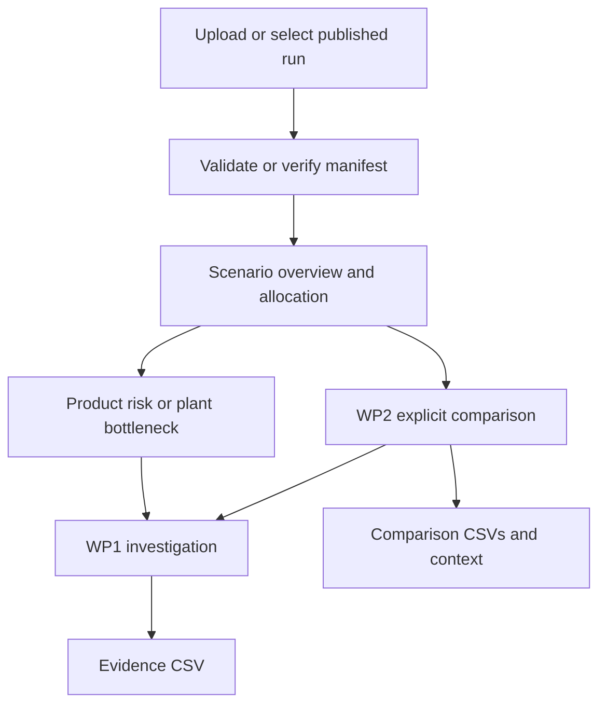

# 使用手冊 — 供應鏈規劃決策支援

**快速摘要：** 新資料走上傳→驗證→執行；既有結果走 Published Run→KPI／風險；需要證據走 WP1；需要兩情境取捨走 WP2。現有 UI 英文為主，沒有語言切換。下列均描述現有控制，未來功能會明示為提案。

2026-11-18 · [Capability Catalog](PRODUCT_CAPABILITY_CATALOG_ZH-TW.md) · [Other language](USER_GUIDE_EN.md)

- [1. 應用概觀與啟動](#u01)
- [2. 語言選擇：目前狀態](#u02)
- [3. 資料上傳](#u03)
- [4. 輸入驗證](#u04)
- [5. 執行 Planning Run](#u05)
- [6. 選擇 Published Run](#u06)
- [7. Scenario Overview](#u07)
- [8. Scenario Comparison](#u08)
- [9. Capacity Allocation Detail](#u09)
- [10. Planning Risk Summary](#u10)
- [11. Product Risk](#u11)
- [12. Plant Bottlenecks](#u12)
- [13. Root Cause Investigation](#u13)
- [14. Scenario Risk](#u14)
- [15. Scenario Trade-off Analysis](#u15)
- [16. Reference／Candidate 選擇](#u16)
- [17. 固定優先級 Cohort](#u17)
- [18. Comparability Status](#u18)
- [19. 證據檢視](#u19)
- [20. CSV 匯出](#u20)
- [21. 疑難排解](#u21)
- [22. 已知限制與驗收狀態](#u22)
- [五種端到端工作流](#workflows)
- [雙語詞彙表](#glossary)

<a id="u01"></a>

## U01 — 應用概觀與啟動

用途：以既有規則試算供需、工作負荷產能與庫存／欠單，查看風險、證據和情境取捨。先備：可讀寫此 repository 的 Python 環境，且已安裝 Pandas、NumPy、Streamlit；Plotly 用於部分 Legacy 圖表，為 optional。

1. 在 repository root 執行下列命令。
2. 開啟 terminal 顯示的 Local URL；預設通常為 http://localhost:8501，實際依該次啟動輸出。
3. 保持側欄 `Planning model = Sequential workload`。
4. 選新資料輸入或直接載入既有 Published Run。不需要為了看結果重新執行規劃。

```bash
python -B -m streamlit run dashboard/scenario_planning_app.py
```

先前驗收準備曾使用 8502；這不是固定網址，也不保證該服務永遠存在。若在遠端容器運行，使用環境提供的 port forwarding；不要把 localhost 視為遠端公開站台。

<a id="u02"></a>

## U02 — 語言選擇：目前狀態

**目前沒有 Language selector；介面主要為英文。** 本手冊中文解釋保留實際英文按鈕／欄位名稱供對照。

未來提案為 sidebar `Language / 語言`，支援 `zh-TW` 與 `en`，但尚未實作，不能依本手冊尋找此控制。語言切換只改顯示標籤，不改公式、IDs、欄名、Run／Scenario、證據或 CSV。詳見能力目錄第 12 節；開發須另行授權。

<a id="u03"></a>

## U03 — 資料上傳

1. 選 `Planning input → Upload CSV data`。
2. 選 `Demand file format = WEEKLY` 或 `ORDER_LINES`。
3. 上傳 Products、Plants、Product to plant mapping、Demand。展開 `Download CSV templates` 取得九種 header 範本；不能把 header-only 檔當有效需求資料。
4. 提供 Weekly workload capacity、Product workload factors、Initial inventory、Opening backlog、External receipts；若缺檔，須在 `Explicit assumptions for optional or missing inputs` 明示適用假設。Priority 可放 Products 或 Optional planning priorities，不能重複。
5. 在 `Column mapping` 對應 canonical 欄位至實際來源欄；選 `Source classification`。
6. 逐一將需求 Status 分為 Qualified 或 Excluded；若 WEEKLY 無 Status，勾選已合格需求聲明。

可先用 `examples/planning/user_data/` 的既有樣本（資料為示範，不保證真實）。其 products 欄為 sku/title/uom/rank、mapping 為 sku/site；不要不經 mapping 就假設符合 canonical 名稱。訂單格式需完整 coverage；source_is_complete 控制的 UI 可達性疑點見疑難排解。

**合成產能 UI 限制：** 校準 checkbox 雖存在，但 recipe 傳遞位置與 adapter 不一致（L11）；目前操作請提供 Weekly workload capacity CSV，或用 JSON 頂層 capacity_calibration。

<a id="u04"></a>

## U04 — 輸入驗證

1. 設 `First planning week (Sunday)` 與 `Last planning week (Sunday)`；首末均為週日，起點不晚於終點。
2. 設 `Demand interpretation`：USER_PROVIDED_PLAN 或 RETROSPECTIVE；系統不替你產生 forecast。
3. 填 `Input/assumption version`；確認 quantity unit、priority、factor／capacity unit。
4. 按 `Validate inputs`。讀 READY／BLOCKED、Errors、來源分類、假設與 unavailable capabilities。
5. BLOCKED 時修正輸入／映射／明示假設，再驗證。缺週要提供可信的零需求 row，不能只勾假設把未知變零。

READY_WITH_ASSUMPTIONS 是 capability 狀態，整體 report 仍是 READY。Validate inputs 在記憶體執行，不發布 Run。

<a id="u05"></a>

## U05 — 執行 Planning Run

1. 設 `Product quantity step (0 = continuous)`。
2. 設 `Demand surge scenario (%)`、`Capacity disruption scenario (%)`、`Plant(s) affected by capacity disruption`、`Shortage policy`。UI 四情境共用該 policy。
3. 確認 READY 後按 `Validate and run planning`；此按鈕會重新驗證，不以舊畫面視為保證。
4. 成功後記下 `Published run` 目錄／Run_ID，查看 manifest 與輸出。

替代流程：選 `Use existing JSON configuration`，在側欄填 `Sequential configuration JSON`，按 `Run sequential planning`。提供完整 JSON 設定，不修改 Python。此流程可定義額外情境／不同 policy／受影響週。每次執行產生新 Run；失敗不會把半成品標成 PUBLISHED。LOST_SALES 如有非零期初欠單會被阻擋。

<a id="u06"></a>

## U06 — 選擇 Published Run

1. 在側欄 `Published sequential run folder` 填含 run_manifest.json 的**單次 Run 目錄**，不是 CSV 或 parent folder。相對路徑以 repository root 為準。
2. 核對 Active results 的 Run_ID、Data_Mode、assumption version、interpretation。
3. 展開 `Active assumptions and planning scope`，核對 horizon、來源、假設及 limitations。
4. 在 `Sequential scenario` 選情境。

既有 USER_DATA 驗收 Run：
```text
tmp/user_data_acceptance_2026-11-17/runs/sequential_20261117T133913_e22d0f430e98
```
此 Run 有 Baseline、Demand_Surge、Capacity_Disruption、Combined_Stress、Combined_Stress_Lost_Sales。另一 SYNTHETIC_DEMO：
```text
tmp/planning_source_runs/sequential_20261117T130829_37d2418290d1
```
後者只有前四情境。這些 tmp 路徑是目前工作區既有資料，不保證在別人的 clone 存在；不能手動改 artifact 來修 hash。

<a id="u07"></a>

## U07 — Scenario Overview

1. 開啟 `Scenario Overview`。
2. 先看頁首五張 KPI 卡：Production Coverage Rate、Demand Fulfillment Rate、Capacity Utilization、Ending Backlog、Lost Sales Qty。
3. 觀察 Ending Inventory／Ending Backlog／Lost Sales 的週趨勢及當前 scenario 的 capacity pools。
4. 有短缺訊號時，進 Allocation Detail 或 Planning Risk Summary。

Stock 圖每點為當週 ending balance，不應加總跨週。Horizon fulfillment 可含延後補供；weekly fulfillment 僅當週 cohort。

<a id="u08"></a>

## U08 — Scenario Comparison

1. 開啟既有 `Scenario Comparison`。
2. 讀 scenario-level KPI summary，先核對 Backlog_Policy。
3. 需要固定 cohort、明確任意兩情境、status/reason 與匯出時，轉到 WP2 `Scenario Trade-off Analysis`。

這不是 WP2 同名別稱。既有 performance change 欄位通常只在同粒度同政策有 Baseline match 時才有值；Scenario Risk 又是另一個描述性 Baseline view。

<a id="u09"></a>

## U09 — Capacity Allocation Detail

1. 開啟 `Capacity Allocation Detail`。
2. 依日期、工廠、Allocation_Order 查看 priority、scenario demand、beginning stock/backlog、receipts、requirement、internal production、factor、workload、fulfilled、ending balances。
3. 對照共享 pool 看 production 是否受 capacity 或 pack step 影響。
4. 需要原始所有欄位時，下載 allocation CSV。

Sequential 頁不提供額外 plant 下拉篩選；不要套用 Legacy 頁操作說明。

<a id="u10"></a>

## U10 — Planning Risk Summary

1. 進 `Planning Risk Summary`。
2. 四個子頁為 Product Risk、Plant Bottlenecks、Root Cause Investigation、Scenario Risk。
3. 用產品風險找服務問題，用工廠瓶頸找共享 pool 壓力，再進 WP1 查看證據。

此分類無 composite risk score；missing 必填 risk 欄位時 view 會顯示 unavailable 訊息。不是 Control Tower PBIX 的 Service Risk Score。

<a id="u11"></a>

## U11 — Product Risk

1. 看 At Risk／Watch／Healthy 排序與 Risk_Reason。
2. 選 `Product drill-down`，讀產品五張 KPI 卡。
3. 按 `Investigate product`，再切到 `Root Cause Investigation`。

At Risk 可由當週 shortfall、期末 backlog、loss 或 horizon service<1 觸發；即使後來補供也可能保留當週風險。Watch 包含正需求且無期末庫存。風險類別不是缺貨機率。

<a id="u12"></a>

## U12 — Plant Bottlenecks

1. 看工廠 Bottleneck_Weeks、Unmet_Workload 與 utilization。
2. 選 `Plant drill-down`。
3. 查看 weekly pool 表、utilization bar chart 與 associated product workload 表。
4. 按 `Investigate plant`，切到 WP1，選週與產品。

瓶頸以未滿足工作負荷判斷，不是利用率達 100% 就一定瓶頸。產品負荷關聯不是他產品缺貨的因果責任。

<a id="u13"></a>

## U13 — Root Cause Investigation

1. 開 `Root Cause Investigation`。
2. `Investigation path` 選 Product → Plant → Week 或 Plant → Week → Product。
3. 依路徑選完整 key，核對 Run／Scenario／Plant／Product／Sunday。
4. 讀 Selected-week observations、Shared plant-week capacity、Observed together、Adjacent-week product trajectory、All products sharing the selected capacity pool。
5. 展開 Supporting Evidence 各表，必要時下載。

Adjacent weeks 僅前一週／選定週／下一週，不是完整 horizon。shared pool 表只有該工廠週一次；peers 保留 Allocation_Order。雖名根因調查，不能宣稱因果證明。

<a id="u14"></a>

## U14 — Scenario Risk

1. 在頁首選非 Baseline 的 `Sequential scenario`。
2. 進 `Scenario Risk`，看各情境及 Baseline delta。
3. 看最大產品／工廠惡化各前十筆與 policy changed 欄位。
4. 用 WP1 追查，而非僅按 delta 大小選方案。

此 view 為描述性 Baseline comparison，不提供 WP2 的 per-metric status gate；缺 Baseline match 時會提示無法比較。

<a id="u15"></a>

## U15 — Scenario Trade-off Analysis

1. 開 `Scenario Trade-off Analysis`。
2. 初次應顯示未選 Reference／Candidate 及未選 priorities。
3. 選比較雙方與 reference priorities，先看 Context／scope。
4. 看五項 summary：Horizon Service、Terminal Backlog、Lost Sales、Allocated Workload、Unmet Workload。
5. 展開 All Products／Selected Cohort／Complement，看完整十類 metric（含週服務）。
6. 讀 comparability reasons、capacity context、evidence，再匯出或開 WP1。

只有同一已發布 Run、完整 horizon；不觸發重跑、不推薦 winner。

<a id="u16"></a>

## U16 — Reference／Candidate 選擇

1. 在 `Reference Scenario` 選比較基準，在 `Candidate Scenario` 選另一個情境；兩者不會自動預選。
2. 同一情境不會出現在 Candidate 可選清單；改 Reference 後無效 Candidate 應清除。
3. Delta 永遠是 Candidate − Reference；服務差值為百分點。
4. 建議先試 Baseline → Combined_Stress；再試 Combined_Stress → Combined_Stress_Lost_Sales（僅有該情境的 USER_DATA Run）。

頁首 `Sequential scenario` 不等於 WP2 Reference。WP2 自己持有兩個選擇；切換 published Run 後重新確認。

<a id="u17"></a>

## U17 — 固定優先級 Cohort

1. 在 `Reference priorities (fixed cohort)` 選 1／2／3，可複選或留空。
2. 看 Reference Priority、Candidate Priority、Cohort Membership、Priority Changed。
3. ALL 是 scope 全部產品；SELECTED 用 Reference priority 固定成員；COMPLEMENT 為其餘。
4. 空 selection：SELECTED 為空／N/A，COMPLEMENT=ALL。全選：COMPLEMENT 為空／N/A。

在建議 USER_DATA Run 選 Priority 3，SELECTED=SKU-A；Priority 2=SKU-C；Priority 1=SKU-B/SKU-D。該 Run 各情境 priority 相同，change count 應為 0，不能用它測非零變更旗標。Candidate priority 改變不移動成員；若任一側 priority 無效，會標 unavailable／blocked。

<a id="u18"></a>

## U18 — Comparability Status

1. 展開 `Metric-level comparability reasons`。
2. COMPARABLE：資料及基礎相容，可按定義讀 delta。
3. DESCRIPTIVE_ONLY：政策／條件資料有差異；可有 delta，但必須讀原因。
4. BLOCKED：缺資料、空 cohort、零分母、coverage 或 unit／factor 不相容等；Delta=N/A，單側 values 可能仍存在。
5. 有 `POLICY_CONTRAST` 時，分開看服務、欠單、流失銷售；LOST_SALES 的零 backlog 不是服務改善證據。

不要把 N/A 當 0，或把比率相加來驗證 ALL=SELECTED+COMPLEMENT。只有可加總數量才可相加。

<a id="u19"></a>

## U19 — 證據檢視

1. WP1 展開 `Evidence: ...`、`Source provenance and assumptions`，讀 native rows 與 source_status。
2. WP2 展開 `Comparison evidence references`，查 artifact path、SHA256、Native_Grain、Key_Filter、Provenance。
3. 查 `Shared plant capacity pool context — counted once`；這是整個選中 pool，非 cohort utilization。
4. WP2 選 `Comparison product to investigate`，按 `Investigate Reference in WP1` 或 Candidate；再切 Planning Risk Summary → Root Cause Investigation。

原始暫存檔缺失可為正常；輸入記錄沒有 scenario 增量的虛構訂單。initial_state 是 horizon opening、performance evidence 是 plant-week、validation_result 是 run-level。

<a id="u20"></a>

## U20 — CSV 匯出

1. 頁首 `Published outputs` 可下載 KPI results、allocation detail、run manifest。
2. WP1 各 Evidence expander 的 Download 按鈕輸出該表與 Investigation_*、Evidence_Artifact。
3. WP2 下載 Comparison CSV、Comparison Cohort、Comparison Evidence References、Comparison Context 四檔。
4. 檢查 Comparison_ID、Reference／Candidate Run_ID 與 Scenario、Comparison_Context；metrics 額外帶 evidence／membership JSON。
5. 將字串 ID 欄設為文字後再用試算表匯入；保留英文 canonical 欄名。

WP2 N/A 會寫成 N/A；其他 CSV 缺值可為空。UI 語言未來切換也不應改 CSV bytes。沒有 XLSX、PDF 或打包下載。

<a id="u21"></a>

## U21 — 疑難排解

依下方排錯表處理。先記下操作、Run_ID、Scenario、完整錯誤；不要修改 published artifacts 或為了消除警示改業務數字。

| 症狀 | 處理與限制 |
| --- | --- |
| URL 無法開啟 | 確認 server 仍在執行、使用 terminal URL、埠未占用；遠端環境需 port forwarding。 |
| 找不到結果頁籤 | 先選 Sequential workload，再提供有效 Published sequential run folder；未載 Run 時會提早返回。 |
| BLOCKED／UNKNOWN coverage | 提供每個 item 每週明確需求或可信零值；訂單邊界週需完整資料；不要 fillna(0)。 |
| 無法勾 ORDER_LINES complete extract | 程式 checkbox 在 status_values 後的 elif；可能不可達。此為靜態疑點，尚未定向重現。可使用明確 JSON source_is_complete；不憑空聲明完整。 |
| 勾合成 capacity 仍 BLOCKED | UI recipe 存在 assumptions.capacity_calibration，adapter 讀頂層 capacity_calibration；此靜態介面差異尚未做執行重現。提供 capacity CSV，或改用合法頂層 JSON recipe；不要改 published outputs。 |
| 單位／factor／capacity 不相容 | 核對 Quantity_Unit、Workload_Unit、Factor_Version；不同 quantity units 要分 Run 或上游明示轉換。 |
| LOST_SALES 拒絕執行 | 非零 opening backlog 不可自動丟棄；確認業務政策，不要任意清零。 |
| hash／schema／identity 錯誤 | 確認目錄正確與 12 artifacts 完整；使用原始完整 Run 或合法重新執行，不修改 manifest hash 掩蓋差異。 |
| SELECTED 空／Delta N/A | 檢查 priority selection、zero denominator、coverage 與 Reason；這可能是正確語義，不是 UI 故障。 |
| Source_Status unavailable | 上傳暫存檔可已清除；用已驗證 published evidence，查 provenance，勿拿不同 raw file 取代。 |
| 按 Investigate 沒切頁 | 按鈕設定 selection context；自行切至 Planning Risk Summary → Root Cause Investigation。 |
| 日期解析／width warning | 已有相關警告紀錄；先確認畫面與數據是否正常，再回報具體缺陷，不修改 engine。 |

<a id="u22"></a>

## U22 — 已知限制與驗收狀態

目前功能有程式與 automated test 依據；最後保存的完整結果為 227 passed、0 failed、0 skipped，本次未重跑。瀏覽器視覺及功能驗收仍待使用者實際回報，不能因 health 200 或 AppTest 就聲稱通過。

限制：同 Run／完整 horizon、單產品單工廠、共同單位、產品 factor、固定 priority、capacity multiplier≤1；無 forecast、optimizer、BOM／lead-time、AI、ERP integration、HTTP business API、語言 selector。歷史 PBIX 功能不等於此 UI。未取得當前應用 screenshot，本手冊不使用示意圖冒充畫面。

[完整限制、公式與開發定位](PRODUCT_CAPABILITY_CATALOG_ZH-TW.md#section-11)

<a id="workflows"></a>

## 五種端到端工作流

以下五種工作流目前均有程式支援；不包含未來語言切換、跨 Run 或 AI 工作流。實際瀏覽器驗收仍未完成。

### Workflow A — 開始新的 Planning Run

| 項目 | 操作說明 |
| --- | --- |
| 入口 | Planning input → Upload CSV data |
| 必要輸入 | 四個必要檔、供給／capacity／factor 或明示假設、完整 horizon。 |
| 步驟 | 上傳→mapping→資格分類→週日／policy／scenarios→Validate inputs→解 BLOCKED→Validate and run planning。 |
| 輸出／依賴 | READY 後產生唯一 Run、12 CSV、manifest 與 results；F01–F16。 |
| 常見錯誤／限制 | 不要把缺週當零、把 assumed priority／capacity 當事實；LOST_SALES 不可帶非零 opening backlog。 UI 合成 capacity fallback 有 L11 限制，請提供 capacity CSV 或用 JSON。 |

### Workflow B — 分析既有情境

| 項目 | 操作說明 |
| --- | --- |
| 入口 | Published sequential run folder |
| 必要輸入 | 完整已發布 Run 目錄。 |
| 步驟 | 貼目錄→核對 active Run／mode／assumptions→選 Sequential scenario→看 Overview、Comparison、Allocation Detail。 |
| 輸出／依賴 | KPI cards、週趨勢、共享 pools 與 allocation；F15–F18。 |
| 常見錯誤／限制 | 不要選 parent folder 或單一 CSV；切換 Run 後重新核對情境。 |

### Workflow C — 調查供應鏈風險

| 項目 | 操作說明 |
| --- | --- |
| 入口 | Planning Risk Summary |
| 必要輸入 | 已載入 Run、scenario、產品或工廠。 |
| 步驟 | Product Risk／Plant Bottlenecks→drill-down→Investigate→切 Root Cause Investigation→選完整路徑→看 selected／adjacent／peers／evidence。 |
| 輸出／依賴 | 完整 key 下的觀察與 supporting evidence；F19–F22、F27。 |
| 常見錯誤／限制 | 共現不是因果；capacity pool 只計一次；來源 unavailable 不表示 published evidence 失效。 |

### Workflow D — 比較替代規劃情境

| 項目 | 操作說明 |
| --- | --- |
| 入口 | Scenario Trade-off Analysis |
| 必要輸入 | 同一 Run 的兩個不同 scenarios。 |
| 步驟 | 明選 Reference／Candidate→選 reference priorities→查 membership→看 ALL／SELECTED／COMPLEMENT→讀 status／reason／policy→需要時開 WP1。 |
| 輸出／依賴 | 逐 metric values／Delta、capacity context、evidence refs；F23–F28。 |
| 常見錯誤／限制 | 不可跨 Run／sub-horizon；空 cohort N/A；百分點非百分比變動；零 loss／backlog 不能單獨選 winner。 |

### Workflow E — 匯出與追溯

| 項目 | 操作說明 |
| --- | --- |
| 入口 | Published outputs／WP1 Evidence／WP2 downloads |
| 必要輸入 | 有效 Run 或 ComparisonResult／investigation selection。 |
| 步驟 | 下載 manifest 與 results→WP1 逐表 CSV→WP2 四檔→以 Run_ID／Comparison_ID／hash／native grain 對照。 |
| 輸出／依賴 | 可追溯的 CSV／JSON；F15、F27–F28。 |
| 常見錯誤／限制 | 保留字串 ID；勿因 UI 翻譯改欄名；evidence refs 不是原始資料封裝。 |



<a id="glossary"></a>

## 雙語詞彙表

| English | 繁體中文 |
| --- | --- |
| Supply Chain | 供應鏈 |
| Planning Engine | 規劃引擎 |
| Planning Decision Support | 規劃決策支援 |
| Scenario | 情境 |
| Reference Scenario | 參考情境 |
| Candidate Scenario | 候選情境 |
| Planning Horizon | 規劃期間 |
| Qualified Demand | 合格需求 |
| Scenario Qualified Demand | 情境合格需求 |
| Demand Eligibility | 需求資格 |
| Priority | 優先級 |
| Cohort | 產品群組 |
| Fixed Reference Priority Cohort | 固定參考優先級群組 |
| Complement | 補集群組 |
| Beginning Inventory | 期初庫存 |
| Ending Inventory | 期末庫存 |
| Opening Backlog | 期初欠單 |
| Terminal Backlog | 期末累積欠單 |
| Lost Sales | 流失銷售 |
| External Receipts | 外部到貨 |
| Required Production Quantity | 所需生產數量 |
| Workload | 工作負荷 |
| Workload Factor | 工作負荷係數 |
| Allocated Workload | 已分配工作負荷 |
| Unmet Workload | 未滿足工作負荷 |
| Capacity Utilization | 產能利用率 |
| Production Coverage Rate | 生產覆蓋率 |
| Demand Fulfillment Rate | 需求履約率 |
| Service Level | 服務水準 |
| Weekly Service Level | 每週服務水準 |
| Horizon Service Level | 規劃期間服務水準 |
| Risk Analysis | 風險分析 |
| Product Risk | 產品風險 |
| Plant Bottlenecks | 工廠瓶頸 |
| Root Cause Investigation | 根因調查 |
| Scenario Risk | 情境風險 |
| Trade-off Analysis | 取捨分析 |
| Comparability | 可比性 |
| Policy Contrast | 政策對照 |
| Evidence References | 證據參照 |
| Published Run | 已發布規劃執行 |
| Artifact | 產出檔 |
| Data Readiness | 資料就緒狀態 |
| Percentage Points | 百分點 |

技術識別值（例如 `Scenario`、`Product Card Id`、`CARRY_FORWARD`、`COMPARABLE`）保留原樣；中文是顯示／說明用語。

操作對照來源：[dashboard/scenario_planning_app.py](../dashboard/scenario_planning_app.py) — `main`; [dashboard/scenario_planning_app.py](../dashboard/scenario_planning_app.py) — `_user_csv_upload_workflow`; [dashboard/scenario_planning_app.py](../dashboard/scenario_planning_app.py) — `_sequential_views`; [dashboard/scenario_planning_app.py](../dashboard/scenario_planning_app.py) — `_planning_risk_summary`; [dashboard/scenario_planning_app.py](../dashboard/scenario_planning_app.py) — `_root_cause_investigation`; [dashboard/scenario_planning_app.py](../dashboard/scenario_planning_app.py) — `_scenario_tradeoff_analysis`
