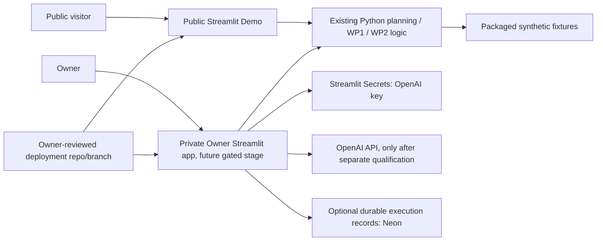

# Cloud-only architecture assessment

> **Owner decision update, 2026-11-25:** The recommendation below for a separate private Owner AI app has been superseded. The approved direction is **one existing Supply Chain Copilot Streamlit app**, with non-AI features available according to the app's access design and paid AI guarded by a backend-validated AI Access Password. No separate AI application is authorized. The original research is retained as historical option analysis; see [Stage 0–3 runtime architecture](CLOUD_RUNTIME_ARCHITECTURE.md).

Research date: 2026-11-25 UTC. Status: **recommendation for Owner review; no migration or deployment performed**. This document separates repository evidence from vendor documentation and design recommendations.

## Executive recommendation

Use **Streamlit Community Cloud only** for the first public, synthetic-data Demo. Keep the existing planning engine, WP1/WP2 analysis, validators, bilingual UI, and packaged fixtures. Publish a reviewed, minimal deployment source from the existing separate Demo repository. The public app must have **no OpenAI secret and no paid dispatch path**. If the Owner later needs live AI, prefer a **separate private Owner app** using Streamlit Secrets and a durable, narrowly scoped execution record store; qualify that feature before enabling it. Neon is the fallback persistence service if durable cross-session paid execution history is required. This avoids continuing the Windows/Container issuer design for a Cloud-only product.

This is a portfolio decision-support prototype, not a production APS or enterprise SaaS. The proposal preserves approved business rules. It does not imply that the current P5 paid workflow can be directly deployed to Community Cloud.

The private Owner app is a **design recommendation**, not an existing verified deployment. A single public app with a password gate is possible but exposes the paid code and secret to public app runtime, making mistakes in authorization or rate limiting more consequential.

## Recovered research and current evidence

| Prior conclusion or decision | Classification on 2026-11-25 | Evidence / qualification |
| --- | --- | --- |
| Streamlit Community Cloud is the intended low-cost Demo platform; free-tier sleep and ephemeral local storage are acceptable | Still valid | Owner decision; [Community Cloud](https://docs.streamlit.io/deploy/streamlit-community-cloud), [app management](https://docs.streamlit.io/deploy/streamlit-community-cloud/manage-your-app). |
| Local-first production, Windows-only credentials, Docker exchange and External P5 Issuer as the production path | Superseded | New Owner cloud-only direction. Existing code/tests remain historical assets. |
| 2026-11-19 report: no known App URL and `main=b29984919342d71c9bc8d3086805058886659cc2` with only acceptance docs | Outdated | Original remote `main` now `be425671b27918788dfcec0d39b2d221158cfef7` (read-only `git ls-remote`). Later deployment records identify a separate private Demo repo and URL. See [historical status report](STREAMLIT_DEPLOYMENT_STATUS_REPORT.md). |
| GitHub Deployments empty; Actions and checks zero for original repository | Still valid for the original repo at this check | Read-only public GitHub API returned zero. These endpoints do not establish Streamlit Cloud deployment state. |
| Separate Demo deployment repo exists | Already implemented, current remote state unresolved | [deployment record](UI_V1_2_1_DEPLOYMENT_REPORT.md) records private `rsm-chl307/SupplyChain-Control-Tower-Demo`, `main=281ac77ba0745c1ebea041fc8f347ade07b8b6b2` on 2026-11-20. Current private remote SHA could not be read without authentication. |
| Public URL and browser UAT | Unresolved | Existing URL `https://supplychain-control-tower-demo-ue5zgscfhjn7ujvlnxwqbs.streamlit.app/` returned unauthenticated HTTP 303 to `share.streamlit.io` on 2026-11-25; no authenticated App settings/logs/deployed SHA or public browser UAT evidence. The private-repo default is private, but current sharing setting is unverified. |
| Current development worktree is deployable | Unresolved / blocked | 142 Git status entries, including untracked deployment and P5 source. [Cloud preparation](STREAMLIT_CLOUD_PREPARATION.md) explicitly blocks its newer 75-file synthetic-only allowlist because it includes authorized P5 execution and Windows Runner paths. Do not push the development worktree wholesale. |

Earlier AI/P5 records referred to **P6 deployment / Cloud compatibility** as a future, separately authorized phase; they were not evidence of a completed Cloud migration. The Owner's new Cloud-only decision supersedes that local-first sequence. The current deployment documents and separate Demo repository show partial Cloud preparation, while the blocked newer source allowlist and missing public UAT show the remaining gap. The repository's unrelated `WP6_scenario_demonstration.md` is a planning-work-package document, not the P6 Cloud deployment phase.

Repository inspection found `dashboard/scenario_planning_app.py` as the Streamlit entrypoint, `dashboard/copilot_view.py` using `FakeProvider` for its visible copilot path, and `src/ai_copilot/provider.py` with `REAL_PROVIDER_DISPATCH_LOCKED=True`. An untracked `src/ai_copilot/credential_provider.py` has a `StreamlitSecretsCredential` adapter, but its presence is **not** Cloud paid-operation readiness. Root `requirements.txt` and `.streamlit/config.toml` are also untracked in this development repository. The current private deployment repository's latest contents and deployed SHA require Owner-side verification.

## Product and data scope

| Capability / data | Demo classification | Cloud treatment |
| --- | --- | --- |
| Scenario planning, allocation, KPIs, validation, risk and WP1/WP2 analysis | A: required public Demo | Reuse rule-based logic and current UI, with synthetic or user-uploaded data. Preserve approved formulas and blocking reasons. |
| Bilingual Guide, charts, CSV upload/download | A | Reuse existing entrypoint; browser UAT still required. |
| AI explanation/proposal preview with FakeProvider | A or E: useful, can be labeled synthetic | Clearly identify fake results; no paid endpoint. |
| Real Token Count and Generation | B: Owner-controlled only | Later qualified private mode, never anonymous public access. Current Windows-specific P5 path is not Cloud-ready. |
| Approved synthetic fixtures, lookup/reference CSV | D: static/read-only | Package a small allowlisted subset; do not ship `data/raw` (about 183 MB), `data/processed` (about 11 MB) or `tmp` (about 1.9 GB) wholesale. |
| Browser form choices and working scenario state | Temporary | `st.session_state` is per session, not durable; generated files must be downloadable. [Streamlit session state](https://docs.streamlit.io/develop/concepts/architecture/session-state). |
| User uploads and generated reports | C only if cross-session retention becomes required | For first Demo, process per session and provide download; avoid claiming durable retention. |
| Paid execution identity, UNKNOWN/HELD, usage, charge, audit | C if real AI is enabled | Require durable shared records before release; existing local SQLite files cannot be relied on across Community Cloud restarts. |
| Local Windows Worker, Task Scheduler, Credential Manager, Host/Container issuer IPC | E: defer/retire from Cloud runtime | Keep historical code/tests; do not deploy them as part of the public Demo. |

## Architecture comparison

| Option | Fit for public Demo | Main tradeoff |
| --- | --- | --- |
| A. Community Cloud only | **Best first release**. Existing Python UI and packaged synthetic data; no separate backend. | Local files/session state ephemeral. Paid execution needs a separate durability and abuse-control decision. |
| B. Community Cloud + Supabase | Useful if persistent user records, storage or built-in auth become requirements. | Adds service, schema, credentials and operations; free project can pause after inactivity. Not justified for static Demo. |
| C. Community Cloud + Neon | **Persistence fallback** for small PostgreSQL execution history; simpler DB-only scope than Supabase. | Adds DB code/migrations/connection security; free compute/transfer limits. Necessary only if persistent records are confirmed. |
| D. Community Cloud + lightweight object storage / external secrets | Useful only for a defined retention or separation requirement. | Extra service and permission surface; no concrete first-release benefit over packaged fixtures and Streamlit Secrets. |
| E. Cloud Run/AWS/Azure backend | Supports scheduled workers, stronger isolation and controlled backend access when needed. | Billing, deployment and operations complexity; no demonstrated need for the portfolio Demo. |

Costs and current vendor limits are in [cost comparison](CLOUD_COST_AND_FREE_TIER_COMPARISON.md). Community Cloud deployment requires a GitHub repository, branch and entrypoint; GitHub changes are reflected automatically, so production source review matters. [Deployment guide](https://docs.streamlit.io/deploy/streamlit-community-cloud/deploy-your-app/deploy).

## WP3.6 / WP3.6.2-A reuse decision

| Component | Decision for Cloud Demo | Reason |
| --- | --- | --- |
| Planning engine, scenario rules, validators, WP1/WP2, UI | Reuse unchanged where deployment-compatible | Product value and deterministic business truth. |
| ProviderRequest, payload serializer, token/evidence validation, digest tests | Reuse with adaptation | Keep identity/integrity checks for any Owner-only Cloud AI path; remove Windows file-exchange coupling. |
| FakeProvider and synthetic harness/tests | Reuse unchanged where possible | Safe public Demo and release checks. |
| P5 authorization, UNKNOWN/HELD, duplicate and cost checks | Refactor for one Cloud app plus durable store before paid use | Preserve invariants, simplify transport-specific machinery. |
| SQLite Ledger, Archive, campaign workflow | Refactor only if paid AI is in scope | Local file persistence is unsuitable as authoritative Community Cloud history. Keep existing tests/history. |
| Streamlit Secrets credential adapter | Reuse with review | Server-side Cloud secret lookup fits this deployment; no secret in repo. |
| Windows Runner, Credential Manager, Docker `cp`, Count Worker, External Issuer, host/issuer permits, formal PKI | Retire from Cloud runtime; retain code/history | Solves the old Host/Container boundary. Do not continue merely because investment exists. |
| Existing private deployment repo and manifest review | Reuse with adaptation | Valuable release boundary; current source version and public visibility must be revalidated. |

## Blocking facts and Owner decisions

1. **Public access and deployed SHA:** Owner must inspect the existing Streamlit App settings/build logs and current private deployment repo HEAD. The unauthenticated 303 is not public acceptance.
2. **Release source:** resolve the blocked 75-file allowlist without shipping P5 authorized dispatch; choose a reviewed public Demo source. No push/deploy in this phase.
3. **AI scope:** decide whether first public release has only synthetic/Fake AI, or a separate private Owner app is part of first release. Real paid AI requires additional implementation and separate dispatch authorization.
4. **Durability:** if paid AI is included, approve a durable execution store and retention policy. Recommend Neon only for that concrete need.
5. **Sharing/review:** Owner controls the deployment repository, production branch, Streamlit App settings and Secrets; no auto-deploy of Codex-authored changes without Owner review.

No Cloud source or infrastructure was changed during this assessment.
