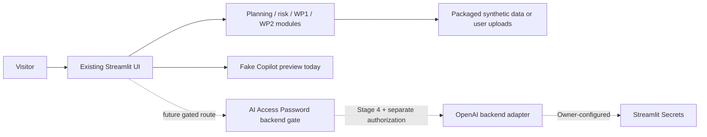

# Stage 2 — Cloud runtime architecture

Date: 2026-11-25 UTC. The **same existing Streamlit application** remains the product. No separate AI app or backend was introduced.

Current startup imports planning and FakeProvider functions but does not fetch `OPENAI_API_KEY`. A missing key must not block public planning or the synthetic preview. `src/ai_copilot/credential_provider.py` selects `streamlit_cloud` explicitly and fails closed with a sanitized `CredentialUnavailable` if no key is configured. There is no fallback to Windows credentials. The real provider dispatch lock remains on.

Generated planning runs are written under an OS temporary root with a random session-specific segment. Source fixtures/templates and locale files are read relative to the application package. Runtime output and `st.session_state` are ephemeral; users must download outputs they need. No authoritative paid Ledger or Archive is run in this Cloud foundation.

Cloud startup and browser rendering remain separate evidence: a local HTTP 200 health response does not prove all pages work on Community Cloud. [Runtime verification](CLOUD_RUNTIME_VERIFICATION_REPORT.md) records actual checks.
