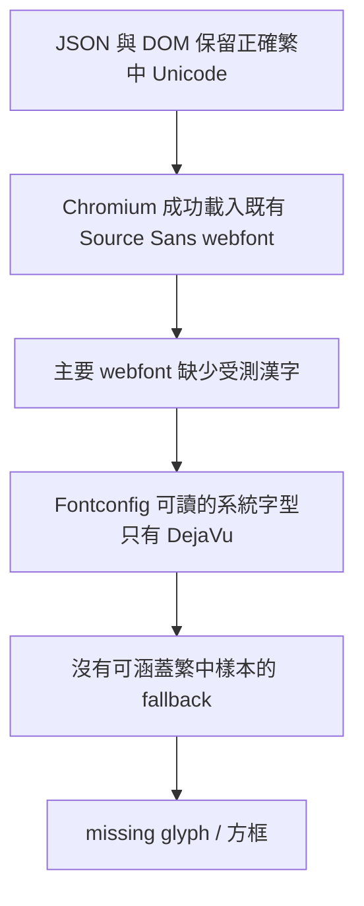

# Phase 2 — CJK Rendering 唯讀環境診斷

日期：2026-11-19 UTC
狀態：**已確認目前受測環境的根因；未執行修復。**
範圍：T32 繁體中文顯示方框。這不是 Phase 2 驗收重跑，也不改變既有 FAIL／PARTIAL 結果。

## 1. 診斷結論

問題發生在 **Chromium 所在容器沒有可供選用、能涵蓋繁體中文字形的字型／fallback**，而非目前已觀察到的翻譯字串、業務邏輯或 App CSS 覆寫問題。

| 目標問題 | 結論 | 信心與邊界 |
| --- | --- | --- |
| Chromium 是否缺少／無法使用繁中字型？ | 是。目前已配置字型無法提供樣本「繁體中文臺灣」的字形，瀏覽器只能選到沒有這些字形的 Source Sans／DejaVu | 系統字型實際 glyph index 與獨立 Chromium DevTools 字型選擇互相支持 |
| 系統是否已有可用 CJK 字型？ | 在 Fontconfig 實際載入的四個目錄內，只有 8 個 DejaVu TTF；未找到能涵蓋受測繁中字元的系統字型 | 不把磁碟任意未配置目錄、其他機器或未安裝套件算成可用字型 |
| 來自執行環境、瀏覽器還是 App？ | 根因層級是此自動化瀏覽器的執行環境／字形供應；Chromium 正常接收 Unicode 並載入 webfont，但沒有可用 CJK fallback | 不載入 App 的靜態頁也無法選到具有樣本字形的字型；沒有證據要求先修 App 或升級 Chromium |
| 最小風險修復？ | 在 Chromium 執行環境提供 CJK 字型，或改用已有繁中字型的受核准瀏覽器 | 原則上不需要修改 App Code；安裝字型屬環境變更，必須另行授權 |

重要修正：**沒有 fc-list，不等於沒有 Fontconfig runtime。** 本環境已安裝 libfontconfig1 與 fontconfig-config，設定能正常解析，字型目錄可讀；缺少的是 fontconfig 命令列工具套件和 CJK 字型資料。只安裝命令列工具不能補出中文字形。

## 2. 範圍、方法與既有證據

本次由 Main Agent 單獨執行，先讀取既有資料，再進行有限的環境探測：

1. Git／已存在檔案指紋及 Run 路徑基線。
2. 容器 OS、容器標記、已安裝套件、本機 APT metadata、Fontconfig 設定與字型檔案。
3. 以既有 FreeType C API 唯讀開啟字型，檢查實際 glyph index。
4. 以相同已安裝 Chromium 建立記憶體靜態 HTML，讀取 DOM Unicode、字型載入狀態與 DevTools CSS.getPlatformFontsForNode。
5. 唯讀檢查專案 CSS／Theme／翻譯檔及 Streamlit 附帶 CSS／webfonts。

**沒有造訪或操作 App、Planning、WP1、WP2、Run 或 Publication。** 靜態頁只使用內嵌字串與已存在的 Streamlit webfont data URL，不連線應用服務，也不下載外部字型。沒有保存新截圖、trace 或 raw evidence 檔；本次新診斷結果記錄在這一份報告。Chromium 僅使用自身管理的暫時 profile，診斷後關閉並清理；未啟停任何既有服務。

重用的 Phase 2 原始證據，均保持不變：

- [visual_readability.json](../../tmp/phase_2_ui/20261119T134451Z/reports/visual_readability.json)：既有 T32 字形方框紀錄，當時根因仍標為 likely。
- [WP2 繁中截圖](../../tmp/phase_2_ui/20261119T134451Z/browser_retry/screenshots/pair_zh.png)。
- [歷史模式繁中截圖](../../tmp/phase_2_ui/20261119T134451Z/browser_supplement/screenshots/legacy_zh.png)。
- [目前全域／配對繁中截圖](../../tmp/phase_2_ui/20261119T134451Z/browser_state/screenshots/global_pair_independent.png)。
- [Phase 2 整合報告](PHASE_2_FINAL_ACCEPTANCE_REPORT.md)及 [Phase 1 結案基線](../phase_1/PHASE_1_CLOSURE_AND_BASELINE.md)。

既有截圖證明實際 App 畫面有方框；本次新增的靜態頁與字型索引測量用來定位層級，不冒充重新執行的產品驗收。

## 3. Docker／Remote Container 環境

| 項目 | 實際讀取結果 |
| --- | --- |
| OS | Debian GNU/Linux 13 (trixie)，VERSION_ID=13，VERSION=13.4 |
| 容器標記 | /.dockerenv 存在；實際 browser 所在 namespace 的 PID 1 為 sleep |
| Remote Container | REMOTE_CONTAINERS 標記存在；僅檢查是否存在，未列印整份環境或認證 |
| Codespaces | CODESPACES 與 GITHUB_CODESPACES_PORT_FORWARDING_DOMAIN 標記未設定；不能斷言目前是 GitHub Codespaces |
| 執行 Python | /usr/local/bin/python3；應用／靜態資源位於 Python 3.10 site-packages |
| 專案容器設定 | repository（含 hidden 路徑）未找到 Dockerfile／devcontainer 設定檔；不能從本 repo 推定 base image ID 或外部 image 建置方式 |

Sandbox 內的 PID namespace 與實際瀏覽器 namespace 不同，因此另外在已授權的實際執行 namespace 唯讀核對 OS／字型資訊，避免以 sandbox 的程序清單推論 browser 狀態。兩邊讀取的 OS 與主要字型內容一致。

本次未查詢外部 Docker daemon／Cloud 控制台，也未調整容器、Dockerfile、Codespaces 或部署設定。

## 4. Fontconfig：runtime 可用，CLI 未安裝

已安裝套件（dpkg-query，實際狀態 ii）：

| 套件 | 版本 | 說明 |
| --- | --- | --- |
| libfontconfig1:amd64 | 2.15.0-2.3 | runtime library 已存在 |
| fontconfig-config | 2.15.0-2.3 | 字型設定已存在 |
| fonts-dejavu-core | 2.37-8 | 系統目前的字型資料 |

未安裝：fontconfig、fonts-noto-cjk、fonts-wqy-zenhei、fonts-arphic-uming。fc-list、fc-match、fc-query、fc-cache 均未找到。

/etc/fonts/fonts.conf 存在；conf.d 包含 generic／Latin／non-Latin fallback 等標準規則。透過 libfontconfig.so.1 的 FcInitLoadConfig 與 FcConfigGetFontDirs 成功解析出：

- /root/.local/share/fonts（不存在）
- /usr/local/share/fonts（沒有字型檔）
- /usr/share/fonts（8 個 DejaVu TTF）
- /root/.fonts（不存在）

這次 API 呼叫只載入設定與目錄清單，沒有呼叫 fc-cache 或修改設定。/var/cache/fontconfig 存在，含既有 cache 檔；「有 cache／fallback 規則」不代表安裝了 CJK 字型。

因此目前不是「Fontconfig 完全沒裝所以不能渲染」，而是可選的字型資料不含所需字形。命令列工具缺席只限制診斷便利性，不是這次方框的充分原因。

## 5. 字型檔案與字形覆蓋：實際量測

使用已存在的 libfreetype.so.6：FT_Init_FreeType → FT_New_Face → FT_Get_Char_Index；完成後釋放本程序 handle，不改字型或 cache。

受測字元：A、繁 U+7E41、體 U+9AD4、中 U+4E2D、文 U+6587、臺 U+81FA、灣 U+7063。

| 系統字型 | A glyph index | 六個繁中字元 glyph index |
| --- | --- | --- |
| DejaVuSans.ttf | 36 | 全部 0 |
| DejaVuSans-Bold.ttf | 36 | 全部 0 |
| DejaVuSansMono.ttf | 36 | 全部 0 |
| DejaVuSansMono-Bold.ttf | 36 | 全部 0 |
| DejaVuSansMono-Oblique.ttf | 36 | 全部 0 |
| DejaVuSansMono-BoldOblique.ttf | 36 | 全部 0 |
| DejaVuSerif.ttf | 36 | 全部 0 |
| DejaVuSerif-Bold.ttf | 36 | 全部 0 |

上述檔案均在 /usr/share/fonts/truetype/dejavu/。glyph index 0 表示該字元未對應到實際字形，將落入 missing glyph／.notdef；不是語言或字串已成功顯示的證據。另以既有 fontTools 檢查可讀的系統 TTF cmap，未找到基本漢字區段的字形。

進一步檢查 **74 個既有檔案**：8 個系統字型，以及 Streamlit 附帶的 66 個 TTF／WOFF／WOFF2 資源。FreeType 全部成功讀取（0 read errors）；沒有任何檔案提供這六個繁中字元的 glyph index。Source Sans／Source Serif／Source Code 的六個直體或斜體 variable webfonts，A 的 index 為 2，六個繁中字元全部為 0。

範圍限制：這是受測繁中字元的實證，不宣稱窮舉所有 Unicode 字元或任意未配置目錄中的字型。KaTeX／Material Symbols 資源也不能因為是 webfont 就當成可用繁中文字型。

診斷工具限制：最初用 fontTools 讀 WOFF2 時，其 Python Brotli 擴充不存在，部分讀取失敗；沒有安裝新套件。隨後改用既有 FreeType，74 個檔案全部成功讀取。**Python 工具缺少 Brotli 不等於 Chromium 不能解碼 WOFF2**；下一節也證明 Chromium 能成功載入 Source Sans webfont。

## 6. Chromium 靜態頁：不依賴 App 也找不到可用繁中 fallback

執行檔與 Phase 2 相同：

`tmp/wp2_browser_uat_phase_a/browsers/chromium_headless_shell-1255/chrome-headless-shell-linux64/chrome-headless-shell`

版本：**159.0.8154.6**。使用既有 Playwright venv。靜態 HTML 指定 UTF-8、lang=zh-TW，BrowserContext locale 為 zh-TW；只在此暫時診斷頁中設定，不改環境變數或 App 設定。將已存在的 SourceSansVF-Upright.ttf.BsWL4Kly.woff2 以 data URL 放入記憶體 @font-face，等待 document.fonts.ready。

結果：document.fonts.status = loaded；DOM textContent 正確保留「繁體中文臺灣」，codepoints 為 7e41 / 9ad4 / 4e2d / 6587 / 81fa / 7063，沒有變成 U+FFFD 或方框字元。

| 靜態頁樣本／CSS | DevTools 實際回報 family | Custom webfont | glyphCount |
| --- | --- | --- | --- |
| ABC；ProbeSourceSans, sans-serif | SourceSans3VF | true | 3 |
| 繁體中文臺灣；ProbeSourceSans, sans-serif | SourceSans3VF | true | 6 |
| 繁體中文臺灣；Noto Sans CJK TC, Noto Sans TC, sans-serif | DejaVu Sans | false | 6 |
| 繁體中文臺灣；serif | DejaVu Serif | false | 6 |
| 繁體中文臺灣；monospace | DejaVu Sans Mono | false | 6 |

注意：**DevTools glyphCount=6 不代表存在六個正確中文字形。** 它描述繪製所使用的 glyph 數；必須配合前節 glyph index=0 解讀。此處實際選中的所有字型都缺少樣本字形，無法提供正確繁中 fallback。

指定未安裝的 Noto 字型名稱，仍然 fallback 到 DejaVu；所以只在 CSS 加上 Noto 字型名稱，並不會憑空修復這個容器。lang=zh-TW、瀏覽器 locale 或 Chromium 的 locales 資源，也不會新增字形資料。

本次沒有從靜態頁保存新截圖；對實際 App 方框的視覺判定沿用第 2 節原始截圖。本次的新證據是相同引擎在獨立靜態頁的 Unicode、font-ready、實際選字型與字形覆蓋結果。

## 7. 專案 CSS、Theme、翻譯與 Streamlit 字型資源

檢查 [scenario_planning_app.py](../../dashboard/scenario_planning_app.py)、[i18n.py](../../dashboard/i18n.py)、[display_metadata.py](../../dashboard/display_metadata.py) 及 [zh-TW.json](../../dashboard/locales/zh-TW.json)：

- 未見自訂 font-family、注入 style、unsafe_allow_html 或 CJK 字型覆寫。
- st.set_page_config 只設定 page_title 與 layout，沒有指定字型。
- repo 未找到自有 CSS／HTML／Theme 檔；.streamlit/config.toml 不存在。
- /root/.streamlit/config.toml 不存在；未見這個使用者的 theme.font 覆寫。
- 原始翻譯字串正確，例如 side.reference=參考情境、side.candidate=候選情境、metric.Horizon_Service_Level.label=規劃期間服務水準；JSON 中是正確 Unicode，並非已寫入方框字元。

安裝的 Streamlit 標準 stylesheet：

`/usr/local/lib/python3.10/site-packages/streamlit/static/static/css/index.D5HInCXB.css`

其 @font-face 載入 Source Sans、Source Code Pro、Source Serif 的既有 WOFF2，與前節成功載入的資源一致。這些字型不含受測漢字，正常情況需要瀏覽器找到系統 CJK fallback。現在缺的是 fallback 字型，沒有證據顯示必須修改這份第三方 CSS 或 App Theme。

不將此結果擴大成「App 沒有任何其他 UI 問題」；結論限於目前方框的字形供應根因。也未登入／檢查其他主機、Cloud App 或所有使用者瀏覽器的字型設定。

## 8. 根因鏈與排除結果



| 假說 | 本次結果 |
| --- | --- |
| 翻譯 JSON／UTF-8 損壞 | 不支持；JSON 與獨立 DOM codepoints 正確 |
| App 自訂 CSS 強制排除 CJK fallback | 未找到此覆寫；獨立於 App 的 CSS 樣本同樣找不到合適字型 |
| Fontconfig runtime 不存在 | 排除；library/config 已安裝且設定 API 成功 |
| Chromium 不能載入任何 webfont／WOFF2 | 排除這個一般性說法；Source Sans WOFF2 正常載入並用於 Latin |
| 系統有 Noto，但 cache／CSS 選錯 | 在已配置目錄未找到 Noto；不能用 cache 重建修出不存在的字型 |
| 瀏覽器所在環境缺 CJK 字型 | 與套件、實際目錄、glyph index、DevTools 選字型及既有截圖一致；為已確認主因 |

這不是 Planning、WP1、WP2、KPI、Run 或資料契約問題；不需要以修改那些模組來處理。

## 9. 建議的最小修復方式（未執行）

### 方案 A：在自動化 Chromium 所在容器補足 CJK 字型

建議優先評估 Debian 套件 **fonts-noto-cjk**。本機 APT cache 顯示未安裝，candidate 為 1:20240730+repack1-1，Suggests 為 fonts-noto-cjk-extra；沒有在此次執行 apt update／install／remove 或下載。

未來經授權後的受控步驟：

1. 先檢視 package-manager simulation，確認只加入核准字型及必要項目，不升級／移除無關套件。
2. 安裝核准的 CJK 字型資料；不預設加入 extra 字重包、不升級 Chromium／Playwright／Streamlit，也不做全系統 upgrade。
3. 確認 Fontconfig 可發現 TC 字族與代表字元。若需要 fc-match／fc-cache，將 fontconfig CLI 的安裝或 cache 操作另列入明確授權；它不是目前缺字的替代修復。
4. 用全新的診斷 Chromium session 檢查代表字元／實際 font fallback，再做 T32 定向視覺驗證。不必重啟既有 Streamlit，也不必重跑完整 UAT、Planning 或產生新 Run。
5. 確認字形、glyph 對應與實際截圖後才判定修復成功。繁中字形地區差異可再以 zh-TW／TC 字族驗證；本次尚未做安裝後 A/B。

**需要修改 App Code 嗎？目前沒有必要。** 標準 fallback 有了實際 CJK 字型後才有可用字形。若日後還有個別文字被錯誤樣式限制，再針對有證據的 App 樣式調查；不先做全 App font-family 覆寫。

安裝字型會變更執行環境，因此本次不執行。若要在容器重建後持續可用，應由 owner 決定將依賴納入實際 image／devcontainer 管理；本 repo 未提供其建置設定，不能自行建立或假設修改位置。

### 方案 B：使用已具 CJK 字型的核准瀏覽器

若要先保留容器完全不變，可由 owner 指定一個已安裝繁中字型的瀏覽器環境做 T32。此方式不需要改 App 或目前容器，但不能據此宣告原本 headless 容器也已修復。

字型需求跟著**執行瀏覽器的機器**，不是只跟著 Streamlit server。遠端桌面瀏覽器可能使用自己 OS 的 CJK 字型；目前自動化 Chromium 則跑在這個只有 DejaVu 的容器。不要因此把所有終端使用者都判定為無法顯示中文，或盲目修改另一台 App server。

### 非優先／超出本次授權

在 App 內附帶完整 CJK webfont、外部字型 CDN、修改 Streamlit CSS／Theme、升級 Chromium／安裝新 framework，均不是目前主因所需的最小修復。這些涉及資源、設定或 App 範圍，須另行評估／授權。本次未嘗試。

## 10. 尚未確認與不可宣告事項

- 未安裝字型，沒有安裝前後 A/B；建議方案尚未通過實際修復驗證。
- 未識別外部 image ID／Docker build pipeline／Codespaces 設定來源。
- 本次未重新讀取 App 每個元件的 computed font-family；避免操作應用流程。專案覆寫以 source/config 檢查為據，靜態頁僅使用同一套引擎及既有 webfont 定位字形缺口。
- 未證明所有 Unicode/CJK Ext 字元的覆蓋，也未測試所有字重、所有區域字形。
- 未重跑 App／WP1／WP2／Planning，未新增產品 acceptance 覆蓋；T25 PARTIAL 與其他 Phase 1 限制原樣保留。
- 本次可確認字形資料缺口，不據此宣告所有未來圖表／第三方元件的字型選擇都不需要檢查。
- 未獨立驗證 Cloud／其他使用者桌面瀏覽器，不把此容器的結論擴大為所有部署環境。

## 11. 診斷命令與可重現方法

以下均為本次實際使用的唯讀檢查類型，沒有套件安裝或修復命令：

- git rev-parse HEAD、git status --short、git diff --cached --name-only。
- /etc/os-release、/.dockerenv、/proc/1/comm；僅讀取具名環境標記是否存在，未改環境變數。
- command -v fc-list / fc-match / fc-query / fc-cache；dpkg-query 查上述字型／Fontconfig 套件。
- apt-cache policy／depends／show fonts-noto-cjk 與 fontconfig：本機 metadata，沒有連線更新。
- 讀取 /etc/fonts/fonts.conf 與 conf.d；ctypes 呼叫 FcInitLoadConfig、FcConfigGetFontDirs。
- 既有 libfreetype.so.6 的 FT_New_Face／FT_Get_Char_Index，74 個既有字型檔。
- 相同 headless executable 的既有 Playwright + 記憶體 HTML；CSS.getPlatformFontsForNode、document.fonts.ready、textContent codepoints；沒有導航到應用 URL。
- rg --files --hidden 排除 .git／tmp，搜尋 Docker、devcontainer、CSS、HTML、TOML；檢查 App 的 font/theme/style/unsafe_allow_html 使用。

本次未新增診斷 script／JSON／圖片到既有 evidence 目錄；新結果以本報告保存。測量 JSON 的關鍵欄位與值如下（直接來自靜態頁輸出，省略重複列）：

```json
{
  "browser_version": "159.0.8154.6",
  "static_page_only": true,
  "visited_application": false,
  "network_requests_to_app": 0,
  "font_ready": "loaded",
  "rows": [
    {
      "id": "latin",
      "text": "ABC",
      "fontFamily": "ProbeSourceSans, sans-serif",
      "codepoints": [
        "41",
        "42",
        "43"
      ],
      "platformFonts": [
        {
          "familyName": "SourceSans3VF",
          "postScriptName": "SourceSans3VF-ExtraLight",
          "isCustomFont": true,
          "glyphCount": 3
        }
      ]
    },
    {
      "id": "named",
      "text": "繁體中文臺灣",
      "fontFamily": "\"Noto Sans CJK TC\", \"Noto Sans TC\", sans-serif",
      "codepoints": [
        "7e41",
        "9ad4",
        "4e2d",
        "6587",
        "81fa",
        "7063"
      ],
      "platformFonts": [
        {
          "familyName": "DejaVu Sans",
          "postScriptName": "DejaVuSans",
          "isCustomFont": false,
          "glyphCount": 6
        }
      ]
    }
  ]
}
```

## 12. Git 與既有資料保護

開始時 HEAD：4674e8bba3551894de0f9e9ea8d60a7e6ce5e0cf；branch：main；index 為空。工作樹仍 dirty，完整開始狀態如下。這些都是既有內容，不是本次新修改：

```text
 M ai_agent_implementation_spec.md
 M dashboard/scenario_planning_app.py
 M docs/PRODUCT_CAPABILITY_CATALOG_EN.md
 M docs/PRODUCT_CAPABILITY_CATALOG_ZH-TW.md
 M docs/USER_GUIDE_EN.md
 M docs/USER_GUIDE_ZH-TW.md
 M docs/planning_csv_inputs.md
 M docs/scenario_planning/dashboard_design_proposal.md
 M docs/scenario_planning/developer_notes.md
 M docs/scenario_planning/project_journal.md
 M src/__pycache__/allocation_engine.cpython-310.pyc
 M src/__pycache__/allocation_manager.cpython-310.pyc
 M src/__pycache__/allocation_validator.cpython-310.pyc
 M src/__pycache__/kpi_engine.cpython-310.pyc
 M src/__pycache__/performance_evaluator.cpython-310.pyc
 M src/__pycache__/performance_manager.cpython-310.pyc
 M src/__pycache__/planning_pipeline.cpython-310.pyc
 M src/__pycache__/planning_snapshot.cpython-310.pyc
 M src/__pycache__/run_planning.cpython-310.pyc
 M src/__pycache__/scenario_generator.cpython-310.pyc
?? dashboard/display_metadata.py
?? dashboard/i18n.py
?? dashboard/locales/
?? docs/phase_1/PHASE_1_USAGE_CONSUMPTION_FORENSIC_REPORT.md
?? docs/phase_2/PHASE_2_EXECUTION_LOG.md
?? docs/phase_2/PHASE_2_FINAL_ACCEPTANCE_REPORT.md
?? docs/phase_2/PHASE_2_IMPLEMENTATION_SPECIFICATION.md
?? docs/phase_2/PHASE_2_INVENTORY_AND_INVARIANTS.md
?? scripts/phase2_browser_acceptance.py
?? scripts/phase2_safe_regression.py
?? tests/test_phase2_display.py
?? tests/test_phase2_i18n.py
?? tests/test_phase2_workflow.py
```

唯讀指紋基線包含 **996 個既有檔案**：Git 可見專案檔、53 個 Run manifest 路徑所屬資料夾的既有檔案，以及整個 Phase 2 evidence root 的既有檔案。該 evidence root 包含原始報告、截圖、trace、CSV 與測試 logs。

新增本報告前已獨立重新雜湊並確認 996 個檔案全部未變，Git status／index 亦相同。報告建立後的最終比對另記於下方。這是內容完整性核對，不是重跑歷史測試或重新接受 T32。

**結束邊界：只完成診斷及新增本報告，未修復任何環境或 App。等待 owner 選擇下一步並另行授權。**

### 最終完整性核對

- 996 個既有檔案指紋與開始基線完全相同，包含原有程式／文件／未提交內容、Run 檔案及完整既有 Phase 2 Evidence。
- 53 個 Run manifest 路徑清單完全相同；未建立、修改、發布或刪除 Run。
- HEAD 前後均為 4674e8bba3551894de0f9e9ea8d60a7e6ce5e0cf，branch main，index 仍為空。
- 原 Git status 逐項保留，唯一新增為本報告；工作樹仍 dirty，沒有 reset／clean／restore／stash／stage／commit／push。
- 未安裝／移除套件或字型，未改 App／Docker／Theme／環境變數／服務設定；未啟停既有服務。
- 本報告的相對連結、code fences、行尾空白及 git diff --check 已檢查。未重新執行任何 Phase 2 驗收測試或修復。
