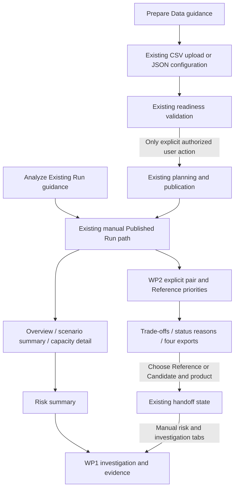
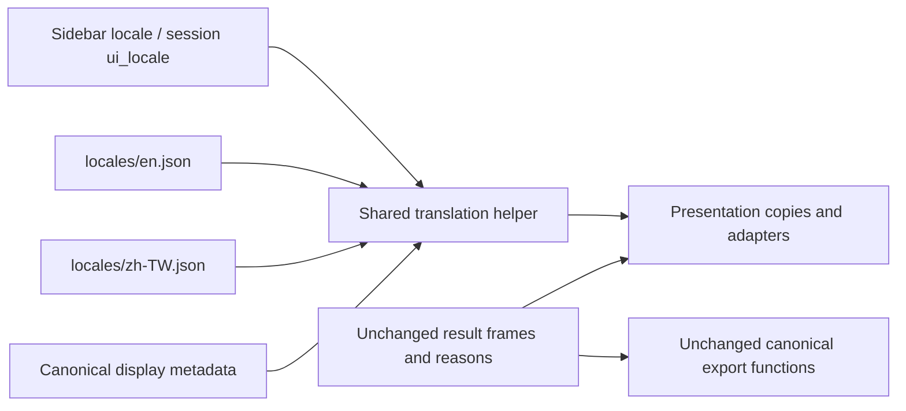
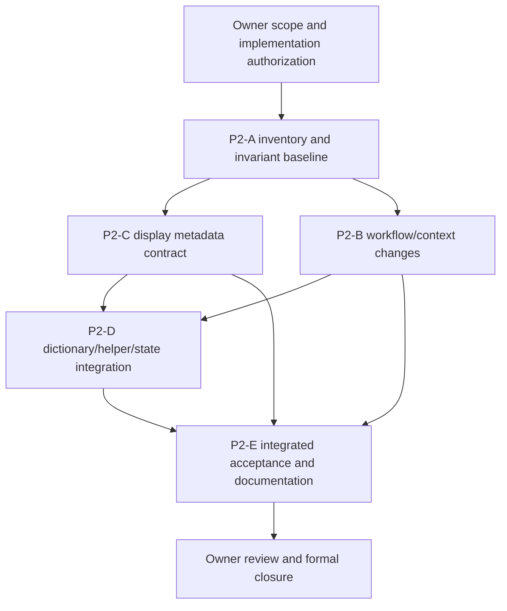

# Phase 2 Implementation Specification

Version 1.1 — 2026-11-19 UTC

**Status: OWNER-AUTHORIZED FOR INTEGRATED IMPLEMENTATION — P2-A THROUGH P2-E**

### Version history

- **1.0:** original planning-only specification; preserved byte-for-byte at [tmp/phase_2_ui/20261119T134451Z/baseline/PHASE_2_SPECIFICATION_V1_0.md](../../tmp/phase_2_ui/20261119T134451Z/baseline/PHASE_2_SPECIFICATION_V1_0.md). Its historical authoring record remains below; authorization language is superseded by v1.1.
- **1.1:** owner authorizes all P2-A–E as one integrated task. P2-A is internal definition/inventory, not a separate approval gate. Internal tests/checkpoints remain mandatory; one consolidated final owner review. Technical invariants and Phase 1 limitations unchanged. No Run Picker, automatic tab activation, new task routing, commit, push or deployment.

The owner authorization in section 16 governs all prospective implementation language in this document. Statements in the preserved v1.0 authoring record describe that earlier task only.

## Contents

1. [Executive Summary](#1-executive-summary)
2. [Scope and Design Principles](#2-scope-and-design-principles)
3. [Current Architecture and Reusable Capabilities](#3-current-architecture-and-reusable-capabilities)
4. [User Journey and Workflow Definition](#4-user-journey-and-workflow-definition)
5. [P2-A Definition and Invariant Baseline](#5-p2-a-definition-and-invariant-baseline)
6. [P2-B Workflow and Context Clarity](#6-p2-b-workflow-and-context-clarity)
7. [P2-C Consistent Display and Metric Help](#7-p2-c-consistent-display-and-metric-help)
8. [P2-D Bilingual UI Architecture](#8-p2-d-bilingual-ui-architecture)
9. [P2-E Documentation and Acceptance](#9-p2-e-documentation-and-acceptance)
10. [File-level Change Plan](#10-file-level-change-plan)
11. [Work Package Dependencies and Execution Sequence](#11-work-package-dependencies-and-execution-sequence)
12. [Regression and Data Integrity Safeguards](#12-regression-and-data-integrity-safeguards)
13. [Testing and Evidence Strategy](#13-testing-and-evidence-strategy)
14. [Acceptance Criteria](#14-acceptance-criteria)
15. [Risks and Open Decisions](#15-risks-and-open-decisions)
16. [Explicit Implementation Authorization Boundary](#16-explicit-implementation-authorization-boundary)

## 1. Executive Summary

Phase 2 improves users' ability to prepare planning data, inspect an existing Published Run, investigate risk in WP1, and interpret WP2 scenario trade-offs. Reuse accepted Planning/WP1/WP2 calculations and workflows. The proposed changes are presentation, terminology, guidance, language state, documentation and bounded acceptance work. No new planning capability, simulation, recommendation engine or architecture replacement is proposed.

This document converts the [Read-only Product Assessment](PHASE_2_READ_ONLY_PRODUCT_ASSESSMENT.md), especially F01–F11 and proposed packages P2-A–E, into an implementation contract. Assessment evidence distinguishes current source facts from inferred usability risks; no user-completion-time, accessibility or performance study was performed. The [Phase 1 Closure and Baseline](../phase_1/PHASE_1_CLOSURE_AND_BASELINE.md) is the formal accepted behavioral baseline, PASS WITH LIMITATIONS. Its deferred items remain deferred.

**Authorized core:** define invariants/state → clarify existing task/context guidance → consistent metric/status display → centralized en/zh-TW presentation as authorized → targeted acceptance/documentation. Run discovery, automatic tab activation, new task routing and WP1-to-WP2 pair seeding are optional decisions, not assumed scope.

Completion requires explicit results at every applicable acceptance gate, real-browser state/translation evidence, unchanged calculation/export contracts and an honest limitations register. This specification defines tests rather than storing results. Version 1.0 authoring executed none; v1.1 execution outcomes are recorded in PHASE_2_FINAL_ACCEPTANCE_REPORT.md. The owner has now separately authorized integrated implementation; proceed through internal package checkpoints without interim owner review.

## 2. Scope and Design Principles

### 2.1 Actual authoring baseline

| Item | Verified current repository state |
| --- | --- |
| Root | /workspace/SupplyChain_Control_Tower_DataCo |
| Branch | main |
| HEAD | 4674e8bba3551894de0f9e9ea8d60a7e6ce5e0cf |
| Index before authoring | Empty |
| Tracked modifications | Ten existing src/__pycache__/*.pyc files; preserved |
| Existing untracked content | docs/phase_1/PHASE_1_USAGE_CONSUMPTION_FORENSIC_REPORT.md; preserved |
| Source relationship to HEAD | Current application/source/test/specification text is tracked after the synchronization commit; do not mistake the historical assessment's pre-sync dirty state for today's status |
| Filesystem Run registry | 53 run_manifest.json paths observed read-only; no semantic Run revalidation or planning was performed |
| Authoring protection inventory | 200 existing Git-visible paths; 881 total file fingerprints including files adjacent to Run manifests and four principal Phase 1 evidence JSONs |

The historical closure's HEAD b299849… and dirty source attribution remain valid historical records. This newer synchronized HEAD is an authoring reference, not a change to Phase 1 acceptance criteria. Future execution must snapshot the then-current working tree again; it may differ. Do not reset, stash, discard or overwrite pre-existing changes to establish a clean baseline.

### 2.2 Design rules

- Describe modeled outcomes; do not imply causal proof, operational certification or an optimal action.
- Change labels/help/display copies only; backend outputs remain the source of truth.
- Preserve existing defaults and selection policies unless this specification explicitly states an approved presentation-state requirement.
- Prefer guidance and context over replacing tabs, adding routes or restructuring engines.
- Keep UI identity independent of translated text. Locale changes must not act as data changes.
- Use existing Streamlit/Python facilities; no dependency, deployment or service change is assumed.
- Keep relative effort Low/Medium/High. Estimates include validation complexity, not fixed person-days.
- Treat this Phase 2 separately from historical Route B Stage 2/WP2 Demand and Capacity. Accepted WP1 here means Root Cause Investigation.

### 2.3 Excluded throughout

No engine/formula/allocation/cohort/policy change, cross-Run comparison, new scenario execution controls, new fixtures to close Phase 1 negative E2E gaps, new Runs/publication, causal scoring, automatic winner, AI, forecasting, optimization, HTTP API, PBIX redesign, caching/export optimization, infrastructure or dependency change. No repair/suppression of Phase 1 toolbar/Vega observations. No Git action is authorized by this specification task.

## 3. Current Architecture and Reusable Capabilities

All references below are existing files; names in section 10 marked New are proposals only.

| Existing layer | Reusable implementation | Protection / proposed presentation seam |
| --- | --- | --- |
| Streamlit shell | [dashboard/scenario_planning_app.py](../../dashboard/scenario_planning_app.py): main, _run_controls, _sequential_views | Keep Sequential workload and Legacy independent weeks; shared shell/labels under one integration owner |
| CSV intake | Same file: _user_csv_upload_workflow, _render_column_mapping, _render_readiness_report, _capture_user_upload_state, _restore_user_upload_state | Keep nine templates, validation/run separation, canonical mappings, assumptions and retained bytes |
| Canonical preparation | [csv_planning_inputs.py](../../src/csv_planning_inputs.py), [planning_inputs.py](../../src/planning_inputs.py), [demand_preparation.py](../../src/demand_preparation.py), [workload_model.py](../../src/workload_model.py) | Inspect schemas/messages; no implementation changes |
| Execution/publication | [run_planning.py](../../src/run_planning.py): run_csv_planning, run_sequential_planning; [sequential_planner.py](../../src/sequential_planner.py), [inventory_engine.py](../../src/inventory_engine.py), [allocation_engine.py](../../src/allocation_engine.py), [sequential_validator.py](../../src/sequential_validator.py) | Reuse existing runner boundaries; do not execute to obtain translation coverage |
| Metrics | [kpi_engine.py](../../src/kpi_engine.py): calculate_sequential_kpis and legacy calculate path | Read-only definition reference; no calculation moves into UI helpers |
| Published loader | Dashboard load_sequential_outputs | Preserve successful/published/schema/shape/hash/identity checks; loader error display may receive a surrounding localized summary, not altered rejection behavior |
| WP1 | Dashboard _planning_risk_summary, _root_cause_investigation, _investigation_select; [planning_risk.py](../../src/planning_risk.py): investigation_views, filter_investigation_evidence, investigation_evidence_csv | Separate native tables, full keys, peer order, adjacent calendar weeks and unique pool preserved |
| WP2 | Dashboard _scenario_tradeoff_analysis, _comparison_display; [scenario_comparison.py](../../src/scenario_comparison.py): ComparisonInput/Scope/Result, compare_published_results | Existing pure comparison/validation unchanged; translated presentation must not feed back into inputs |
| Handoff | Dashboard _comparison_investigation_entry | Explicit side/product → existing WP1 state; manual tab navigation retained by default |
| Export | [comparison_io.py](../../src/comparison_io.py): comparison_csv_exports; WP1 investigation_evidence_csv | Preserve canonical frame/schema/context/bytes and existing filenames |

There is no need for a second planner, duplicated KPI logic, new loader, independent comparison service or external HTTP API. The IO loader currently imports the dashboard loader locally; do not turn this presentation phase into a coupling refactor.

## 4. User Journey and Workflow Definition

| Journey | Entry, user actions and outcome | Required boundary |
| --- | --- | --- |
| J1 Prepare Data | Identify required datasets, upload/map or select JSON; inspect qualification, horizon, assumptions; Validate inputs | Analysis instructions do not execute planning; no new assumptions/defaults; existing run buttons remain explicit separate actions |
| J2 Analyze Existing Run | Enter existing folder; loader accepts/rejects; inspect Run/data mode/assumptions and global scenario | No upload or planning required; manual path remains available; blank/invalid path never shows stale results/exports |
| J3 Investigate | From Product Risk or Plant Bottlenecks, choose entity; open Root Cause Investigation; refine product/plant/week | Both existing paths and published native evidence remain; label/help changes do not reset valid selections |
| J4 Compare | Select explicit different Reference/Candidate in active Run, optionally choose Reference priorities; inspect membership and three groups | No implicit pair from global scenario; empty priorities mean empty SELECTED, not “all priorities” |
| J5 Compare → investigate | Choose product and side; existing callback sets WP1 scenario/product and clears dependent selections; follow destination guidance | No automatic tab activation by default; Reference/Candidate direction and cohort remain intact |
| J6 Export | Download Published outputs, native WP1 tables or four WP2 CSVs | Identify export family/grain/context; translate instructions only, never filenames/headers/serialized values |
| J7 Change language | Switch en ↔ zh-TW in same browser session, continue current journey | Preserve uploaded bytes/mappings, active path, global scenario, pair/cohort/product and valid WP1 selections; no runner calls |

### Context rules

1. One active validated Published Run supplies analysis. Show its exact Run_ID, data mode and available assumption/interpretation context. Keep original source/provenance caveats; missing metadata is Unavailable, not invented.
2. Global Sequential scenario governs overview, capacity and risk/WP1. WP2 Reference/Candidate are independent. Show both scopes near the relevant controls and handoff; do not label global scenario as “the Reference.”
3. Run display name, Scenario display description, Product Name and translated labels must never replace their identifiers. Show canonical values beside translated descriptions or in clearly available technical details.
4. Handoff intentionally changes global scenario to the selected comparison side. This is an existing contract, not a state-preservation failure. Current WP1 plant/week defaults are preserved; do not invent transfer of a WP2 week when none was selected.
5. No automatic WP1 → WP2 pair/cohort selection; no comparison-scope narrowing from a global scenario/product/plant filter.
6. Analysis-only actions (tab, language, filters, loading existing Run, comparison and downloads) must not invoke Planning or publication. Existing explicitly invoked planning functionality remains unchanged and is not exercised in this phase's default acceptance plan.

## 5. P2-A Definition and Invariant Baseline

| Required field | Implementation plan |
| --- | --- |
| Business objective | Establish one approved meaning/state/contract baseline before presentation changes |
| User problem | Ambiguous task, scenario and metric terms can obscure existing valid workflows; labels currently influence widget identity |
| Reuse | Assessment F01–F11, Phase 1 closure, WP2 v1.0, current widget/upload state and canonical schemas |
| Files | Inspect dashboard, comparison_io, scenario_comparison, planning_risk, kpi_engine, planning_inputs and relevant tests; propose new dashboard/display_metadata.py and tests/test_phase2_display.py; no backend edits |
| Changes/boundaries | Inventory every user-facing literal, control identity, displayed field/status and message family; specify display metadata/state ownership; prepare exact future edit/test allowlist |
| Dependencies/order | First package within the integrated authorization; OD01–OD09 approved below; implement their stated boundaries |
| Invariants | Section 12 INV01–INV13; capture raw values/CSV baselines before display adaptation |
| Regression risks | Treating historical names as current requirements, incomplete diagnostic inventory, overlooking unkeyed widgets or setup side effects |
| Test cases | T01 contract map coverage; T02 protected-input snapshots; T03 no-planning guard; expected no mutation and zero runner calls |
| Acceptance | Every touched UI surface has canonical identity, display key, locale/state owner, export boundary and test mapping; no unresolved business-rule decision hidden in copy |
| Effort | Medium |
| Exclusions | No architecture redesign, new schemas, refreshed Phase 1 acceptance, baseline cleanup or new negative-data fixtures |

P2-A inventory rows must contain: function/surface, literal or canonical field, translation/display key, en and zh-TW wording, units/precision, widget key if applicable, raw-data ownership, machine/export representation, diagnostic policy and test ID. Unknown definitions block that row for review; do not invent formulas or translate raw source values.

## 6. P2-B Workflow and Context Clarity

| Required field | Implementation plan |
| --- | --- |
| Business objective | Make existing Run → result → investigation → comparison journeys discoverable |
| User problem | Manual path loading, nested destination and overlapping comparison labels; correct independent scenarios can look inconsistent |
| Reuse | main, _sequential_views, _planning_risk_summary, _root_cause_investigation, _scenario_tradeoff_analysis, _comparison_investigation_entry |
| Files | Dashboard shared edit only; display_metadata/i18n keys coordinated with C/D; tests/test_phase2_workflow.py; scripts/phase2_browser_acceptance.py proposed for E |
| Changes/boundaries | Clearly titled Prepare Data / Analyze Existing Run guidance around existing controls; known folder syntax/Published validation instructions; purpose help for each view; adjacent Run/global scenario/pair/product context; destination instruction after handoff |
| Dependencies/order | A internally complete; use C metadata and D key conventions even if English lands first; integrate shared dashboard edits sequentially |
| Invariants | No default-pair creation, automatic cohort/global-scenario coupling or implicit planning; handoff keeps original side/product callback semantics |
| Regression risks | Removing widgets while hiding panels, relabeling unkeyed controls, stale path/result banners, incorrectly asserting the WP1 destination is already active |
| Test cases | T04–T10 workflow/context; T11–T15 selection/state; T26–T28 WP1/handoff; no new planning or invalid stale export |
| Acceptance | Users can identify preparation versus existing-result steps and both comparison scopes; handoff provides accurate destination instructions and correct visible WP1 identity |
| Effort | Medium |
| Exclusions | New Run Picker, automatic tab switching, replacement of tabs, task-mode routing, WP1 → WP2 pair seeding, new data filters/scenario controls |

### Core interaction details

- Keep the current input method options and existing valid defaults. The minimum design is headings, captions/help and context blocks within the current layout; do not conditionally unmount existing upload widgets merely to create a task switch.
- Keep existing tab concepts and their canonical roles. Proposed visible descriptions: Scenario Overview = selected scenario trend/pool view; Scenario Comparison = multi-scenario KPI summary; Scenario Trade-off Analysis = explicit two-scenario/cohort comparison. Translate descriptions without merging functions.
- Existing manual folder input remains the supported Run loading mechanism. Explain that only successful published sequential_v1 results pass the loader. Do not auto-select a historical test Run or fabricate a default Run.
- Context blocks derive only from already loaded manifest/session/comparison context. Show empty pair as “Not selected”; no suggested scenario is silently applied. Mark global scenario versus comparison pair explicitly.
- Keep handoff buttons disabled until a product is selected. After invocation, show chosen side, canonical scenario/product and the manual path Planning Risk Summary → Root Cause Investigation; do not show a success message claiming tab activation.

### Separate optional decisions — not core implementation

| Option | Benefit / cost | Prerequisite and default disposition |
| --- | --- | --- |
| O-B1 Bounded Run Picker | Easier discovery; introduces scan scope, validation and stale-candidate handling | OD06 APPROVED: excluded. No discovery implementation in this phase; manual path remains |
| O-B2 Automatic tab activation | Fewer clicks after handoff; depends on actual installed Streamlit tab control and focus/state behavior | OD07 APPROVED: excluded. Manual tab navigation and guidance only; no dependency/DOM workaround |
| O-B3 Prepare/Analyze task selector | Clearer landing modes; may unmount widgets and lose upload state | Excluded under approved OD06 and current scope. Existing controls remain mounted; no new routing |

If an optional item is not approved, record it as OUT OF SCOPE, not PASS or a required missing feature. Do not implement it indirectly through another package.

## 7. P2-C Consistent Display and Metric Help

| Required field | Implementation plan |
| --- | --- |
| Business objective | Explain existing outcomes consistently without altering meaning or values |
| User problem | Raw headings, mixed ratio/quantity units and duplicate comparison concepts require technical interpretation |
| Reuse | Existing result DataFrames, captions, _comparison_display, _render_kpi_cards, published Unit/Delta_Unit/Fulfillment_Basis, comparison status/reason fields |
| Files | New dashboard/display_metadata.py; dashboard presentation-only edits; tests/test_phase2_display.py; inspect kpi_engine/scenario_comparison as authoritative read-only sources |
| Changes/boundaries | Stable metadata registry keyed by canonical model/metric/status/column IDs; labels, help, grain/unit descriptions and display formatting; technical-details view retains original IDs/reasons |
| Dependencies/order | A internal inventory; define metadata before D translates it; B consumes the same vocabulary |
| Invariants | Raw numeric values/frames unmodified, canonical columns/statuses retained, no new metric, aggregation, denominator policy or preferred action |
| Regression risks | Double converting percentage-point Delta; confusing horizon with weekly fulfillment or legacy meanings; formatting evidence twice; treating zero as missing |
| Test cases | T16–T21 formats/status/cohort/policy; T29–T31 data/export invariance |
| Acceptance | Every displayed metric has correct basis/unit/help; N/A is distinct from zero and status; canonical identifiers/reasons remain accessible; exports unchanged |
| Effort | Medium |
| Exclusions | Formula/threshold/scoring changes, custom performance optimization, CSV compression/schema change or reduced evidence |

### Display metadata contract

Proposed display_metadata entries reference translation keys rather than containing calculation functions. Minimal fields: canonical_id, model_namespace, label_key, help_key, kind (ratio/quantity/workload/percentage_points/text), unit_source, basis_key, precision policy and canonical-column association. Distinguish legacy and sequential namespaces even when their English labels look alike. Unknown canonical fields remain visible unchanged; do not drop them or infer a metric type from a localized name.

Use table column configuration or copies for display. Preserve the original frame for comparisons/CSV. A canonical-ID caption or clearly labeled technical-details expander must expose Metric_ID, Cohort_ID, Comparability_Status, Reason, Unit/Delta_Unit and run/scenario identities without requiring a CSV download. Do not translate user Product Names, uploaded headers/status data or source paths.

| Canonical concept | Proposed English / Traditional Chinese | Meaning and formatting contract |
| --- | --- | --- |
| Production_Coverage_Rate | Production Coverage Rate / 生產涵蓋率 | Internal production / required production, already calculated; display ratio as percentage; zero denominator stays N/A in sequential model |
| Weekly_Service_Level | Weekly Service Level / 每週服務水準 | Current-week demand cohort only; do not include later service of backlog in this numerator |
| Horizon_Service_Level | Horizon Service Level / 規劃期間服務水準 | Current fulfillment plus fulfilled horizon-origin backlog / horizon qualified demand; opening-origin service excluded |
| Demand_Fulfillment_Rate | Demand Fulfillment Rate / 需求滿足率 | Explain its Fulfillment_Basis and aggregation, not a universal synonymous formula |
| Terminal_Backlog / Ending_Backlog | Terminal Backlog / 期末累積欠單 | Keep canonical metric distinction; terminal item endpoints, not weekly-stock summation |
| Terminal_Opening_Backlog / Terminal_Horizon_Backlog | Opening-origin / horizon-origin backlog / 期初來源／期間來源欠單 | Existing Ending_Opening_Backlog / Ending_Horizon_Backlog endpoint mapping; no combination or renaming of machine IDs |
| Fulfilled_Quantity | Fulfilled Quantity / 已滿足數量 | Existing Demand_Fulfillment_Numerator for the approved horizon metric; excludes opening-origin service and is not total production |
| Current_Unfulfilled_Quantity | Current Unfulfilled Quantity / 當期未滿足數量 | Existing sum of Current_Unfulfilled_Qty at requested flow grain; not terminal backlog and not a new loss definition |
| Lost_Sales | Lost Sales / 流失銷售 | Policy-defined flow; zero ending backlog alone is not service improvement |
| Ending_Inventory | Ending Inventory / 期末庫存 | Endpoint stock in product quantity units; no sum across weeks |
| Allocated_Workload / Unmet_Workload | Allocated / Unmet Workload / 已分配／未滿足工作負荷 | Show workload unit separately from product quantities |
| Capacity_Utilization | Capacity Utilization / 產能利用率 | Existing unique shared-pool ratio; not a SELECTED/COMPLEMENT capacity claim |
| Required_Production_Qty | Required Production Quantity / 所需生產數量 | Existing net supply requirement; not raw demand or allocated workload |
| Scenario_Qualified_Demand | Scenario Qualified Demand / 情境合格需求 | Existing qualified-demand basis; retain exclusions and source/coverage context |
| Delta | Candidate − Reference / 候選－參考 | Existing service Delta already multiplied by 100 in compare_published_results; display directly as pp / 百分點, never multiply again |

OD03 approved display policy: cards show ratios with one decimal percent and quantities/workload with two decimals, matching current card conventions; comparison value columns may show percent copies for rates, explicitly labeled as percentages. Keep unrounded raw values in technical detail/CSV; do not judge numeric equality from rounded screen values. Derived examples for formatting tests: raw 0.41 → 41.0%; raw Delta −6.5 with Delta_Unit=percentage points → −6.5 pp. These are illustrative format inputs, not claimed Run results.

Legacy Service_Level and Allocation_Rate keep the legacy engine's definitions and zero-denominator policies; do not label them as sequential horizon service. Distinguish production coverage from fulfillment and stock from flows in both languages.

### Cohort, policy and status language

| Machine value / condition | Display contract |
| --- | --- |
| ALL / SELECTED / COMPLEMENT | 全部／選定群組／補集; retain machine value in technical details; SELECTED comes from Reference priorities, COMPLEMENT is the remaining fixed universe |
| No selected priorities | “No Reference priorities selected; SELECTED is empty / N/A”; do not choose defaults or convert it to ALL |
| Priority Changed | Show the existing indicator/count only; do not move products between cohorts |
| COMPARABLE | Explain that the metric passed applicable comparison checks, not that one scenario is preferred |
| DESCRIPTIVE_ONLY | Show actual reason and values permitted by the engine; no fairness or improvement ranking implied |
| BLOCKED | Keep engine-unavailable values and reasons; never substitute zero or calculate Delta independently |
| N/A | Undefined/unavailable at this grain or denominator; use actual reason where available; not the same as BLOCKED status |
| POLICY_CONTRAST | Keep explicit warning: LOST_SALES zero backlog is not by itself improved service; service, loss and backlog must be read together |

## 8. P2-D Bilingual UI Architecture

| Required field | Implementation plan |
| --- | --- |
| Business objective | Consistent English/Traditional Chinese presentation throughout the approved UI surface |
| User problem | Current English literals and dynamic diagnostics cannot switch as one coherent product experience |
| Reuse | Catalog section 12 proposal, paired manuals/glossary, display registry, existing stable state/option IDs |
| Files | New dashboard/i18n.py, dashboard/locales/en.json, dashboard/locales/zh-TW.json; optional presentation adapter functions inside display_metadata.py; dashboard integration; tests/test_phase2_i18n.py and tests/test_phase2_workflow.py |
| Changes/boundaries | Sidebar locale, centralized dictionaries/helper, display-only adapters, safe widget-state migration and explicit diagnostic exception policy |
| Dependencies/order | A glossary/state inventory and C registry approved; B context keys settled before translating all surfaces |
| Invariants | Translation never enters engines/configuration/CSV/identity; session values keep canonical existing values and keys; no accidental reset or implicit submit |
| Regression risks | Label-dependent identity, unsubmitted forms, uploader resets, translated sentinel/options changing mapping decisions, missed backend text or inconsistent fallback |
| Test cases | T22–T25 locale/dictionary/diagnostics; T11–T15 state transitions; T29–T33 bytes/integration/browser |
| Acceptance | All inventoried application-owned UI strings covered in en/zh-TW; approved external/raw text exceptions listed; state and exports invariant; actual browser checks required |
| Effort | High, primarily due to complete coverage/state testing rather than dictionary mechanics |
| Exclusions | Backend diagnostic schema redesign, dependency changes, third-party patching, user-data translation, cross-session/browser language persistence, unrestricted machine translation service |

### 8.1 Proposed interfaces and dependencies

Proposed contracts (design signatures only, not existing code):

- t(key: str, *, locale: str | None = None, **params) -> str: resolve a stable key, named parameters and selected locale; no business calculation, IO to Runs, or mutation of caller values.
- metric_display(canonical_id, model_namespace, locale) -> display metadata: label/help/unit/basis only; delegate numeric calculation to original data.
- diagnostic_display(original_message, *, message_family, canonical_id=None, locale=None) -> display summary plus original detail: exact recognized patterns/IDs only, never rewrite exported Reason or exception semantics.

Keep JSON loading simple and local to the module directory. No environment variables, network translation service, locale-dependent machine hash, new dependency or global OS locale change. Do not introduce ambiguous positional string interpolation. Keys are semantic and stable, e.g. nav.tradeoff, context.reference, metric.horizon_service.help, status.blocked.label, upload.mapping.required, diagnostic.published_run_unavailable.

### 8.2 Locale and fallback

Default en is approved (OD02). Sidebar label Language / 語言, canonical options en and zh-TW, display English and 繁體中文. A stable ui_locale key persists within the current Streamlit session and normal reruns/model/tab changes only; do not promise browser restart persistence.

Resolve selected locale → en → visible [missing:key] marker and development diagnostics. Unsupported locale resolves to en. Missing or mismatched named placeholders must fail dictionary tests with the key identified; rendering must not crash the application or silently drop required context. In production, a localized generic error summary plus original details is an approved option only for the explicit diagnostic exceptions, not a shortcut for missing application-owned translations.

Require key-set and placeholder parity across dictionaries. Fallback is resilience, not completeness: any unapproved application-owned missing key/fallback prevents bilingual acceptance. Preserve canonical interpolation values (Run_ID, dates, Scenario IDs, quantities); escape/render through existing safe Streamlit text paths rather than constructing injected HTML.

### 8.3 Translation coverage inventory

| Surface | Existing functions/objects | Mandatory application-owned coverage |
| --- | --- | --- |
| Shell and navigation | main, _sequential_views, _overview, _comparison, _allocation_detail | Title, model/input choices, tabs, sidebar labels, help, empty/error states and purpose/context captions in both model branches |
| Prepare Data | _user_csv_upload_workflow, _render_column_mapping, _csv_preview | Upload/template buttons, required/optional text, field help, mapping/source labels, demand qualification, horizon/scenario assumptions and validation/run instructions |
| Readiness | _render_readiness_report and loader/runner error display boundaries | READY/BLOCKED summary, source/assumption/capability display labels, warnings and approved diagnostic summaries |
| KPIs/tables/charts | _render_kpi_cards, sequential cards/charts, risk charts, _comparison_display | Metric names/help, display headings, axes/legends, units, N/A and pp captions; preserve canonical computational frames |
| WP1/risk | _planning_risk_summary, _root_cause_investigation | Risk/cohort/observation help, selection labels, provenance caveats, evidence captions, empty states and native-grain export instructions |
| WP2 | _scenario_tradeoff_analysis | Pair/priority controls, group labels, statuses/reasons, input-difference summaries, policy warning, context and handoff instructions |
| Downloads | Template/Published/WP1/WP2 controls | Translated button/instruction text; identical file_name, headers, MIME contract and canonical contents |
| Technical data | st.json payloads, raw frames/Reason/paths/IDs/user content | Translate surrounding headings only; canonical detail remains raw and accessible |

No “all text translated” claim may include machine-readable JSON, uploaded content, raw developer detail or framework UI by implication. Enumerate every exemption in the final coverage register.

### 8.4 Dynamic messages and external text

1. Use existing Metric_ID, Check_ID and comparability/status fields where present. Do not manufacture a new backend code contract.
2. For known reason/message families, build a presentation-only adapter that extracts documented parameters from exact recognized patterns or IDs. Retain the original English reason adjacent/in technical detail and in every export.
3. For unknown/custom/backend errors, translate the application-owned summary (e.g. published results could not be loaded) and retain original detail without pretending to translate it. Record the family in the explicit untranslated-detail allowlist; owner approves OD04.
4. Risk_Reason/Risk_Signals, Input_Differences, readiness strings and exceptions need their own inventory; naïve global English string replacement is unacceptable.
5. Streamlit/grid/Vega/Plotly/OS-generated messages/toolbars may remain original language. No asset patching, warning suppression or dependency upgrade. If owner requires full third-party localization, that requirement blocks this scope pending separate feasibility/authorization.

### v1.1 pending-form implementation decision

Within the approved OD05 policy, CSV mode places the Language selector inside the existing planning form with an explicit Apply language and keep form inputs submit action. It transmits pending form values and changes locale only; it never calls input validation, planning, upload staging or publication. The sidebar explains where to apply language. Outside CSV mode, the selector is in the sidebar. Both request keys are synchronized. This preserves the existing form/routing architecture and avoids an external language rerun discarding client-buffered edits. Browser validation of pending numeric edits and locale round trips is mandatory. No source dataset, Run or new business state is introduced.

### 8.5 Widget identity and state contract

Locale changes are not domain resets. Inventory before rendering and restore domain state before widgets instantiate, never overwrite already-instantiated widget state illegally. Keep current explicit keys/prefixes, including upload_widget_*, map_*, provenance_*, eligibility_*, upload_*, sequential_scenario, investigation_*, wp2_* and evidence/download keys. Do not append locale to these keys.

Proposed new explicit keys for currently unkeyed controls: ui_planning_model, ui_planning_input_method, ui_sequential_config_path and ui_published_run_path. They are UI-only; preserve existing internal option values and bridge the current sequential_run_dir behavior instead of replacing it. Add keys for remaining unkeyed controls such as the weekly already-qualified assertion only after inventory; retain the upload_ prefix where needed by the existing capture/restore helpers. Keys listed here are proposed, not present today.

For file uploaders, preserve retained filename/bytes through the existing stored-upload mechanism; do not assign unsupported file-uploader state. A retained-file caption is valid even if the native uploader cannot be programmatically repopulated.

The mapping sentinel “— not provided —”, planning model strings, WEEKLY/ORDER_LINES and eligibility choices currently participate in control logic. Keep existing internal values; localize via format_func where supported. Translate field display captions without changing the source/canonical mapping or mapping-key construction. Stable keys alone are insufficient if installed Streamlit identity includes other changed parameters: use explicit non-widget backing state/restoration only when tests demonstrate it is necessary, and keep the fix bounded to presentation state. No blind reset/None assignment on every rerun.

| Event | Required state outcome |
| --- | --- |
| Locale en → zh-TW → en, valid Run | Same active folder, global scenario, Reference/Candidate, priorities, comparison product, WP1 selection and input bytes/settings; no planning; same Comparison_ID |
| Ordinary tab navigation | Existing WP1 and WP2 state semantics preserved; no silent synchronization between them |
| Reference becomes old Candidate | Candidate visibly clears, remains None until explicit user reselection; no auto-alternative |
| Reference changes but Candidate stays valid | Candidate retained as accepted existing behavior |
| Run A → B → A | WP2 Reference/Candidate/product empty and priorities []; do not resurrect prior pair; browser/ARIA and server values agree |
| WP2 side handoff | Existing callback changes global scenario and WP1 entry product, clears dependent WP1 fields; comparison direction/priorities unchanged |
| Model/input-method switch | Existing captured upload bytes/mappings/settings restored on return; retain locale; do not strengthen other legacy-state semantics silently |
| Invalid/blank Run path | Controlled current loader feedback and no stale valid-result/export display |

**Unsubmitted forms:** language switching must not execute submit actions or silently change pending mappings/assumptions. Installed Streamlit form buffering behavior must be tested. If pending edits cannot survive an external locale rerun with a bounded UI-state solution, use an owner-approved explicit apply/discard warning strategy; do not call Validate/run automatically to save state. This is OD05 and a release gate, not a permission to lose edits or redesign intake unnoticed.

## 9. P2-E Documentation and Acceptance

| Required field | Implementation plan |
| --- | --- |
| Business objective | Deliver truthful operating instructions and verifiable preservation of accepted capabilities |
| User problem | Existing deferred-upload prose conflicts with current UI; historical test results can be mistaken for present multilingual acceptance |
| Reuse | Paired catalogs/manuals, input contracts, journal, WP2 specification and Phase 1 safe regression/evidence design |
| Files | Existing docs listed below; proposed tests/test_phase2_i18n.py, test_phase2_display.py, test_phase2_workflow.py, scripts/phase2_browser_acceptance.py; new Phase 2 execution/acceptance reports only after implementation authorization |
| Changes/boundaries | Update current instructions/status for delivered features only, annotate historical drift, run allowlisted targeted tests and real browser/export integrity checks; preserve historical raw evidence |
| Dependencies/order | Define acceptance early in A; final execution/closure follows approved B/C/D integration |
| Invariants | No report-only success claim; no tests that create Runs unnoticed; separate Python/AppTest/browser/exports and inherited coverage gaps |
| Regression risks | Label-based historical test locators, adapter suites with planning in setUpClass, local ignored fixture/harness dependencies, overclaiming complete translation or E2E |
| Test cases | All T01–T33 as applicable, with explicit layers/preconditions and separate outcomes; no execution during v1.0 authoring; integrated results recorded separately |
| Acceptance | Applicable gates complete with evidence; owner reviews final report and actual UI; unresolved new functional/contract regressions prevent acceptance |
| Effort | Medium |
| Exclusions | Rewriting Phase 1 history, running full suites blindly, new persisted fixtures/planning/publication, closure of accepted Phase 1 gaps |

### Existing documents requiring a bounded future update

- [planning_csv_inputs.md](../planning_csv_inputs.md), “UI scope and limitations”: replace current-capability claim that upload/mapping is deferred with the delivered workflow; do not change input/schema rules.
- [developer_notes.md](../scenario_planning/developer_notes.md), source-independent intake record: retain chronological text and add a current-state clarification rather than erasing the earlier decision; document approved presentation interfaces only.
- [USER_GUIDE_EN.md](../USER_GUIDE_EN.md) and [USER_GUIDE_ZH-TW.md](../USER_GUIDE_ZH-TW.md): synchronize actual task/context guidance, locale procedure if delivered, troubleshooting, raw-detail exceptions and unchanged filenames.
- [PRODUCT_CAPABILITY_CATALOG_EN.md](../PRODUCT_CAPABILITY_CATALOG_EN.md) and [PRODUCT_CAPABILITY_CATALOG_ZH-TW.md](../PRODUCT_CAPABILITY_CATALOG_ZH-TW.md): promote only delivered/accepted bilingual items; preserve glossary, metric definitions, limits and proposals for excluded items.
- [dashboard_design_proposal.md](../scenario_planning/dashboard_design_proposal.md), [project_journal.md](../scenario_planning/project_journal.md) and [ai_agent_implementation_spec.md](../../ai_agent_implementation_spec.md): append a concise Phase 2 completion/interface reference only for work actually delivered. Do not restate all historical specifications.

The Phase 1 closure, acceptance reports, original WP2 approved specification/progress and historical UAT evidence are read-only references; do not rewrite them to claim Phase 2 outcomes. This new specification remains the reviewed scope; future deviations need explicit decision entries.

## 10. File-level Change Plan

All modifications below are authorized for this integrated execution, within the allowlist.

| Path / scope | Proposed action | Owner / packages | Boundary and conflict control |
| --- | --- | --- | --- |
| dashboard/scenario_planning_app.py | Modify presentation labels/help/context, UI-only keys/state bridge and locale wiring | One integration owner, B/C/D | Shared file; sequence function-scoped edits, review diff after each package; do not edit loader validation or runner behavior |
| dashboard/display_metadata.py | New canonical-to-display registry and formatting/diagnostic adapters | Integration owner, A/C then D keys | No pandas aggregation, KPI calculation, IO/export or backend contract changes |
| dashboard/i18n.py | New dictionary/helper and locale resolution | D owner under integration coordination | No environment mutation or Run/config/CSV writes |
| dashboard/locales/en.json; dashboard/locales/zh-TW.json | New paired dictionaries | D; terminology review with C | Same key/placeholder sets, no translation of technical identifiers |
| tests/test_phase2_display.py | New display immutability/format/help contract tests | A/C/E | Use declared literal values/existing in-memory cases; no new Phase 1 negative-data fixture |
| tests/test_phase2_i18n.py | New dictionary/fallback/placeholder/diagnostic tests | D/E | Pure helper tests; no service or planning |
| tests/test_phase2_workflow.py | New guarded AppTest/state integration tests | B/D/E | Existing data/fixtures only; block runner calls; no Run generation |
| scripts/phase2_browser_acceptance.py | New bounded actual browser harness | E integration owner | Existing runtime/Run inputs; no planning/upload/publish action; diagnostics to new authorized evidence directory only |
| tests/test_dashboard_app.py; tests/test_dashboard_upload_workflow.py; tests/test_comparison_dashboard.py | Inspect; narrowly adapt locale-sensitive locators/assertions only if necessary | E with integration review | Preserve assertions and setup hazards; no weakening contract checks or silently enabling planning |
| tests/test_phase1_risks.py; test_phase1_ui_layers.py; test_scenario_comparison.py; test_comparison_acceptance.py; test_planning_risk.py | Inspect/reuse appropriate original methods via safe adapters | E | Prefer no edits to Phase 1 tests; any necessary compatibility update must be explicitly justified, not business-expectation change |
| Existing docs in section 9 | Bounded updates after actual delivery | E | Pair translations, preserve historical records and immutable approved specs |
| Proposed docs/phase_2/PHASE_2_EXECUTION_LOG.md and PHASE_2_FINAL_ACCEPTANCE_REPORT.md | New future decision/test/closure record | Integration owner/E | No empty placeholders or retroactive claims |
| src/* business, comparison IO, schemas; examples/planning/*; historical docs/evidence; existing Runs | Inspect only | All packages | No changes proposed; any required change is a scope stop for that task |

Future evidence path proposal: tmp/phase_2_ui/<unique-execution-id>/. The v1.0 authoring task created none of these outputs. Integrated execution now records its actual unique evidence root and exact file allowlist in PHASE_2_INVENTORY_AND_INVARIANTS.md; historical evidence is never overwritten.

## 11. Work Package Dependencies and Execution Sequence

| Sequence | Action / exit condition | Permission dependency |
| --- | --- | --- |
| 0 | Recheck actual HEAD/worktree/fixtures/runtime and record approved options; protect existing bytes | Integrated owner authorization; no reset or automatic service changes |
| 1 | A: finalize inventory/glossary/state/allowlist and measured baseline contracts | Resolve relevant OD decisions; a pending business definition blocks only affected work |
| 2 | C: add canonical display registry/help/format contract and pure tests | No business computation edits |
| 3 | B: add guidance/context around existing controls; verify original selection behavior | No optional Picker/tab/task-routing work without separate selection |
| 4 | D: add helper/dictionaries/locale and migrate UI literals in bounded surfaces | Bilingual delivery included; preserve pending values through the approved form-local language application |
| 5 | Integrate translated controls, risk/WP1/WP2, tables/charts and diagnostic adapter coverage | Dictionary and state tests before browser acceptance; shared dashboard remains serialized |
| 6 | E: safe regression, actual browser/export/immutability checks, paired documentation, final report | Runtime available and approved; unresolved new regression blocks closure |
| 7 | Final file/Run integrity and owner review; stop | No automatic next phase, commit, push or deployment |

Main Agent only for this integrated execution. Do not launch subagents; an unexpected strictly necessary delegation must first be reported to the owner. Shared dashboard/test changes are serialized; B/C/D do not edit shared files concurrently.

## 12. Regression and Data Integrity Safeguards

| Invariant | Required protection |
| --- | --- |
| INV01 Planning | Preserve priority ordering, shared workload pools, full-horizon coverage, inventory/backlog conservation and receipt timing; engines untouched |
| INV02 KPI | Preserve formulas, numerator/denominator/origin/grain, tolerance and undefined-value policies in each model |
| INV03 Identity | Run_ID, canonical Scenario field values/Scenario IDs, string identifiers including leading zeros and Comparison_ID remain unchanged; locale never enters hash inputs |
| INV04 Publication | Manifest/artifact schemas, paths, statuses, source classifications, row counts and artifact bytes/hashes immutable |
| INV05 CSV | Canonical columns/order/types/values, N/A serialization, deterministic context/evidence embedding, sidecars, MIME and download filenames unchanged |
| INV06 Evidence | Full-key/native-grain provenance, selected/adjacent/peers/pool separation and Investigation_* context unchanged; no fabricated source records |
| INV07 WP1 | Both investigation paths, existing defaults/reset semantics and handoff selection preserved; no causal claim |
| INV08 WP2 cohort | Fixed Reference priorities and universe; Candidate changes only indicators; complement and empty-cohort semantics unchanged |
| INV09 WP2 comparison | Same Run, different explicit scenarios, no universe shrink, endpoint completeness and metric-level comparability/reasons/policy rules unchanged |
| INV10 State | Run A→B→A clears comparison selectors visibly; invalid Candidate clears explicitly; valid Candidate retained; locale does not trigger a Run reset |
| INV11 Intake | Existing upload bytes, source/canonical mappings, eligibility/assertions, assumptions and user settings survive reruns/model return as defined; no automatic validation/planning |
| INV12 Repository/runtime | Preserve all existing dirty/untracked files, historical evidence and Runs; no dependencies, config, service or Git change outside separate permissions |
| INV13 Display isolation | Translate presentation only; canonical IDs/statuses/filenames/values remain accessible and never replaced in computational inputs or exports |

### Accepted Phase 1 limitations carried forward unchanged

- NC-B09, NC-N01, NC-N02, NC-N04, NC-N05, NC-N06 and NC-N07 remain **PARTIAL cases**. Their previously passed lower layers are distinct from negative Published E2E/browser sublayers, which remain **NOT COVERED**. No new fixture or Run is proposed to fill them.
- NC-SYNTHETIC, NC-N03 and NC-N08 retain their existing bounded PASS: one existing synthetic fixture; a zero plant-week pool rather than entire-horizon zero capacity; existing unpublished Run/disposable-invalid-snapshot scope respectively. Do not broaden those claims.
- Two Plant Show-chart mouse interactions at 1440×1100 and 1600×1100 remain a known non-blocking observation; historical Phase 1 keyboard alternatives worked. Do not fix or remeasure that observation as a Phase 2 requirement and do not force-click a pass.
- USER_DATA / SYNTHETIC_EXAMPLE source metadata remains unresolved; no verified real-operational-data claim.
- Vega warnings remain recorded; do not suppress them or claim universal harmlessness. New UI acceptance may record console output incidentally, without reopening the lifecycle investigation.

## 13. Testing and Evidence Strategy

**Test definitions, not results. Current v1.1 execution outcomes are recorded in PHASE_2_FINAL_ACCEPTANCE_REPORT.md; no test is presumed PASS from this design.** No historical test count is a Phase 2 result. Tests must use declared layers; passing Python/AppTest does not establish browser or Published E2E acceptance.

### 13.1 Safe execution plan

- At future execution preflight inspect setup/teardown and module import side effects. Block run_csv_planning/run_sequential_planning for analysis/state tests; assert zero calls. Do not blindly run discovery or existing full classes.
- [scripts/phase1_safe_regression.py](../../scripts/phase1_safe_regression.py) is a design reference, not a command to rerun: it changes process-local environment and writes old evidence paths. Create a Phase 2 allowlist/harness only under this authorization, pointing to fresh evidence and existing immutable Run inputs; never overwrite Phase 1 outputs.
- Existing ComparisonDashboardTests, InvestigationAppTests and PublishedFixture setups can invoke planning even with TemporaryDirectory. Do not execute them unchanged under no-planning permissions. Reuse safe method bodies/adapters after fresh setup inspection.
- Reuse existing approved in-memory/presentation examples as read-only test inputs; do not create new Phase 1 negative-data fixtures, corrupted Runs or new Published Runs. If required input is unavailable, mark the affected validation BLOCKED/NOT COVERED and continue independent safe tests.
- The actual upload/planning execution is excluded from default Phase 2 UAT. State retention may be tested with existing retained-upload in-memory test values and patched runner guards, without publishing. Browser upload/new dataset acceptance requires separate permission and cannot be silently substituted.
- Use existing Playwright environment/runtime only if available and authorized at execution. Do not start/restart services or install packages based on this specification. Missing prerequisites block the relevant layer; no fabricated browser PASS.

### 13.2 Existing test/reference map — inspect, do not execute now

| Family | Existing references and future safe use |
| --- | --- |
| Planning protection | [test_inventory_transition.py](../../tests/test_inventory_transition.py), [test_independent_validation_upgrade.py](../../tests/test_independent_validation_upgrade.py), [test_planning_inputs_upgrade.py](../../tests/test_planning_inputs_upgrade.py), [test_sequential_upgrade.py](../../tests/test_sequential_upgrade.py): inspected pure methods only; no persisted-run test |
| WP1 and intake | [test_planning_risk.py](../../tests/test_planning_risk.py), [test_dashboard_app.py](../../tests/test_dashboard_app.py), [test_dashboard_upload_workflow.py](../../tests/test_dashboard_upload_workflow.py): keep native/full-key and upload assertions; adapt Run-producing setup only in a separate guarded harness |
| WP2 | [test_scenario_comparison.py](../../tests/test_scenario_comparison.py), [test_comparison_dashboard.py](../../tests/test_comparison_dashboard.py), [test_comparison_acceptance.py](../../tests/test_comparison_acceptance.py): pure/immutable-existing-Run portions; retain all mathematical assertions |
| Selector and type protections | [test_phase1_risks.py](../../tests/test_phase1_risks.py): RunSwitchWireTests and existing guards; CandidateSelectionSyncTests in comparison dashboard tests |
| Negative display | [test_phase1_ui_layers.py](../../tests/test_phase1_ui_layers.py): read existing presentation expectations; do not claim new negative E2E or regenerate their fixtures |

### 13.3 Planned case matrix

P = pure Python/helper; A = guarded AppTest; B = actual browser; X = independent actual-download/data check; D = documentation/static integrity. Multi-layer rows require separate recorded outcomes, not one inferred PASS.

| ID | Package / layer | Preconditions and action | Expected result |
| --- | --- | --- | --- |
| T01 | A / D | Review touched controls/fields/messages against inventory | Every surface has canonical/display/state/locale/test ownership; unknown meanings flagged |
| T02 | A,E / D,X | Snapshot approved source/contracts/Run files and baseline output bytes | Existing baseline captured; no mutation; no clean-tree assumption |
| T03 | A,B,D / A,B | Guard planner/publisher; navigate, switch locale, compare/export | Zero runner calls/new Runs; only intended UI state changes |
| T04 | B / A,B | Open default sequential view without a Run | Prepare/Analyze guidance distinct; no automatic Run or planning; existing input defaults preserved |
| T05 | B / A,B | Load existing valid Run by manual path | Correct identity/mode/assumptions and views; no dependency on upload |
| T06 | B / A,B | Blank/invalid path using existing safe rejection cases only | Controlled original rejection, localized summary when D included, no stale result/export |
| T07 | B / A,B | Inspect overview, multi-scenario summary and pair analysis | Distinct purpose labels/help; original tabs and functions remain |
| T08 | B / A,B | Change global scenario while WP2 pair remains valid | Global views/WP1 reflect scenario; pair not silently changed |
| T09 | B / A,B | Inspect Reference/Candidate/product context before/after side action | Exact Run/scenario/product values and explicit side; instructions truthful about manual destination |
| T10 | B / B | Follow documented existing Run → risk → WP1 → WP2 → WP1 journey | Correct visible selection and evidence at each step; no hidden context substitution |
| T11 | B,D / A,B | Fresh WP2 then choose Baseline → Combined_Stress | Both initially empty, Candidate excludes Reference, comparison works after explicit selection |
| T12 | B,D / A,B | Reference becomes selected Candidate, then manually reselect | Candidate visibly None/empty, no automatic replacement; backend same-scenario guard remains |
| T13 | B,D / A,B | Reference changes to a third scenario while Candidate valid; then explicitly reverse a valid pair through allowed selections | Valid Candidate retained; reversed finite Delta changes sign without automatic scenario selection; compare independent raw outputs |
| T14 | B,D / A,B | Existing Run A → B → A with overlapping scenario labels | Reference/Candidate/product cleared and priorities []; visible/ARIA state agrees; no resurrected pair |
| T15 | D / A,B | Locale round trip with pair/cohort/WP1 and committed upload settings; pending form edits separately | Valid state and bytes retained, no implicit submit; pending edits follow OD05 approved policy |
| T16 | C / P,A | Ratio/quantity/workload/pp formatting and zero/N/A examples | Correct display-only values; no double scaling; raw frames equal before/after |
| T17 | C / P,A | Compare weekly/horizon/legacy help against authoritative definitions | No conflated numerators, origins, policies or model namespaces |
| T18 | C,D / P,A | Inspect status and reason display using existing comparison cases | N/A, BLOCKED, DESCRIPTIVE_ONLY, COMPARABLE remain distinct with canonical detail |
| T19 | C,D / A,B | Empty priorities then Priority 3 on primary existing Run | Empty SELECTED/N/A then existing fixed Reference membership; no automatic reclassification |
| T20 | C,D / A,B | Existing Combined_Stress vs Combined_Stress_Lost_Sales | POLICY_CONTRAST warning retained; no winner or zero-backlog service-improvement claim |
| T21 | C / P,A | Display technical columns/units and user source IDs | Canonical values accessible; leading-zero/NA-like strings, source names/paths unchanged |
| T22 | D / P | Compare en/zh-TW dictionary keys and named placeholders | Exact parity, required strings nonempty; no unintended application fallback |
| T23 | D / P,A | Unsupported locale and missing key/placeholder diagnostic behavior | Deterministic safe fallback with visible diagnostic; release fails if required translation missing |
| T24 | D / P,A | Known and unknown diagnostic families with existing literal examples | Approved localized summary plus original technical detail; no exported Reason change or application crash |
| T25 | D / A,B | Navigate both models, risk subviews, empty/warning/help/download states in both locales | Every inventoried application-owned surface covered; external/raw exemptions explicit |
| T26 | B,C,D / A,B | WP1 both Product→Plant→Week and Plant→Week→Product | Same full-key row, pool, peers/order and adjacent weeks as original inputs |
| T27 | B,D / A,B | Ordinary WP1↔WP2 tabs and locale switch | Valid selection retained per original scope; no unintended reset/cross-filter |
| T28 | B,D / A,B | Explicit Reference and Candidate product handoffs | WP1 side scenario/product set correctly; dependent fields reset per existing contract; pair unchanged |
| T29 | C,D,E / P,X | Compare canonical result/context/DataFrames before/after display/locale | Exact unchanged values/columns/Comparison_ID/evidence/statuses; formatting never mutates source |
| T30 | C,D,E / B,X | Download all four WP2 files for identical existing pair/cohort in both locales | Actual events/files parse; canonical headers/rows/context/filenames and deterministic bytes equal |
| T31 | C,D,E / B,X | Representative WP1 native evidence and Published output downloads | Native grain/full identifiers and Investigation_* context retained; original artifact hashes/bytes unchanged |
| T32 | B,C,D,E / B | Both approved locales at 1440×1100 and 1600×1100, or owner-approved alternatives | Controls/context/help readable, no new page errors/failed requests; wide-table scrolling explained; inherited toolbar/Vega observations not relabeled fixed |
| T33 | E / D,X | Compare final scope/files/Run registry/hashes, paired docs and results | Only approved changes; inherited limits unchanged; all required cases have evidence and explicit outcomes |

T15/T25 locale coverage is mandatory: P2-D is included. Do not exclude it to bypass a failed or missing test. The final report must not combine per-layer executions into an inflated unique-case total.

### 13.4 Future evidence contract

Under a newly authorized unique evidence root, retain test_results.json with case ID/package/layer, expected/actual, PASS/FAIL/BLOCKED/NOT COVERED, command or interaction, locale/viewport, Run identity, source/expected-value oracle, screenshot/download/log reference and limitations. Record existing Phase 1 inherited gaps separately; a missing new mandatory test is not silently accepted merely because the baseline had limitations.

Capture actual screenshots, trace/logs and download events; wait for observable rerun/visible-state completion rather than fixed sleeps. No force-click, warning suppression or mocked-browser PASS. Record console/page errors, failed requests, actual selected values and ARIA reset state. Use full-precision CSV/data checks independently of formatted UI; do not use a formatter or comparison function as its own sole oracle.

Record before/after HEAD/status/index, protected source/Run hashes and Run count, environment/runtime used and any separately authorized process ownership. Preserve original failed attempts/retries and reasons; no overwrite of historical evidence. Local ignored tmp evidence is not automatically archived by committing documentation.

## 14. Acceptance Criteria

These Phase 2 gates do not rename Phase 1 G00–G13. They are mandatory integrated acceptance conditions; execution results are recorded separately without rewriting this test design.

| Gate | Required evidence / pass condition | Failure handling |
| --- | --- | --- |
| P2-G00 Scope/baseline | Owner-authorized P2-A–E and excluded optional features, actual worktree and immutable input/Run register, safe allowlist | Missing permission/input blocks only affected work; no destructive restoration |
| P2-G01 Definition | P2-A inventory/glossary/state/contract map internally verified; T01–T03 | Undefined business meaning stops affected display mapping |
| P2-G02 Workflow | J1–J6 guidance/context and T04–T14/T26–T28 pass at declared layers | New state/navigation defect blocks package acceptance |
| P2-G03 Metric/display | T16–T21/T29 pass; original metric meanings and statuses unchanged | Any data/semantics/format scaling corruption blocks release |
| P2-G04 Bilingual coverage | Included, T22–T25 and en↔zh-TW state/browser checks pass; exemptions owner-approved | Unapproved untranslated text, fallback or data loss blocks D; no partial “complete bilingual” claim |
| P2-G05 Export/data | T29–T31: actual downloads and independent byte/schema/context invariance | Any contract/identity/evidence change blocks release |
| P2-G06 Protected regression | Inspected safe Planning/WP1/WP2 tests and state/browser cases pass; zero planning/publication | Do not run unsafe setup to force coverage; blocker recorded |
| P2-G07 UI/docs | T10/T25/T32 and synchronized instructions accurate; technical values accessible | Missing real-browser evidence blocks affected UI acceptance; inherited limits remain separate |
| P2-G08 Final integrity/closure | T33, unchanged historical data/evidence, exact approved file list, explicit limitations/owner review | Stop before closure if material integrity discrepancy or unresolved new functional failure |

Final verdict rules: PASS only when all required selected-scope gates pass without new unresolved issues; PASS WITH LIMITATIONS may retain the explicitly accepted Phase 1 limitations and owner-reviewed non-blocking presentation exceptions; FAIL for new functional/contract violations; BLOCKED where mandatory evidence/prerequisites are unavailable. Do not use PASS WITH LIMITATIONS to conceal a missing mandatory language/state/export test. Scope exclusion is an owner decision, not an agent workaround.

Formal closure requires the final Markdown acceptance report, case/layer coverage table, data/export integrity, documentation synchronization, inherited-versus-new issue register and actual owner review. Passing automated tests alone is not complete visual acceptance.

## 15. Risks and Open Decisions

| Decision | Approved implementation value | Required boundary |
| --- | --- | --- |
| OD01 Scope/order | APPROVED: P2-A through P2-E as one integrated implementation | Internal dependency checkpoints; no package-level owner review |
| OD02 Language policy | APPROVED: English default; zh-TW supported | Session persistence; no new cross-browser storage |
| OD03 Terminology/format | APPROVED: centralized glossary/display metadata; canonical meanings/IDs/KPIs preserved | Presentation only |
| OD04 Diagnostic boundary | APPROVED: translate owned summaries and recognized families; preserve original technical details | Explicit raw/third-party exception register |
| OD05 Pending forms | APPROVED: preserve where feasible; otherwise explicit warning/user choice; no silent discard or auto-submit | Language application through form submit may transmit pending values without invoking validation/planning |
| OD06 Discovery/routing | APPROVED: no new Run Picker | Existing manual path, no new task routing |
| OD07 Automatic navigation | APPROVED: no automatic tab activation | Manual destination guidance |
| OD08 Execution prerequisites | APPROVED: establish exact allowlist, safe tests and fresh evidence first | See P2-A execution log/inventory; no new Runs/services/dependencies |
| OD09 Release/storage | APPROVED: commit, push and deployment excluded | Final consolidated review only |

Risks: shared dashboard conflict, translated identity resets, form buffering, incomplete generated-message inventory, legacy/sequential terminology conflation, double percentage conversion, exported display labels, locally dependent historical harnesses and stale documentation. Controls are the shared-file owner, invariant/state tests, diagnostic inventory and explicit per-layer acceptance. No measured new performance defect or need for broad refactoring was established.

Reference glossary: Scenario/情境; Reference Scenario/參考情境; Candidate Scenario/候選情境; Root Cause Investigation/根因調查; Trade-off Analysis/取捨分析; Service Level/服務水準; Terminal Backlog/期末累積欠單; Lost Sales/流失銷售; Workload/工作負荷; Capacity Utilization/產能利用率; Evidence/佐證資料. Keep canonical IDs and English raw technical detail accessible. Owner review approves wording, not new business semantics.

## 16. Explicit Implementation Authorization Boundary

**Status: OWNER-AUTHORIZED FOR INTEGRATED IMPLEMENTATION — P2-A THROUGH P2-E**

The owner authorizes specification v1.1, P2-A internal inventory, P2-C display metadata, P2-B existing-flow guidance, P2-D English/Traditional Chinese UI and P2-E safe tests/documentation as ONE integrated task. P2-A is not a separate implementation approval gate. Work proceeds in internal dependency order, with targeted tests/checkpoints and one consolidated final owner review. No interim owner sign-off is required.

This authorization includes bounded new presentation modules/dictionaries/tests/harnesses and the documentation/evidence allowlist established before edits. It does not authorize changing business semantics, creating Planning Runs/Published artifacts, modifying historical Runs/evidence, service/dependency/environment changes, Git commit/push/deployment, Phase 3 or WP3. Stop only an out-of-scope action and record its blocker; continue independent authorized tasks. Required unexecuted/failed acceptance must not be called PASS.

The original v1.0 document is preserved in the version-history archive. Its proposed file designs become authorized scope subject to these invariant boundaries; optional Picker/auto-tab/task-router features remain excluded. The following authoring record is historical, not an instruction to stop the authorized integrated execution.

### Authoring verification record

Read-only source/specification review and documentation checks only; zero application/test/browser executions. The pre-authoring fingerprint inventory and Git/index/status are compared after creating this one document. Link checks cover current relative file targets and local headings; proposed new paths are plain text and are not misrepresented as existing implementations. Historical Phase 1 tests and measurements were not repeated.

Authoring verification completed: exactly this new specification path was added; all 200 prior Git-visible paths and 881 protected-file fingerprints matched the pre-authoring inventory, including existing source/tests/docs, Run-adjacent files and selected historical evidence. The 53 Run-manifest paths, HEAD, branch and empty index were unchanged. Prior dirty/untracked status was preserved, with only this new file added. All 54 document links/headings resolved, code fences and tables were checked, and git diff --check returned 0. No application code/tests/browser automation were executed; no existing file or Git history was changed.
