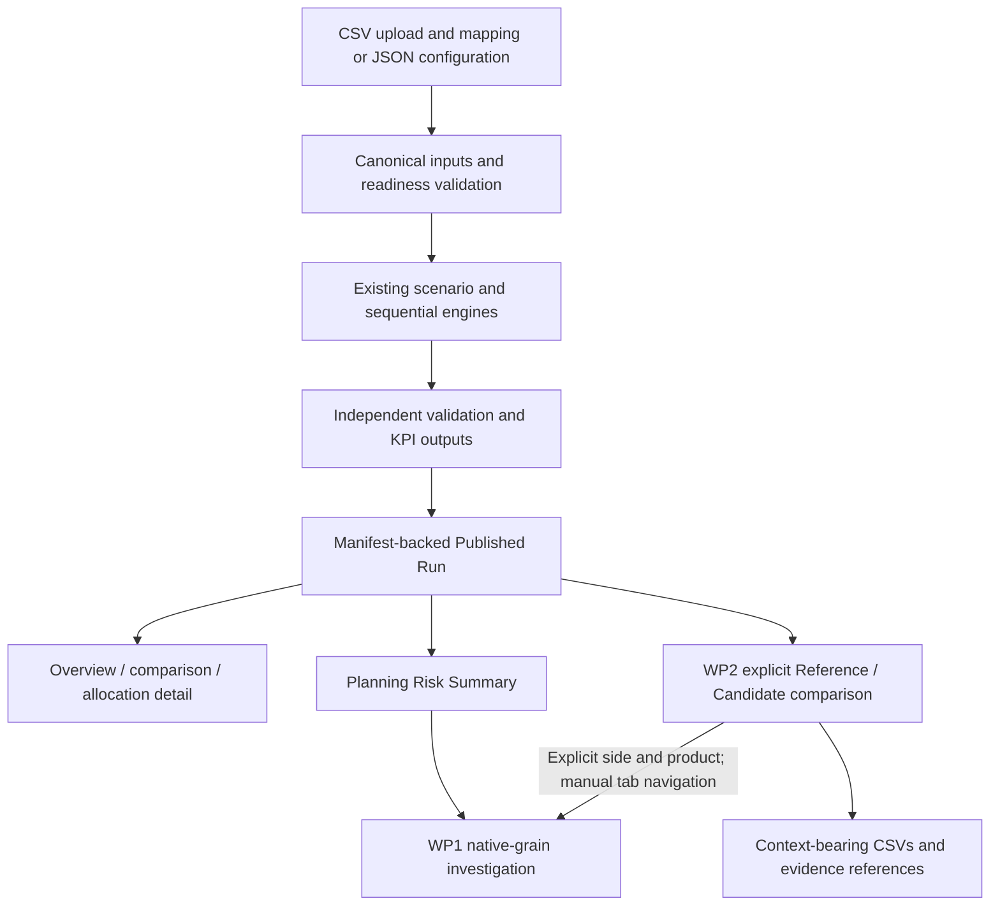

# Phase 2 — Read-only Product Assessment

**Date:** 2026-11-19 UTC
**Disposition:** Assessment complete; implementation is not authorized.
**Baseline:** Phase 1 formally closed as PASS WITH LIMITATIONS.

## Contents

1. [Executive Summary](#1-executive-summary)
2. [Current Architecture and Capability Inventory](#2-current-architecture-and-capability-inventory)
3. [Planning / WP1 / WP2 Assessment](#3-planning--wp1--wp2-assessment)
4. [End-to-End Workflow Assessment](#4-end-to-end-workflow-assessment)
5. [UI/UX Findings](#5-uiux-findings)
6. [Bilingual UI Assessment](#6-bilingual-ui-assessment)
7. [Roadmap Reconciliation](#7-roadmap-reconciliation)
8. [Prioritized Findings](#8-prioritized-findings)
9. [Recommended Phase 2 Work Packages](#9-recommended-phase-2-work-packages)
10. [Dependencies, Risks, and Acceptance Criteria](#10-dependencies-risks-and-acceptance-criteria)
11. [Decisions Requiring Owner Approval](#11-decisions-requiring-owner-approval)

## 1. Executive Summary

The current application already supports source-independent CSV intake, explicit readiness checks, sequential scenario planning and publication, risk summaries, WP1 Root Cause Investigation, and WP2 same-Run Scenario Trade-off Analysis with evidence-bearing exports. The next phase should improve completion of these existing analytical workflows, not rebuild them or add a second engine.

Recommend a presentation-focused Phase 2: clarify task/navigation and active context, improve metric/cohort/status explanations, standardize display labels, then implement bilingual presentation only after a reviewed translation and state-preservation contract. Centralized English/Traditional Chinese translation is feasible within the existing Streamlit architecture; complete dynamic diagnostic translation is more complex than translating labels. No dependency or architecture replacement is demonstrated as necessary.

The most useful confirmed source-level findings are manual Run-path entry, nested WP1 navigation after an otherwise functioning WP2 handoff, two differently scoped comparison views, raw technical columns/statuses, and outdated documentation that still says upload/mapping are deferred. User confusion and its frequency are inferred risks, not newly observed user-study results.

### Method, baseline and limits

Main Agent only. Read current source, tests as text, documentation, and the Phase 1 closure records. No application import, test execution, planning/upload action, browser session, service probe, deployment change or dependency change was performed. There are no new visual acceptance results or measured usability/performance outcomes in this assessment.

Assessment started at HEAD b29984919342d71c9bc8d3086805058886659cc2, branch main, configured upstream origin/main. The index was empty. The dirty working baseline contained 20 modified tracked paths and 36 expanded untracked files (18 collapsed short-status entries). The two Phase 1 closure documents explain the difference from the earlier 34-file register. Current source, including untracked WP2 modules, was inspected; HEAD alone does not contain the full accepted implementation.

A memory-only inventory of 199 existing Git-visible file hashes and 53 Run-manifest paths was captured before writing this report. Only this assessment file is created by the assessment portion. Subsequent Git synchronization, if executed under the owner's additional authorization, is a distinct task and does not retroactively change the assessment baseline or authorize product implementation.

Authority: [Phase 1 Closure](../phase_1/PHASE_1_CLOSURE_AND_BASELINE.md), [Closure Execution Report](../phase_1/PHASE_1_CLOSURE_EXECUTION_REPORT.md), [MVP Acceptance](../MVP_ACCEPTANCE_REPORT.md).

## 2. Current Architecture and Capability Inventory

This is a deterministic, rule-based planning decision-support prototype, not a Production APS, ERP replacement or optimization platform. Streamlit presentation and internal Python interfaces are implemented; no external application HTTP API endpoint was found in dashboard/ or src/ (FastAPI/Flask/router searches and entrypoint inspection). Streamlit's own HTTP/WebSocket service is not a product planning API.

| Capability | Current implementation and boundary | Actual source reference |
| --- | --- | --- |
| UI entry and model separation | Defaults to Sequential workload; Legacy independent weeks remains separately selectable | [dashboard application](../../dashboard/scenario_planning_app.py), main, _run_controls, _sequential_views |
| CSV intake | Nine dataset templates; multi-file upload, mappings, WEEKLY / ORDER_LINES, source classification and eligibility controls | Same file: _user_csv_upload_workflow, _render_column_mapping; [templates](../../examples/planning/templates) |
| Readiness | Required inputs, explicit assumptions, source/coverage details; READY/BLOCKED before execution | _build_upload_config, _validate_uploaded_config, _render_readiness_report; [CSV adapter](../../src/csv_planning_inputs.py), load_csv_planning_inputs |
| JSON and programmatic input | Configuration-relative CSV paths; canonical bundle shared by both data modes | [planning inputs](../../src/planning_inputs.py), CanonicalPlanningInputs; [runner](../../src/run_planning.py), run_csv_planning |
| Demand and workload preparation | Eligibility and coverage ledger, factor/unit validation, explicit/calibrated capacity | [demand preparation](../../src/demand_preparation.py), [workload model](../../src/workload_model.py) |
| Scenario generation | Baseline, demand surge, capacity disruption and combined stress kinds; declared policies/configuration | [scenario generator](../../src/scenario_generator.py); runner configuration path |
| Sequential execution | Chronological isolated scenarios; stock/backlog/receipts, same-week production, shared workload pools | [sequential planner](../../src/sequential_planner.py), simulate_sequential; [inventory engine](../../src/inventory_engine.py), transition_inventory; [allocation engine](../../src/allocation_engine.py), allocate_workload |
| Independent validation and KPI | Validates requirements/allocation/conservation; grain-specific production, fulfillment, loss, terminal and capacity metrics | [sequential validator](../../src/sequential_validator.py); [KPI engine](../../src/kpi_engine.py), calculate_sequential_kpis |
| Published results | Isolated Run output and status-bearing manifest; successful validation precedes publication; loader verifies required artifacts and hashes | runner run_sequential_planning; dashboard load_sequential_outputs |
| Monitoring views | Scenario Overview, Scenario Comparison, Capacity Allocation Detail | dashboard _sequential_views; legacy implementations are separate |
| Risk analysis | Product ranking, unique plant-week bottlenecks and Baseline-oriented scenario risk deltas | [planning risk](../../src/planning_risk.py), product_risk_ranking, plant_bottleneck_summary, scenario_risk_comparison |
| WP1 | Two selection paths, selected/adjacent weeks, allocation peers, one shared pool, native-grain supporting evidence and CSVs | planning_risk.investigation_views, filter_investigation_evidence, investigation_evidence_csv; dashboard _root_cause_investigation |
| WP2 | Pure same-Run comparison; fixed Reference cohorts, metric-level comparability, policy contrast, evidence and four CSVs | [comparison engine](../../src/scenario_comparison.py), compare_published_results; [comparison IO](../../src/comparison_io.py); dashboard _scenario_tradeoff_analysis |
| WP2 → WP1 | Explicit Reference/Candidate side and selected product seed existing investigation state | dashboard _comparison_investigation_entry |
| CLI / Python interfaces | Existing runner CLI includes sequential config and validation-only switch; internal functions are callable | runner main, run_csv_planning, run_sequential_planning; not executed here |
| Bilingual product UI | Not implemented; paired catalogs/manuals and proposal exist | [English catalog](../PRODUCT_CAPABILITY_CATALOG_EN.md), section 12; no current ui_locale/helper/locale dictionaries found |

### Data contracts to preserve

Product × Plant × Week facts gain Scenario and Run identity in published results. Capacity is a shared Scenario × Plant × Week workload pool, not a per-product resource duplicated across rows. Stock quantities and workload have different units; totals must preserve native grain. Missing demand is not automatically observed zero. Sunday-ending weekly coverage, explicit initial conditions, source assumptions and workload-unit/factor compatibility remain engine/input constraints, not UX preferences.

The primary accepted Run is sequential_20261117T133913_e22d0f430e98, classified USER_DATA with SYNTHETIC_EXAMPLE source metadata. This is not independently verified operational production data. Both USER_DATA and SYNTHETIC_DEMO feed the same engine. The metadata ambiguity remains deferred; this assessment neither changes nor resolves it.

## 3. Planning / WP1 / WP2 Assessment

### 3.1 Planning

The upload flow is already implemented: templates → upload/preview → canonical mappings and status qualification → horizon/scenarios/explicit assumptions → Validate inputs → optional Validate and run planning. Successful execution sets sequential_run_dir, displays the Published Run and provides a manifest download. Existing JSON configuration is an alternative path into the same runner, not a separate planning calculation.

Required base uploads are Products, Plants, Product-to-plant mapping and Demand. Inventory, capacity, workload factors, receipts and opening backlog can require explicit data or allowed declarations/assumptions; “optional” file labels do not mean unlimited silent defaults. The UI already explains this boundary, but the volume and mixture of technical decisions can make first use demanding. That learning burden is an assessment inference, not measured abandonment.

The engine requires explicit full-horizon item coverage, compatible pool/factor units and one supported shortage policy per scenario. LOST_SALES rejects nonzero opening backlog. UI improvements must explain these existing constraints instead of weakening validation or inventing missing data.

### 3.2 WP1 Root Cause Investigation

Implemented Product → Plant → Week and Plant → Week → Product navigation, product/plant entry actions, published selected-week observations, adjacent calendar-week trajectory, allocation order/peers and separate shared capacity. Evidence is filtered independently rather than joining fine-grained demand/receipt lines into aggregate quantities. CSV exports add investigation context without replacing native fields.

The view explicitly says coincident simulated observations are not validated causal attribution. “Root cause” must not be translated or redesigned to imply causal proof. Selection defaults/reselections are currently valid behavior; do not apply WP2's deliberately empty initial selectors to WP1 without a new UX decision.

### 3.3 WP2 Scenario Trade-off Analysis

Reference and Candidate are explicit, initially empty, different scenarios within the same Published Run. Candidate options exclude Reference. Run changes explicitly clear relevant state; invalid Candidate is explicitly cleared. These accepted fixes must survive any label, navigation or language change.

Reference priorities define fixed membership and its complement. Candidate priority changes are indicators, not reclassification. The UI uses the manifest's product universe and planning horizon, plus initial-state plants; the global Sequential scenario selector controls overview/risk but does not choose WP2 Reference/Candidate. This independence is correct and should be visible to users.

ALL / SELECTED / COMPLEMENT tables, metric-level reasons, unique shared pool context, input differences, policy warning and evidence references already exist. WP2 reuses existing KPI calculations; it does not simulate a new scenario or select a winner. Different backlog policies produce POLICY_CONTRAST; zero LOST_SALES backlog alone is not improved service.

### 3.4 Metric explanations that must remain distinct

Source: KPI engine calculate_sequential_kpis and comparison engine _metric_values.

| Display concept | Current meaning that future copy/translation must preserve |
| --- | --- |
| Production Coverage Rate | Sum internal production / sum required production; zero requirement yields N/A in sequential metrics |
| Weekly Service Level | Current-week fulfilled demand / current-week qualified demand; later backlog service is not the same-week numerator |
| Horizon Service Level | Current fulfilled + fulfilled horizon-origin backlog, divided by horizon qualified demand; opening-origin backlog service excluded |
| Terminal Backlog | Ending state at terminal item endpoints; not a sum of weekly stocks; origin distinctions remain available |
| Lost Sales | Flow accumulated from policy-defined unfulfilled quantities; not interchangeable with terminal backlog |
| Capacity Utilization | Unique pool allocated workload / available workload; no fabricated cohort-specific utilization |
| Delta | Candidate minus Reference; service Delta is percentage points while source rates are fractions |
| N/A / BLOCKED / DESCRIPTIVE_ONLY | Undefined/unavailable value and comparison permissions have different meanings; preserve explicit reasons |

## 4. End-to-End Workflow Assessment

| Step | Actual route and expected output | Confirmed connection / remaining friction |
| --- | --- | --- |
| 1 Prepare | Sequential workload → Upload CSV data, or Use existing JSON configuration | Inputs and existing-result loading share the screen; no distinct “analyze only” entry mode |
| 2 Validate | Upload form Validate inputs → READY/BLOCKED and diagnostics | Actionable readiness exists; raw messages and mapping complexity remain |
| 3 Execute, when authorized | Existing run action → validated published artifacts and active path | Already integrated; no need for new planner, runner or publication system |
| 4 Reopen results | Sidebar Published sequential run folder → hash-verified loader | Requires a known filesystem path; no bounded Run discovery picker in current implementation |
| 5 Inspect outcomes | Global Sequential scenario → KPI cards / Overview / Comparison / Capacity detail | Table-only sequential comparison differs from the separate explicit WP2 comparison workflow |
| 6 Investigate risk | Planning Risk Summary → Product Risk or Plant Bottlenecks → Investigate | Seeds investigation path/entity; user still follows nested Root Cause Investigation tab |
| 7 Trace WP1 | Product/plant/week selectors → observations, peers, trajectory, evidence and CSV | Native grain and context are preserved; many technical tables and expanders |
| 8 Compare alternatives | Scenario Trade-off Analysis → Reference + Candidate + optional Reference priorities | Pair is independent of global scenario; empty priorities deliberately produce empty SELECTED/N/A |
| 9 Reconcile trade-offs | ALL / SELECTED / COMPLEMENT, statuses/reasons, policy/evidence | Existing functions support the task; interpretation requires explicit metric and cohort guidance |
| 10 Return to WP1 | Choose comparison product and Investigate Reference/Candidate in WP1 | Callback sets scenario/product and clears downstream selectors; caption instructs manual tab navigation |
| 11 Export | Published artifact downloads, WP1 evidence, four WP2 CSVs | Different export families have different grain/context; full machine-readable contracts must remain |

There is a direct implemented WP2 → WP1 data/state handoff. There is no equivalent explicit WP1 → prepopulated WP2 pair/cohort action in the inspected functions. Adding one is not required for integration correctness and would require a deliberate design decision; do not claim a broken link or rebuild handoff functionality.

## 5. UI/UX Findings

Evidence classes: **S** = confirmed current source structure; **H** = historical accepted observation; **I** = inferred usability risk; **P** = proposal, unimplemented. Priority indicates recommended user value, not defect severity. No new functional bug is declared solely from static inspection.

| ID | Evidence / current finding | Impact and recommendation | Source / classification |
| --- | --- | --- | --- |
| F01 | Existing-results entry is a free-text filesystem folder path | Hard to discover/reopen Runs; first clarify Analyze existing vs Prepare data. Optional bounded picker only if approved; retain manual path and existing loader gates | dashboard _sequential_views, around 1302–1340; S + I; high |
| F02 | WP1 is nested under risk; handoff callbacks do not directly activate the tab | Users must find the destination after valid state transfer; improve destination breadcrumb/instructions before considering navigation changes | _planning_risk_summary, _comparison_investigation_entry, _scenario_tradeoff_analysis; S + I; high |
| F03 | Scenario Comparison and Scenario Trade-off Analysis coexist | One summarizes scenarios; the other compares an explicit pair/cohort. Explain their purposes without replacing either | _sequential_views, _scenario_tradeoff_analysis; S + I; high |
| F04 | Global scenario and WP2 pair are independently selected | Correct semantics can look inconsistent; display their scopes distinctly and preserve Run identity | Same functions; S + I; high |
| F05 | Many raw IDs/column headings; KPI cards partly use underscore replacement | Standardize display names/help, retain canonical IDs in technical detail and exported data | _comparison_display, _root_cause_investigation, _sequential_views; S + I; high |
| F06 | Readiness and optional assumptions are comprehensive but dense | Group required data, explicit assumptions and blockers more clearly; do not remove validation or silently preselect assumptions | _user_csv_upload_workflow, _render_readiness_report; S + I; medium |
| F07 | Rates/fraction values, percentage-point deltas, flow/stock and unit distinctions coexist | Add consistent display formatting and contextual help; avoid altering actual values or comparison rules | KPI engine and WP2 caption; S + I; high |
| F08 | Investigation/evidence and summary tables are wide; embedded context increases CSV size | Improve guidance/display ordering, preserve complete native/context exports. Approximately 6.9 MB is a historical fixture observation, not a general benchmark | comparison_csv_exports; Phase 1 closure section 6; S + H; medium |
| F09 | All five sequential tab bodies are constructed in _sequential_views; comparison exports generated when a pair exists | Potential rerun work even while viewing another tab; requires later profiling before optimization. No cache/lazy-load requirement is established here | _sequential_views, _scenario_tradeoff_analysis, comparison_csv_exports; S + I; low/defer |
| F10 | Current UI contains English literals and backend diagnostic strings; no centralized locale layer | Bilingual UX needs shared display catalogs and explicit diagnostic policy, not scattered replacements | dashboard, csv_planning_inputs, planning_risk, scenario_comparison; S; medium/high dependency |
| F11 | CSV input docs/developer notes still say upload/mapping wizard deferred | Confirmed documentation drift; future authorized documentation update should reconcile current source and retain historical context | planning_csv_inputs “UI scope and limitations”; developer_notes “Source-independent CSV intake”; S; high, low effort |
| F12 | Two Plant Show-chart mouse interactions failed historically; keyboard alternative worked in Phase 1 | Carry forward explicit limitation. Do not fix or reproduce under this assessment | Phase 1 closure section 4; H; deferred |
| F13 | Vega warnings and source provenance caveat remain open | Preserve honest labels, no causal/operational-data overclaim; material new evidence is the reopening trigger | Phase 1 closure sections 6 and 9; H; deferred |

No fresh browser verification establishes current focus behavior, narrow-screen usability, text clipping, completion times, accessibility conformance or new warning counts. Those are future acceptance measurements, not confirmed findings here.

## 6. Bilingual UI Assessment

### 6.1 Feasibility and proposed architecture

Feasible as a presentation extension, with Medium overall effort and higher uncertainty for complete diagnostics/state coverage. Reuse the existing paired catalogs/manuals and glossary; do not rebuild translation design already proposed in catalog section 12. Proposed paths below are not existing implementation:

- dashboard/i18n.py: shared t(key, **params), display-label/status adapters and locale lookup.
- dashboard/locales/en.json and zh-TW.json: centralized dictionaries with stable semantic keys, e.g. nav.tradeoff, metric.horizon_service.label, validation.coverage_unknown.
- Sidebar Language / 語言 selector and stable session_state ui_locale. Recommend en default for continuity, subject to owner approval; reruns/pages share the same locale.
- Fallback selected locale → English → visible missing-key marker plus development diagnostics. Missing keys are acceptance gaps, not successful translation. Placeholder sets must match across languages.

Use standard-library JSON initially; no new dependency is justified by this assessment. Do not introduce a second UI stack, replace Streamlit, or move business logic into translation helpers.

### 6.2 Translation surface and integrity boundary

| Surface | Affected existing functions / concerns | Proposed treatment |
| --- | --- | --- |
| Shell, navigation, controls | main, _sequential_views, legacy _overview/_comparison/_allocation_detail | Shared keys for labels/help/buttons and translated display options; retain underlying values |
| Intake/readiness | _render_column_mapping, _user_csv_upload_workflow, _render_readiness_report | Required/optional explanations, source types, READY/BLOCKED summaries and detailed display diagnostics |
| KPIs/tables/charts | _render_kpi_cards, _sequential_views, _comparison_display | Display copies/column configuration, metric registry, axes/legends/tooltips; no renamed computational frames |
| Risk and investigation | _planning_risk_summary, _root_cause_investigation | Translate captions, observations, evidence instructions and status labels; retain full keys/artifact names |
| WP2 | _scenario_tradeoff_analysis, _comparison_investigation_entry | Consistent cohort/comparability/policy terms; stable scenario values and widget/session keys |
| Errors and dynamic reasons | CSV adapter, planning_risk, comparison engine, loader exceptions | Localized summary and recognized-template/ID adapter; original machine reason/details remain accessible |
| Downloads | Buttons/help and displayed filenames policy | Canonical CSV headers/data/context unchanged; localized instructions only by default |

**Never translate or mutate:** internal metric IDs, canonical dataset column names, Published artifact schemas, Run/Scenario IDs, Comparison_ID inputs, status machine values, formulas, cohort membership, comparison logic, evidence references or CSV contracts. Language must not enter runner configuration/manifest or comparison identity. Use format_func and display mappings rather than translated selectbox values.

An important state risk: some widgets lack explicit keys, and Streamlit identity depends partly on widget definition/labels. Adding translated text can reset selection unless stable keys and explicit state restoration are designed and tested. Even explicit keys do not substitute for actual browser verification after definition changes. Reuse the Phase 1 state-sync regression pattern; do not blindly apply the prior reset fix to every widget. Upload data retention via _capture_user_upload_state / _restore_user_upload_state must remain intact.

Backend messages are not uniformly coded. Free-form exception string substitution is brittle; existing Check_ID / Metric_ID / comparability fields can anchor display mappings. Any new backend diagnostic contract is a separate reviewed scope; preserve original messages/exports. Third-party Streamlit/grid/OS errors and default toolbar text cannot be promised fully bilingual without compatibility investigation or additional scope. Do not modify third-party assets/dependencies to force translation.

### 6.3 Shared glossary baseline

| English | Traditional Chinese | Required distinction |
| --- | --- | --- |
| Planning Run / Published Run | 規劃執行 / 已發布規劃執行 | Retain Run_ID verbatim |
| Scenario | 情境 | Distinct from Run |
| Reference Scenario / Candidate Scenario | 參考情境 / 候選情境 | Preserve direction and canonical Scenario IDs |
| Root Cause Investigation | 根因調查 | Observational investigation, not proven causality |
| Trade-off Analysis | 取捨分析 | No automatic winner or recommendation |
| Qualified Demand | 合格需求 | Explicit source eligibility, not all raw demand |
| Service Level | 服務水準 | Weekly/current vs horizon-origin basis must be named |
| Production Coverage Rate | 生產涵蓋率 | Production / production requirement, not fulfillment |
| Demand Fulfillment Rate | 需求滿足率 | Maintain numerator/cohort definition |
| Opening Backlog / Terminal Backlog | 期初欠單 / 期末累積欠單 | Opening origin is separate from horizon origin |
| Lost Sales | 流失銷售 | Policy flow, not terminal stock |
| Ending Inventory | 期末庫存 | Never sum weekly ending stocks |
| Workload / Allocated Workload / Unmet Workload | 工作負荷 / 已分配工作負荷 / 未滿足工作負荷 | Different unit from product quantity |
| Capacity Utilization | 產能利用率 | Shared pool ratio, not cohort allocation claim |
| Fixed Reference Priority Cohort | 固定參考優先群組 | Candidate changes do not reclassify membership |
| ALL / SELECTED / COMPLEMENT | 全部 / 選定群組 / 補集 | Display translation only; machine values stable |
| Comparable / Descriptive only / Blocked | 可比較 / 僅供描述 / 阻擋 | Retain reason and machine status |
| Evidence / Provenance | 佐證資料 / 來源沿革 | Native grain, source identifiers and hashes stable |

Glossary is a proposed working baseline grounded in the paired catalogs, not a new approved business vocabulary. Owner review is needed for user-facing wording and retention of English terms alongside Chinese.

## 7. Roadmap Reconciliation

| Original document / historical plan | Current source and acceptance evidence | Phase 2 implication |
| --- | --- | --- |
| [Legacy project journal](../scenario_planning/project_journal.md): stages data → generator → allocation → performance | Functions/modules implemented; chronological entries later add sequential, CSV, risk, WP1 and WP2 | Do not restart the legacy stages or treat old “next step” text as new authorization |
| [Route B roadmap](../improvement_program/07_implementation_roadmap.md): validation → demand/workload → sequential → KPI → pipeline → demonstration | [Developer notes](../scenario_planning/developer_notes.md) record a reduced sequential_v1 vertical slice, not complete approval/implementation of every Route B work package | Reuse accepted slice; remaining Route B items require explicit business gates, not automatic completion claims |
| Route B WP1 = Independent Validation Layer; Route B WP2 = Demand and Capacity Model | Accepted MVP WP1 = Root Cause Investigation; WP2 = Scenario Trade-off Analysis | Preserve namespaced terminology; current Phase 2 is not historical Stage 2/WP2 |
| [Input contracts](../planning_csv_inputs.md), UI scope: upload/mapping deferred | Actual dashboard implements upload, mappings, templates, readiness and execution | Outdated current-scope prose; update only in a future authorized documentation package |
| Developer-notes CSV-intake entry: wizard remains deferred | Same confirmed discrepancy; historical entry describes an earlier point in time | Annotate current state without erasing historical development decisions |
| [Dashboard proposal](../scenario_planning/dashboard_design_proposal.md): original views, drill-through, future parameter execution | Current upload/JSON runner and WP1/WP2 provide substantial parts; PBIX consolidation and larger future capabilities are not established as delivered | Separate Streamlit implementation from Power BI proposals; no PBIX redesign assumed |
| [WP2 specification](../wp2_scenario_tradeoff_analysis_specification.md) and [progress](../wp2_implementation_progress.md) | Explicit comparison, cohort, statuses, exports/handoff exist; old “no browser visual testing” implementation entry was later superseded by UAT | Use current Phase 1 closure for latest acceptance, retain earlier historical test claims |
| [Bilingual catalog proposal](../PRODUCT_CAPABILITY_CATALOG_EN.md#section-12) and paired manuals | Documentation exists; UI translation not implemented | Reuse architecture/glossary rather than claiming completed bilingual experience |
| [Phase 1 closure](../phase_1/PHASE_1_CLOSURE_AND_BASELINE.md) | Reliability completed within safe scope, limitations accepted | No reopening or automatic fix of deferred observations in this assessment |

There is no verified fixed original numbered next stage that unambiguously means this Phase 2 UX/bilingual scope. The current owner-authorized assessment defines the planning context; implementation packages below are recommendations requiring approval, not a rewrite of the original roadmap.

## 8. Prioritized Findings

| Priority | Findings | Why now | Recommended disposition |
| --- | --- | --- | --- |
| P0 planning prerequisite | Scope naming, dirty implementation baseline, contract/state inventory | Prevent accidental rebuild or semantic/data-contract changes | Approve specification and preservation gates first |
| P1 workflow value | F01–F04, F07 | Helps users find results, follow investigation handoffs and interpret comparisons correctly | First presentation delivery, preserving existing controls/semantics |
| P1 maintainability/accuracy | F11 | Current documentation contradicts implemented upload capability | Bounded documentation reconciliation after approval |
| P2 consistency and language | F05, F06, F10 | Standard vocabulary/display registry reduces confusion and translation duplication | Central display design, then approved bilingual scope |
| P3 optional later improvement | F08–F09 | Wide tables and rerun work may matter, but no fresh performance defect is proven | Guidance first; profile only if separately authorized and needed |
| Accepted deferred | F12–F13 and seven negative E2E sublayers | Already bounded by Phase 1 closure | Carry forward unchanged; no fixes or fixture generation now |

This prioritization is value/risk reasoning from inspected implementation, not a ranked user survey. No unrestricted refactoring or new feature backlog is required to act on the high-value findings.

## 9. Recommended Phase 2 Work Packages

These identifiers are Phase 2 proposals, not the historical WP1/WP2/WP3 names. Effort is relative implementation-plus-validation complexity, not a fixed schedule or completed work estimate.

| Package | Objective / deliverable | Dependencies and likely files | Effort / boundary | Completion criterion |
| --- | --- | --- | --- | --- |
| P2-A Definition and invariant baseline | Approved user journeys, terminology/display inventory, navigation/locale/state contract and acceptance matrix | Closure, current app, catalogs/manuals, safe-test allowlist | Low–Medium; definition only before implementation | Owner-approved scope; every proposed label/navigation change mapped to existing function and invariant |
| P2-B Workflow and context clarity | Distinguish prepare vs analyze tasks, overview vs pair comparison, active Run/global scenario/pair scope; clear WP1 destination guidance | A; dashboard main/_sequential_views/risk/tradeoff | Medium; avoid dashboard rebuild or implicit scenario selection | Representative users can reopen an existing Run and follow WP2-side/product → WP1 with correct context; no planning triggered |
| P2-C Consistent display and metric help | Central metric/status/cohort display mapping, readable units/N/A/delta/help and export guidance | A; dashboard presentation functions; unchanged engines/IO | Medium; display-only, no new KPIs | Production/fulfillment/weekly/horizon/stock/workload concepts stay distinct; technical IDs accessible; CSV unchanged |
| P2-D Bilingual UI, if approved | Central en/zh-TW dictionaries/helper, sidebar state, complete inventoried application-owned text and known diagnostic adapters | A and C; proposed i18n/locales files; dashboard shared edits coordinated | Medium–High; diagnostics and widget identity drive uncertainty | Language switch retains uploaded data and intended Run/scenario/cohort/WP1 state; no unexpected fallback; actual browser acceptance in both languages |
| P2-E Documentation and acceptance | Reconcile stale upload statements, update existing paired documentation for delivered changes only, targeted Python/AppTest/browser/export checks and integrity report | B/C and D if selected | Medium; tests require safe fixture inspection | Accepted workflow/contract matrix passes; remaining limits explicit; no inflated E2E coverage |

Suggested sequence: approve A → define C mappings and B context behavior → implement B/C incrementally → D only if selected → E. Keep shared dashboard/state changes under one integration owner; translation-copy preparation can be independent after the glossary is approved. No parallel implementation or subagent work was performed here.

Optional bounded Run picker: if included in B, owner must approve search root, scan depth, candidate validation, provenance display and path fallback. It must call the existing loader, show no invalid Run as selectable success, avoid scanning arbitrary filesystem locations and never create/publish Runs. It is not essential for the first navigation/help improvement.

Automatic tab activation, a WP1 → WP2 shortcut, export performance changes and toolbar fixes are **not** implicitly included. Each needs a demonstrated user need, feasibility/contract review and explicit scope selection.

## 10. Dependencies, Risks, and Acceptance Criteria

### 10.1 Protection and validation gates for a future authorized implementation

| Gate | Required acceptance evidence |
| --- | --- |
| Repository and data integrity | Before/after HEAD/status and protected-file fingerprints; no loss of pre-existing work; same existing Run registry and immutable artifact hashes; changes limited to approved files |
| Planning protection | No engine/formula/policy change; verify existing priority/shared pools/full-horizon/conservation/receipt-timing protections using inspected safe allowlists |
| State and navigation | Actual browser checks for WP2 empty selectors, invalid Candidate reset, Run A→B→A, deliberate WP1 scenario changes on side handoff, tab return and uploads retained across reruns/model/locale switching |
| WP1 | Both selection paths, full-key isolation, unique shared pool, ordered peers, adjacent trajectory, native evidence/CSV context |
| WP2 | Same Run/different scenarios, fixed Reference cohort and complete universe/endpoints; values/delta/reasons and POLICY_CONTRAST unchanged; no winner recommendation |
| Bilingual, if selected | Dictionary/placeholder parity, fallback checks and approved glossary; no widget identity loss; both languages cover full inventoried application-owned scope including empty/error/warning/help/download states |
| Data and export invariance | Same numeric frames, Comparison_ID and evidence refs for same inputs regardless of language; four actual WP2 downloads parsed, schemas/context/bytes reconciled; representative WP1 exports and Published artifact identity retained |
| UI acceptance | Browser-observed task completion in approved viewports/languages, readable scope/unit/status explanations; console/page/failed-request observations captured without suppressing warnings |
| Documentation truthfulness | Paired catalogs/manuals synchronized only for delivered behavior; proposed vs implemented distinctions retained; historical evidence preserved |

Existing test references for reuse, not executed here: [test_dashboard_app.py](../../tests/test_dashboard_app.py), [test_dashboard_upload_workflow.py](../../tests/test_dashboard_upload_workflow.py), [test_planning_risk.py](../../tests/test_planning_risk.py), [test_scenario_comparison.py](../../tests/test_scenario_comparison.py), [test_comparison_dashboard.py](../../tests/test_comparison_dashboard.py), [test_comparison_acceptance.py](../../tests/test_comparison_acceptance.py), [test_phase1_risks.py](../../tests/test_phase1_risks.py) and [test_phase1_ui_layers.py](../../tests/test_phase1_ui_layers.py). In particular CandidateSelectionSyncTests and RunSwitchWireTests cover previous synchronization risks. These are coverage pointers, not fresh PASS claims.

Some existing suites have setup that calls run_csv_planning even into temporary directories; test_comparison_dashboard.ComparisonDashboardTests.setUpClass is an explicit example. Do not run blind suites under a no-Run/no-planning authorization. Reuse the [Phase 1 regression report](../phase_1/PHASE_1_REGRESSION_REPORT.md) and inspected safe adapters/allowlists; separately authorize any required execution beyond them.

### 10.2 Risks and existing limitations

| Risk / limitation | Assessment and control |
| --- | --- |
| Dirty baseline incompletely represented by Git HEAD | Preserve actual current implementation; assess/review any separately authorized synchronization independently of this report |
| Translated labels/options reset Streamlit state | Stable widget IDs and explicit state contract plus actual browser checks, not AppTest alone |
| Display labels leak into business frames/exports | Translate copies only; assert invariant IDs/columns/formulas/evidence and deterministic CSVs |
| Dynamic/third-party messages lack stable translation codes | Approved diagnostic display policy; retain originals; do not promise universal translation without enumerated scope |
| Large all-tab render/export work | Source-level possible cost only; no optimization or SLO justified without authorized profiling |
| Seven NC negative Published E2E sublayers | Phase 1 case statuses remain PARTIAL despite passed lower layers; no new Runs to force closure |
| Two Plant Show-chart mouse failures | Accepted non-blocking historical observation, keyboard alternatives passed; not reopened here |
| Vega warnings | Recorded, not suppressed; no universal harmlessness assertion; investigate only after approved material trigger |
| USER_DATA / SYNTHETIC_EXAMPLE metadata | Not independently validated operational data; preserve caveat and request authoritative provenance separately |
| Ignored local evidence / deployment assumptions | Existing evidence is local; presence does not establish durable remote archival. No runtime/deployment or dependency readiness is newly tested here |

Performance observations are historical and fixture-specific (approximately 6.9 MB metrics CSV; three local samples), not production SLOs. Phase 1's three PASS NC cases also remain bounded: existing synthetic fixture, single zero plant-week pool, and existing unpublished Run/disposable invalid snapshots. They do not establish every possible Published E2E permutation.

## 11. Decisions Requiring Owner Approval

1. Approve the Phase 2 objective and packages: workflow/display first; choose whether bilingual implementation belongs in the same phase or a later bounded delivery.
2. Approve navigation scope: guidance/context only, optional bounded Run picker, or actual automatic tab activation. Do not silently remove legacy views or merge comparison semantics.
3. Approve language default, glossary, bilingual display format and application-owned versus third-party diagnostic boundaries. Determine whether retained English technical details meet acceptance expectations.
4. Approve exact file/change boundaries and safe-test/runtime permissions before implementation. UI work does not authorize engine, schema, runner, dependency or deployment changes.
5. Decide separately whether to reopen toolbar repair, negative-data E2E fixtures or provenance clarification. None is reopened by this assessment and none blocks the definition work by itself.
6. Approve release/evidence preservation and Git synchronization separately when desired; Git actions do not constitute Phase 2 implementation approval.

**Recommendation:** Proceed to owner review and an actionable Phase 2 execution specification for selected P2-A–E packages. Do not begin implementation, WP3, new planning capabilities, external integration, automated recommendations, optimization, forecasting or AI under this assessment.

### Assessment verification record

This report was created from current source/documents; no existing file was edited by the assessment. Relative source/document links and whitespace were checked. No tests were run and no new screenshots or evidence were created. The assessment's original HEAD/state is intentionally historical if a later separately authorized synchronization commit includes this report.

Assessment verification: all 199 pre-existing Git-visible file fingerprints remained unchanged; the 53 Run-manifest paths matched the initial register. Relative file links resolved, all 23 proposed synchronization Python files parsed without importing/executing them, and git diff --check returned 0. Pattern-based credential screening found no matches in the synchronization candidates; this is not a universal secret-detection guarantee. The additional synchronization authorization permits committing existing work but does not permit new UI implementation. Historical runtime/evidence files under tmp/ remain local; several Phase 1 harnesses explicitly depend on those local fixtures or prior harness files and are not claimed to be standalone clean-checkout E2E infrastructure.

Synchronization pre-commit note: staged whitespace checking exposes pre-existing Markdown hard-break spaces in the original Phase 1 assessment and WP2 specification, plus a trailing blank line in the historical deployment audit. These existing documents are preserved byte-for-byte; the warnings are disclosed rather than silently rewriting accepted specifications/history. The newly created assessment has no trailing whitespace. Ten tracked Python cache files and the local usage-consumption forensic report are deliberately excluded from synchronization; ignored runtime/evidence data remains local.
